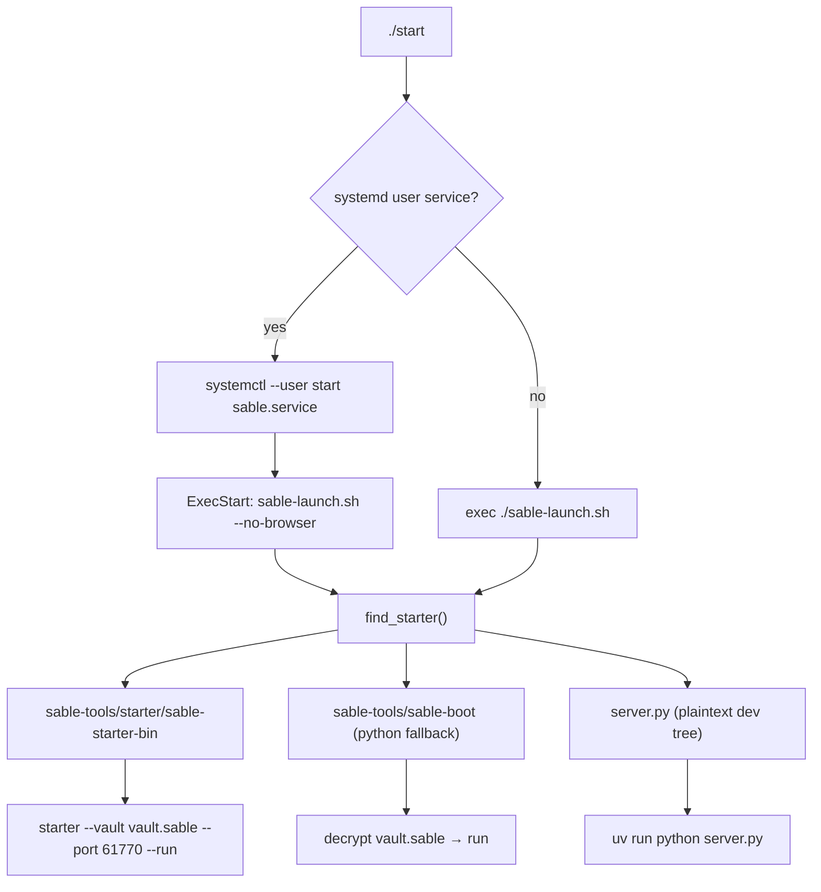

# Root Layout & Launch Chain

> [!INFO] Scope
> Everything that lives in the repository root: entrypoints, bootstrap scripts, packaging, deploy config, and the scratch/debug scripts Sifat left behind. This is the "how does it start" layer before any application code runs.

***

## What the root actually contains

The root is **not** application code — it's the bootstrap + launch layer. Four categories:

| Category | Files | Role |
|:--|:--|:--|
| **Entrypoints** | `server.py`, `sable-launch.sh`, `sable-launch.cmd` | Boot the app |
| **Installers** | `start` (779L bash), `start.ps1` (1079L pwsh), `start.bat`, `start_shortcut.ps1` | Zero-intervention setup |
| **Packaging** | `pyproject.toml`, `uv.lock`, `.python-version`, `render.yaml`, `.gitignore` | Deps + deploy |
| **Scratch** | `debug_*.py`, `experiment_*.py`, `probe_study_persona.py`, `eiffel.html`, `paris_tower.html` | One-off investigations, not part of runtime |
| **Vault** | `vault.sable` (33 MB), `sable.db` (0 B) | Sealed source tree + SQLite stub |

***

## `server.py` — the real entrypoint

29 lines of actual work wrapped around a Windows-specific hack. Three responsibilities:

1. **Windows console suppression** — calls `FreeConsole()` then **monkeypatches `subprocess.Popen` globally** to force `CREATE_NO_WINDOW | CREATE_NEW_PROCESS_GROUP` on every spawn. One chokepoint so no child process (uv, git, playwright, bash) ever pops a CMD window.
2. **Import the ASGI app** — `from server import app` (the `server/` package's `__init__.py`).
3. **Run uvicorn** — `host`/`port` from `engine.config`, `reload=False`, `log_level="warning"` (suppressed so `startup_banner` owns the console).

> [!NOTE] Extras worth knowing
> - A `SIGTERM` handler starts a **0.8s deadman timer** that `os._exit(1)`s if graceful shutdown hangs. Aggressive, but it stops systemd from waiting on a stuck browser governor.
> - `engine.service_manager._write_pid()` writes `.sable_server.pid` so `start` can kill stale instances.
> - `print_startup_banner` runs in a daemon thread that **polls the port** instead of guessing a sleep delay.

```
server.py
  └─ from server import app          → server/__init__.py
       └─ FastAPI app                → server/api/application.py
  └─ uvicorn.run(app, host, port)    → engine.config HOST/PORT
```

***

## The launch chain (three layers deep)



### `start` — zero-intervention installer (Linux/macOS)

779 lines of bash. Ordered pipeline in `main()`:

```
detect_platform → ensure_python → ensure_uv → ensure_git → ensure_ffmpeg
→ ensure_ripgrep → cleanup_stale_pid → bootstrap_files → setup_playwright
→ install_playwright_deps → setup_github_mcp → setup_searxng → sync_deps
→ install_desktop_file → install_systemd_service → start_via_systemd
→ wait_for_server → print_info_box → open_browser
```

| Function | Does |
|:--|:--|
| `detect_platform` | OS + package manager (apt/dnf/pacman/zypper/apk/brew), sets `$SUDO` |
| `retry` | 3 attempts, 2s apart, on any network install |
| `ensure_python` | Finds `python3.12`→`python3`, auto-installs if missing, hard-fails below 3.12 |
| `ensure_uv` | Installs uv via curl if absent |
| `ensure_docker` | Starts daemon, auto-installs via `get.docker.com` on Debian, adds user to docker group |
| `setup_searxng` | Runs `searxng/searxng:latest` on `:8080`, **patches `settings.yml` to enable JSON output**, restarts |
| `setup_github_mcp` | Downloads `github-mcp-server v1.12.1` native binary, arch-aware, `/usr/local/bin` → `system/` fallback |
| `install_playwright_deps` | Per-distro Chromium libs, then `playwright install-deps` |
| `bootstrap_files` | Copies `Maria.md.example` → `Maria.md`, `Memory.json.example` → `Memory.json`, migrates `browser-data` → `browser-data-acc1` + symlink |
| `sync_deps` | `uv sync`, on failure nukes `.venv` and retries |
| `install_systemd_service` | Writes `~/.config/systemd/user/sable.service`, **auto-regenerates if ExecStart points elsewhere**, enables linger |
| `start_via_systemd` | Starts, and on failure **clears `system/browser-data`** then retries once (stale-profile recovery) |
| `wait_for_server` | Polls `/api/health` for 30s |
| `install_desktop_file` | `~/.local/share/applications/sable.desktop`, writes a shim launcher if `sable-launch.sh` is missing |
| `cleanup_stale_pid` | Reads `.sable_server.pid`, TERM then KILL |

> [!TIP] The clever bits
> - **systemd service is self-healing** — it compares `systemctl show -p ExecStart` against the current launcher path and rewrites itself when stale. No manual `daemon-reload` dance after moving the repo.
> - **`start_via_systemd` failure path** deletes the browser profile. That's the #1 real-world failure (locked Chromium profile from a killed process), so it's automated rather than documented.
> - **SearXNG JSON patch** is idempotent — greps for `formats:` before appending, so re-runs don't corrupt the YAML.

### `start.ps1` — Windows equivalent

1079 lines, same pipeline plus Windows-only concerns:

| Extra function | Why |
|:--|:--|
| `Ensure-ExecutionPolicy` | Unblocks the script itself |
| `Ensure-VCRedist` | Playwright/ONNX need the VC++ runtime |
| `Test-LibreOffice` / `Ensure-LibreOffice` | DOCX→PDF conversion for document skills |
| `Get-DockerPreference` | Handles Docker Desktop vs WSL2 vs none |
| `Invoke-HiddenCommand` | Runs subprocesses with no visible window |
| `Setup-BurntToast` | Windows toast notifications for `engine/notifications` |
| `Setup-AutoStart` | Registers a **Task Scheduler** task instead of systemd |
| `Create-DesktopShortcut` | `.lnk` on the Desktop |

### `sable-launch.sh` / `sable-launch.cmd` — thin resolvers

Both just walk a fixed candidate list and `exec` the first hit:

1. `$SABLE_STARTER` (explicit override)
2. `sable-tools/starter/sable-starter-bin`
3. `./sable-starter`
4. `sable-starter` on `PATH`
5. `sable-tools/sable-boot` (python, needs `vault.sable`)
6. `server.py` (**plaintext dev tree — this is your current mode**)

Flags: `--no-browser`, `--port=N`; anything else is forwarded verbatim to the starter. Default port **61770**.

***

## Packaging & deploy

**`pyproject.toml`** — `sable` v2.0.3, Python pinned `>=3.12,<3.13`, `uv`-managed, `package = false` (app, not a library).

Dependency groups by purpose:

| Group | Packages |
|:--|:--|
| **Web** | fastapi, uvicorn[standard], python-multipart, websockets, aiohttp |
| **Browser** | playwright, lxml, beautifulsoup4, trafilatura, curl-cffi, pymupdf |
| **Memory/search** | fastembed, numpy, rank-bm25 |
| **AI/protocol** | mcp, google-genai, json-repair, tenacity |
| **Voice** | kokoro-onnx, faster-whisper, soundfile, misaki, edge-tts |
| **Messaging** | telethon, python-telegram-bot, pyaes |
| **Documents** | python-docx, python-pptx, openpyxl, pypdf, pdf2image, pillow, defusedxml |
| **Data/cloud** | oss2, pymongo, huggingface-hub, matplotlib |
| **Test** | pytest, pytest-asyncio |
| **Windows-only** | pywinpty (ConPTY terminal backend), platform-gated |

**`render.yaml`** — optional cloud deploy: Singapore region, free plan, health check `/api/health`, `uv sync --frozen` + `playwright install --with-deps chromium` at build, `SABLE_HOST=0.0.0.0`, `PORT=10000`. Note this runs the **plaintext tree**, not the vault.

**`.python-version`** — `3.12`.

**`.gitignore`** — heavy. Blocks `*.bak`, all DBs, `.venv`, `.editor_tools_backups/`, `system/` entirely (browser cookies/tokens live there), `output/`, `test/`, model caches. One surgical exception: `!web/vendor/pdfjs/build/**` because the broad `build/` rule was swallowing the prebuilt `.mjs` the Study reader imports.

***

## Scratch scripts (not runtime)

| File | What it investigates |
|:--|:--|
| `debug_acc11_raw.py` | Raw DeepSeek session-create → hello → chained-message trace on `browser-data-acc11` |
| `debug_ban_diff.py` | Captures **real UI send headers vs ghost fetch headers** to explain why the ghost gets banned and the scraper doesn't |
| `debug_ghost_live.py` | Tests in-page native signing — does DeepSeek's SPA mint fresh `x-hif-dliq`/`x-hif-leim`, or is the cached identity stale? |
| `debug_hello_seed.py` | Dumps raw SSE from a minimal first message |
| `probe_study_persona.py` | Runs the real `build_instructions()` with a Study persona override against DeepSeek, comparing output style to ChatGPT |
| `experiment_consolidation.py` | 286k-char conversation → API backend fallback + `.txt` attachment limits |
| `experiment_v2.py` | Corrected Qwen STS+OSS upload flow; hunts the source of a 203k-char message leak |
| `eiffel.html`, `paris_tower.html` | Visual test artifacts (render-html previews) |

> [!WARNING] These import live tokens from `system/.deepseek_tokens.json` and drive real accounts. They're diagnostic weapons, not tests — never wire them into CI.

***

## Key facts to remember

- **Default port: 61770.** Health endpoint: `/api/health`.
- **Current mode is the plaintext tree** — `vault.sable` (33 MB sealed bundle) exists but no starter binary is committed, so `sable-launch.sh` falls through to `server.py`.
- `sable.db` at root is **0 bytes** — the real DB lives under `system/`.
- Windows console popups are killed by a **global Popen monkeypatch**, not per-callsite fixes.
- The systemd unit **does not** run `server.py` directly — it runs `sable-launch.sh`, which keeps the vault/plaintext decision in one place.
