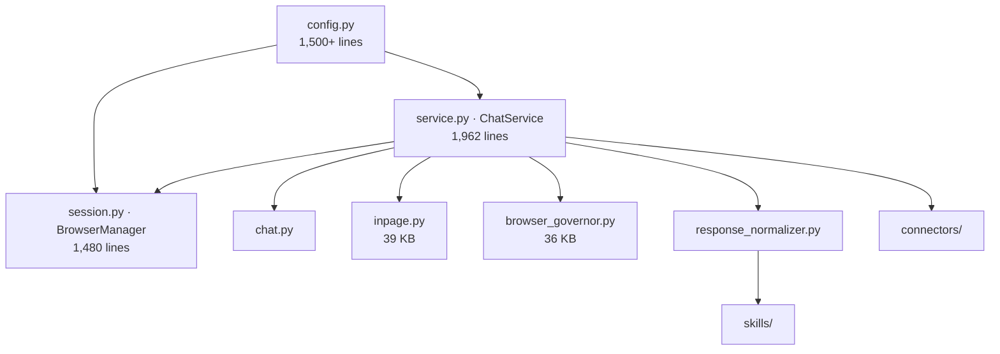

# `engine/` — Root Modules (full read)

> [!INFO] Scope
> **47,557 lines across 153 files.** This document covers the 46 root-level modules. `service.py` and `session.py` were read line-by-line in full; every claim below comes from the file, not from a function name.

***

## The spine



***

# `service.py` — `ChatService` (1,962 lines, read in full)

## Module level: opt-in raw logging

```python
_QWEN_LOG_DIR = _ROOT / "output" / "qwen_raw"

def _qwen_raw_logging_enabled() -> bool:
    return os.environ.get("SABLE_RAW_LOG", "0") == "1"
```

`_log_qwen_raw_line(line)` appends every raw SSE line to `output/qwen_raw/YYYY-MM-DD.txt`; `_log_qwen_stream_chunk(phase, content)` appends parsed deltas to `output/qwen_chunks/`. Both are **no-ops unless `SABLE_RAW_LOG=1`** — they open and close a file per line, so leaving them on would mean a disk write per token.

## Constructor — three independent browser caches

```python
self._browser: BrowserManager                    # default (Qwen) profile
self._headers: dict | None                       # default header cache
self._headers_account: str | None                # guards stale-header races
self._headers_ts: float                          # when the headers were fetched
self._lock = asyncio.Lock()
self._account_override: str | None               # derived from user_data_dir name

self._scoped_browsers: dict[str, BrowserManager]  # bdd path → manager
self._scoped_headers:  dict[str, dict[str, str]]  # bdd path → headers
self._scoped_accounts: dict[str, str]             # bdd path → account name
```

> [!IMPORTANT] `_account_override` is a regex sniff on the directory name
> ```python
> basename = Path(user_data_dir).name
> if re.match(r"browser-data-acc\d+$", basename):
>     self._account_override = basename
> ```
> It exists so an isolated stream (a critique agent on `acc5`) doesn't read tokens for whatever account is globally active. If the dir name doesn't match the pattern, the override stays `None` and the global active account wins.

## Browser resolution — three entry points

| Method | Returns |
|:--|:--|
| `_get_browser(bdd)` | Default manager if `bdd` is falsy, else a lazily-created scoped one |
| `_browser_for_provider(provider)` | Resolves `get_provider_browser_dir(provider)`; **reuses the default manager if the path matches** |
| `_resolve_account(bdd, provider)` | bdd basename → provider pin → override → global active |

`_browser_for_provider()`'s own comment states the invariant: *"two providers that happen to share the SAME account reuse one BrowserManager (Chromium permits one process per profile); different accounts get fully independent browsers."*

## `_ensure_headers(bdd)` — the token ladder

Two near-identical paths (default and scoped), each attempting in order:

1. **In-memory** — `self._headers` and `_headers_account == account` → return.
2. **Disk cache** — `get_qwen_tokens_for_account(account)` → `build_headers(cookies, bx_ua, bx_umidtoken)` → return.
3. **Launch browser** — under `self._lock`: `browser.start()`, `get_fresh_headers()`, then `save_qwen_tokens_for_account(...)`.
4. **Cache fallback** — on launch failure, retry step 2 once before raising.

```python
from engine.browser_governor import NoSlotAvailable
if isinstance(exc, NoSlotAvailable):
    raise
```

> [!WARNING] `NoSlotAvailable` is deliberately *not* swallowed
> *"A full browser pool is a USER-FACING condition, not a token problem — cached fallback would mask it. Let it bubble so the chat stream can render the kill card."* Every other exception falls back to disk cache; this one is an explicit carve-out.

## `_refresh_headers(bdd)` — force a live re-mint

Same shape, but skips both fast paths and calls `browser.get_fresh_headers()` directly. On failure it still falls back to cached tokens before raising.

## `warmup(account=None)`

```python
if self._headers and self._headers_account == account:
    return                                   # fast path
cached = get_qwen_tokens_for_account(account)
if cached and cached.get("cookies"):
    self._headers = build_headers(...)       # load cache, but DO NOT return
async with self._lock:
    await browser.start()                    # still start the browser
```

> [!IMPORTANT] It deliberately does not return after loading the cache
> *"Loads cached tokens instantly so the first request isn't delayed by a Chromium launch, then starts the browser in the background so that subsequent requests can call `get_live_headers()` for fresh bx-ua/cookies."* Returning early would push the browser launch onto the *next* turn.

A warmup browser failure is logged, not raised — *"cached headers still usable"*.

## `force_refresh_waf(account=None)` — 15-second dedupe

```python
_fresh_enough = (self._headers
                 and self._headers_account == account
                 and (time.time() - self._headers_ts) < 15)
if _fresh_enough:
    logger.info("force_refresh_waf: reusing headers fetched %.1fs ago for %s", ...)
```

> [!TIP] The comment quantifies why this exists
> *"`get_fresh_headers()` costs ~9s (2 probes + WAF cookie poll), so re-running it back-to-back is pure waste."* `warmup()` and `force_refresh_waf()` run adjacently at startup — without this guard every boot paid 18 s for identical headers.

## `refresh_provider_token(provider)` — the seven-way switch

| Provider string(s) | Mechanism |
|:--|:--|
| `qwen`, `qwen_scraper` | `force_refresh_waf()` → `bool(headers["Cookie"])` |
| `deepseek`, `deepseek_scraper` | `get_own_token_for_account()`, else `refresh_deepseek_token()` |
| `zai` | `refresh_zai_token()` → `zai_client().set_token()` |
| `gemini`, `gemini_web` | `get_gemini_cookies()` → `client.invalidate_jar()` |
| `mimo` | `get_mimo_cookies()` → `invalidate_jar()` |
| `mistral_web` | `get_mistral_web_cookies()` → `invalidate_jar()` |
| `kimi` | `refresh_kimi_token()` |

Never raises — failures are logged and returned as `False` so callers can batch.

The DeepSeek branch carries a subtle guard:

```python
if _ds_own(account) == ds_token:
    ds_client.set_token(ds_token, account=account)                 # persist
else:
    ds_client.set_token(ds_token, account=account, persist=False)  # memory only
```

> [!NOTE] "Don't smear a foreign token"
> If the extracted token isn't genuinely this account's own, it stays in memory but is **not** written to disk. Otherwise account A's token gets saved under account B and every future request 401s in a way that looks like a login failure.

## `refresh_all_provider_tokens()` — grouped by account

```python
_REFRESHABLE = ("qwen", "deepseek", "zai", "gemini_web", "mimo", "kimi", "mistral_web")
groups: dict[str, list[str]] = {}      # account dir → providers
groups.setdefault(acct, []).append(prov)
```

Providers sharing an account dir refresh **in one browser pass** — the shared `BrowserManager` is reused, so three providers on `acc3` cost one Chromium launch, not three. One failure never blocks the others; the result map reports what actually succeeded.

## Per-provider cookie readers

### `get_gemini_at_token()`

```javascript
() => { const w = window.WIZ_global_data || {};
        return {at: w.SNlM0e || null, bl: w.cfb2h || null, sid: w.FdrFJe || null}; }
```

> [!IMPORTANT] Google removed these from the HTML
> *"Current build no longer embeds SNlM0e (at=) or the frontend build id in the curl-fetchable HTML — they only live in `window.WIZ_global_data`."* And: *"a stale `bl` silently drops sends."* Hence it's refreshed on every call, never cached.

### `get_gemini_cookies()`

Live read → `_gauth.has_google_auth(jar)` → snapshot to `active_dir` → fall back to `_gauth.load_best_gemini_auth()`.

> [!WARNING] Why a browser is unavoidable here
> *"The connector sends via curl_cffi, but auth cookies live encrypted in Chromium's store — only a live context can read them."* `engine/cookie_reader.py` can read the DB, but not the live session.

### `get_mimo_cookies()`

Three cookies only: `xiaomichatbot_serviceToken`, `xiaomichatbot_ph`, `userId`.

```python
def _has_auth(jar):
    if any("\ufffd" in (v or "") for v in jar.values()):
        return False
    return bool(jar.get("xiaomichatbot_serviceToken"))
```

> [!TIP] The mojibake guard is a bug fix, not paranoia
> *"`cookie_reader` used to ship undecryptable ciphertext as a 'value', so a corrupt jar passed this check, got cached to `.mimo_auth.json`, and then 401'd forever with 'expired token'."* Checking for U+FFFD catches a failed decrypt that otherwise looks like a valid string.

### `get_mistral_web_cookies()`

Same shape with an explicit anti-glob rule:

> *"disk snapshot fallback — ONLY this account's own snapshot. Never glob across accounts: doing so returns another profile's session and validates the wrong user (the refresh would report success for an account that is actually logged out)."*

## `get_zai_page()`

```python
await browser.ensure_headed()
```

> *"z.ai captcha minting only works in a headed browser (Aliyun rejects headless Chromium). Promote the browser if it's headless."*

Page reuse is bound to the browser instance, so a pin change invalidates it:

```python
if page is not None and bound is browser and not page.is_closed():
    return page
```

## `_stop_upstream_generation(chat_id, response_id)`

```python
if not response_id:
    logger.info("stop_generation skipped: no response_id for chat_id=%s", chat_id)
    return False
```

> [!IMPORTANT] `response_id` is mandatory
> *"Qwen's stop endpoint REQUIRES response_id — calling without it returns RequestValidationError and burns a request."* The caller must resolve it (frontend value, or the server-side cache in `/api/chat/stop`) before invoking. Transport is `curl_cffi` with `impersonate="chrome"`.

***

## `stream_events()` — the main generator

`(message, chat_id, parent_id, files, model, thinking_mode, bdd) → AsyncGenerator[dict]`

### Path 1: ghost tab (primary)

```python
if (not files and not bdd and qwen_ghost_enabled()):
    try:
        from engine.inpage import GhostError, ghost_stream_events
        async for _ev in ghost_stream_events(...):
            yield _ev
            if _ev.get("type") in ("done", "error"):
                return
        return
    except GhostError as _ge:
        logger.warning(f"ghost failed ({_ge}) — falling back to raw API path")
```

Skipped when files are pre-attached, a non-default `bdd` is pinned, or the ghost is disabled.

> [!IMPORTANT] The fallback is safe only because `GhostError` fires before content
> *"ghost_stream_events raises GhostError before yielding content if the ghost can't produce, so falling through to the curl path below is always safe."* There is no half-sent response to reconcile.

Logged at WARNING rather than debug: *"a silent ghost failure means every message quietly pays the slower, more WAF-exposed curl path."*

### Path 2: curl

```python
yield {"type": "status", "message": "qwen_transport_curl"}
headers = await self._ensure_headers(bdd)
active_chat_id = chat_id or await create_new_chat(headers, model=model)
```

Chat creation failure: refresh headers, retry once, then `{"type": "error"}`.

### `NoSlotAvailable` → `no_slot` event

```python
yield {"type": "no_slot", "message": str(exc), "slots": getattr(exc, "slots", []) or []}
```

> *"Both browser slots are held by live chat sessions. This is not a failure to report as an error — it is a choice for the user: kill one of the holders, or wait."*

### Instruction fallback injection

```python
if needs_instruction_fallback(_stream_account):
    _fb_instr = build_instructions(provider="qwen")
    message = f"[SYSTEM INSTRUCTION]\n{_fb_instr}\n\n[USER MESSAGE]\n{message}"
```

When `sync_context` keeps failing for an account, the full instruction block is prepended to **every first message** instead. Mirrors DeepSeek's pattern; persisted per account.

### Jitter before send

```python
from connectors.common.jitter import jitter_for, sleep_jitter
_jdelay = _jitter_for("qwen")
if _jdelay:
    yield {"type": "status", "message": f"qwen_delay_{_jdelay:.1f}s"}
    await _sleep_jitter(_jdelay)
```

Shares the config with the scraper path (`connectors.common.jitter`).

### `request_sent` sentinel

```python
yield {"type": "request_sent"}
```

> *"Sentinel: all setup complete, HTTP request is about to be sent. Consumers can use this to start first-chunk timeouts accurately."* Without it a client can't distinguish "still in browser setup" from "upstream is hung".

***

## `_stream_request()` — the retry state machine

`max_attempts` iterations. Per attempt: POST, inspect status, handle error envelopes, consume SSE.

### Error taxonomy

| Code | Event emitted | Action |
|:--|:--|:--|
| `RateLimited` | `rate_limited` (+ hours, template, debug account info) | `mark_account_exhausted()`, return |
| `CHAT_NOT_FOUND` | `chat_not_found` | return |
| `PARENT_NOT_FOUND` | `parent_not_found` | return |
| `CHAT_IN_PROGRESS` / `GENERATING` / `BUSY` | `status: chat_in_progress_waiting` | `_wait_for_chat_in_progress_clear()`, refresh headers, retry |
| WAF: `FAIL_SYS_USER_VALIDATE`, `RGV587_ERROR` | — | recorded as `last_error_msg`, retried |
| anything else | `error [code]` | return |

> [!IMPORTANT] `CHAT_IN_PROGRESS` is checked **before** the `success:false` gate, in three places
> *"Qwen sometimes returns CHAT_IN_PROGRESS without success:false, or in a flat structure. Check BEFORE the success gate so it never leaks as a generic error."* The three sites: JSON body, SSE data body, and the leftover buffer after the stream ends.

### SSE consumption

```python
_decoder = codecs.getincrementaldecoder("utf-8")(errors="replace")
chunk = await asyncio.wait_for(_byte_iter.__anext__(), timeout=_CHUNK_TIMEOUT)
```

> [!TIP] The incremental decoder is load-bearing
> *"multi-byte chars (Bengali, emoji) can span chunk boundaries."* A naive `chunk.decode()` emits `\ufffd` on split characters — visible as corruption mid-sentence.

Chunk timeout: calls `_stop_upstream_generation()`, then breaks — which exits the `async with client.stream` and closes the connection.

### Delta parsing

```python
delta      = choices[0]["delta"]
phase      = delta.get("phase")
content    = delta.get("content")
extra      = delta.get("extra", {})
tool_calls = delta.get("tool_calls") or extra.get("tool_calls")
```

| Phase | Emits |
|:--|:--|
| `think` / `thinking_summary` / `thinking` | `thinking` events from `extra.summary_thought.content` |
| normal | `answer` events |

> [!NOTE] The thinking array is cumulative
> ```python
> new_parts = thoughts[_thinking_sent_count:]
> _thinking_sent_count = len(thoughts)
> ```
> The API resends the whole thoughts array on each chunk. Slicing by an index counter is the only way to avoid re-emitting the entire reasoning block on every token.

Also emitted: `usage` (when reported), `response_id` (immediately, so the frontend can use it for stop requests), `tool_call`, `tool_result`.

### Response-id branch arbitration

```python
if chosen_response_id is None:
    chosen_response_id = response_id
    yield {"type": "response_id", "id": response_id}
elif response_id != chosen_response_id:
    continue          # ignore the other branch
```

Qwen can return multiple response branches; only the first chosen one is streamed.

### Post-attempt fast-fail

```python
_fail_lower = (last_error_msg or "").lower()
if any(kw in _fail_lower for kw in ("ratelimit", "rate_limit", "rate limit",
                                     "quota", "daily usage", "exceeded", "429")):
    mark_account_exhausted(...)
    yield {"type": "rate_limited", ...}
    return
```

> [!IMPORTANT] Rate limits skip every remaining retry
> Retrying a daily quota is pure waste. The keyword scan is deliberately broad because the message wording varies. The same scan runs again after all attempts as "defense-in-depth", with an added captcha/WAF branch (`captcha`, `waf`, `validate`, `rgv587`, `blocked`, `forbidden`) → `waf_blocked`.

## `chat()` — non-streaming wrapper

Accumulates `thinking_parts`, `answer_parts`, `tool_events` from `stream_events()`. On `chat_not_found` it creates a new upstream session and **re-runs the whole stream once**. Returns `{chat_id, parent_id, thinking, answer, tool_events, error}`.

> [!NOTE] The recovery path skips history injection
> *"Re-call with new session, no history injection (non-streaming is simpler)."* A non-streaming caller loses conversation context on session expiry — a known, accepted trade-off.

***

# `session.py` — `BrowserManager` (1,480 lines, read in full)

## Virtual display — Xvfb management

```python
_XVFB_PROC: Any = None
_XVFB_DISPLAY: str | None = None

def _display_available(display=None) -> bool:
    num = disp.rsplit(":", 1)[-1].split(".", 1)[0]
    return Path(f"/tmp/.X11-unix/X{num}").exists()
```

`_ensure_virtual_display()` probes display numbers **99–110**, spawns `Xvfb :N -screen 0 1280x1024x24 -nolisten tcp` with `start_new_session=True`, waits 0.8 s, verifies the socket, keeps the first working one. `_browser_env_with_display()` returns `None` when `DISPLAY` is already valid (child inherits) or a modified env copy otherwise.

> [!TIP] Why headed Chromium needs this
> *"The server often runs with no DISPLAY (systemd/ssh). Headed Chromium aborts without one, so we spawn a private Xvfb once and reuse it."* This is what makes `ensure_headed()` — and therefore z.ai captcha minting — work on a headless server.

## `_pid_is_headless(pid)`

```python
raw = Path('/proc/%d/cmdline' % pid).read_bytes()
for tok in toks:
    if tok == '--headless' or tok.startswith('--headless='): return True
    if tok.startswith('--ozone-platform=headless'): return True
```

Returns `None` when unreadable — callers treat `None` as unknown, not as headed.

## `_increment_playwright_counter()`

Atomically increments `system/.playwright_launches` and returns the new count. `_start_once()` logs it alongside the caller's `filename:lineno`, so a browser-leak investigation has both a launch number and a culprit.

## `build_headers(...)`

```python
def build_headers(cookies=None, bx_ua=None, bx_umidtoken=None,
                  referer=None, account=None, authorization=None) -> dict[str, str]
```

> *"Mirrors the real chat.qwen.ai Chromium web client so the WAF fingerprint (UA + sec-ch-ua + bx-ua token) stays internally consistent. The UA and sec-ch-ua brands are derived from the Chromium version of the browser that created the account (see accounts.json → browser_path), so a Helium-created account announces Chromium 153, not a hardcoded guess."*

`_account_ua(account)` → `get_account_ua_fingerprint()` with a `derive_ua_fingerprint(None)` fallback. Never raises: *"a broken accounts.json must not break outbound requests."*

## `_check_profile_lock()` — the PID-recycling fix

```python
lock_file = Path(user_data_dir) / "SingletonLock"
if not (lock_file.is_symlink() or lock_file.exists()):
    return True
# symlink target looks like "Archie-24367"
host, _, pid_str = target.rpartition("-")
same_host = (not host) or host == socket.gethostname()
if same_host and self._pid_is_browser(pid):
    stale = False
```

> [!IMPORTANT] Two distinct bugs are fixed here
> 1. **`exists()` alone is wrong.** `SingletonLock` is a symlink to `hostname-PID`. If the target process died, `exists()` returns `False` but the dangling symlink still blocks Chromium. Hence `is_symlink() or exists()`.
> 2. **`os.kill(pid, 0)` is not enough.** PIDs get recycled, so a dead Chromium's PID can belong to an unrelated live process and a stale lock looks real. `_pid_is_browser()` reads `/proc/<pid>/cmdline` and matches `chrom/chrome/chromium/brave/msedge/browser`. The comment names the symptom: *"the phantom 'profile locked for no reason' warnings."*

## `_start_once()` — the five-step launch ladder

```
0. _adopt_hub()        → ride a live ProfileHub's shared browser
1. _adopt_existing()   → attach over CDP to a live headed browser
2. lock inspection     → stale? clear. headless holder? reclaim. headed w/o CDP? fail
3. launch              → governor slot → Playwright persistent context
4. auth check          → poll localStorage for 'token' or 'userToken' (6 s)
5. Aliyun OSS SDK      → add_script_tag, non-fatal
```

### Step 0 — `_adopt_hub()`

```python
hub = ProfileHub.get_live(Path(self.user_data_dir))
_ = ctx.pages          # verify genuinely usable before adopting
self.page = await hub.new_tab(self._hub_start_url())
```

> [!TIP] This prevents a SingletonLock kill-war
> *"Kimi and DeepSeek own the shared browser through ProfileHub; Qwen/z.ai/Gemini/MiMo ride this BrowserManager. Without this step the manager would launch a rival Helium on the same user-data-dir and the two would kill-war over SingletonLock."* We take only a tab — the hub owns the browser, so `close()` closes our tab and nothing else.

### Step 1 — `_adopt_existing()`

Collects candidate CDP ports from three sources — `_cmdline_cdp_ports(holders)`, `_devtools_port(profile)`, `_listening_ports(holders)` — then tries `connect_over_cdp` on each.

```python
if any(_pid_is_headless(p) is True for p in holders):
    return False    # headless is useless for z.ai captcha
```

### Step 2 — three-way conflict resolution

| Situation | Action |
|:--|:--|
| Lock is stale | `_clear_singleton()` |
| Holder is headless | `_reclaim_profile()` — kill it |
| Holder is headed, no CDP port | **Raise.** Never double-launch. |

`_reclaim_profile()`: `kill_process_tree(pid)` → poll up to 3 s → `SIGKILL` survivors → `_clear_singleton()`.

### Step 3 — governor slot, then Playwright

```python
self._slot = await browser_governor.acquire(
    f"headers:{Path(self.user_data_dir).name}",
    priority=browser_governor.PRIORITY_EPHEMERAL,
)
```

> *"EPHEMERAL priority: this browser mints headers/tokens and then dies. At the cap it waits for a chat browser rather than evicting one."*

```python
ignore_default_args=list(BROWSER_IGNORE_DEFAULT_ARGS)
```

> [!IMPORTANT] One argument, one login bug
> *"Use the REAL OS keyring, not Playwright's forced mock keychain. A profile logged in via a raw `chrome` launch has v10 cookies encrypted with the keyring key; with the default `--use-mock-keychain` they are undecryptable and every API call 401s."*

After launch the browser PID is bound to the slot via `find_browser_pids(user_data_dir)` — Playwright spawns the process, so there's no `Popen` handle to read a PID from.

### Step 4 — the multi-provider auth check

```python
_AUTH_KEYS = ("token", "userToken")
has_token = await self.page.evaluate(
    "(keys) => keys.some(k => !!localStorage.getItem(k))", list(_AUTH_KEYS))
```

> [!TIP] Why two keys
> *"Qwen/z.ai park their JWT at localStorage 'token', DeepSeek at 'userToken'. Checking only 'token' made every DeepSeek refresh (which reuses this same manager) log a bogus 'no JWT' warning even though login was fine."*

### Step 5 — OSS SDK

```python
await self.page.add_script_tag(url="https://gosspublic.alicdn.com/aliyun-oss-sdk-6.18.1.min.js")
```

> *"Await the SDK load directly — the old fixed 1s sleep added dead time to every cold launch with no guarantee it had loaded."* Wrapped in try/except; non-fatal.

### Failure handling

```python
self._start_failed = True
try:
    if self._slot is not None:
        self._slot.release(kill=True)
        self._slot = None
except Exception:
    pass
await self.close()
raise
```

> [!WARNING] `_start_failed = True` is permanent
> *"Mark as permanently failed so callers can't loop on this profile. One failure = done. Re-login or delete the profile to recover."*

## `hold()` / `unhold()` / auto-close — the job-and-die lifecycle

```python
_auto_close_ttl = float(os.environ.get("SABLE_HEADER_BROWSER_TTL", "20"))
```

| Method | Effect |
|:--|:--|
| `hold()` | `_hold_count += 1`, cancel the close timer |
| `unhold()` | decrement; at zero, `_schedule_auto_close()` |
| `_schedule_auto_close()` | spawn a `_closer()` task after `_auto_close_ttl` |
| `_cancel_auto_close()` | cancel the task |

`_schedule_auto_close()` **refuses** when `self._adopted or self._hub is not None`:

> *"Adopted/hub browsers are never auto-closed — we don't own them."*

> [!NOTE] TTL is 20 s, and every op re-arms it
> *"TTL>0 lets a burst of header ops in one turn reuse the same warm browser (each op re-arms the timer) while still guaranteeing the browser is gone before the next turn."* A header-only browser squatting a governor slot forever was the bug this fixes.

Sync-caller fallback: if `asyncio.create_task` raises `RuntimeError` (no running loop), `_close_timer` is set to `None` instead of crashing.

## `get_fresh_headers()` — the expensive path (~9 s)

1. Register `page.on("request", on_request)` capturing `bx-ua` / `bx-umidtoken` from any `api/v2` request.
2. Probe two URLs in order — `/api/v2/users/status`, then `/api/v2/chats?page_number=1&page_size=1` — via in-page `fetch({credentials:'include'})`, 1.5 s apart.
3. Remove the listener.
4. Poll for WAF cookies:

```python
for _ in range(12):            # up to 6 s, every 500 ms
    if "acw_tc" in names and "isg" in names:
        break
else:
    logger.warning("WAF cookies (acw_tc/isg) not detected after 6s — captcha likely")
```

> [!IMPORTANT] Three Alibaba cookies are non-negotiable
> *"acw_tc (WAF session), isg (bot detection token), and tfstk (fingerprint) are generated asynchronously by Alibaba's anti-bot SDK. Without them, httpx requests get captcha-challenged even with perfect headers."* This 6 s poll is the real reason header minting costs ~9 s.

5. Filter cookies to only what a real browser would send to Qwen:

> *"Playwright's context stores cross-domain cookies (DeepSeek, mmstat, etc.) that a browser would never leak to Qwen. Sending them is a fingerprint."*

## `get_live_headers()` — the cheap path (~200 ms)

No network probe at all:

1. Read cookies from `context.cookies()` — instant.
2. Extract `bx-ua` / `bx-umidtoken` from **four** in-page patterns:

| Pattern | Source |
|:--|:--|
| 1 | `window.__baxia__` → `.getUA()`, `.umidToken`, `.token` |
| 2 | `window.AWSC.getUA()` |
| 3 | `window.__umid_getinfo().token` |
| 4 | `<meta name="umid-token">` |

3. Only if all four fail: one `fetch('/api/v2/users/status')` probe with an 800 ms wait.
4. Derive `referer` from `page.url` when it matches `https://chat.qwen.ai/c/`.
5. `_schedule_auto_close()`, then `extract_qwen_token()` for the bearer.

> [!TIP] This is exactly why `warmup()` matters
> `get_live_headers()` ≈ 200 ms; `get_fresh_headers()` ≈ 9 s. Warmup pays the 9 s once so every later turn takes the cheap path.

## Token extractors

### `extract_qwen_token()`

```python
raw = await self.page.evaluate("() => localStorage.getItem('token')")
if raw.startswith("{"):
    raw = str(parsed.get("value") or parsed.get("access_token") or "")
raw = raw.strip().strip('"')
```

> [!NOTE] The docstring records the exact format
> *"The stored value is the bare JWT string (confirmed: 281 chars, starts `eyJhbGciOiJIUzI1NiIsImtpZCI6ImxlZ2FjeSJ9`)."* It also tolerates a JSON envelope because the shape has changed before.

`extract_deepseek_token()` and `extract_zai_token()` follow the same pattern against their own keys.

## `upload_file()` — Aliyun STS → OSS in three steps

**Step 1 — STS token** (`curl_cffi`, `impersonate="chrome"`):

```python
POST https://chat.qwen.ai/api/v2/files/getstsToken
{"filename": ..., "filesize": str(filesize), "filetype": sts_filetype}
```

Guards: HTTP status, `data.success`, and a raw-text check — a WAF captcha page returning HTTP 200 would otherwise parse as garbage.

**Step 2 — OSS PUT:**

```python
import oss2
auth   = oss2.StsAuth(sts["access_key_id"], sts["access_key_secret"], sts["security_token"])
bucket = oss2.Bucket(auth, f"https://{sts['endpoint']}", sts["bucketname"])
put_result = bucket.put_object(sts["file_path"], f)
```

**Step 3 — build the file object:**

```python
file_obj = {
  "type": "file" | "image",
  "file": { "created_at", "data": {}, "filename", "hash": None, "id",
            "user_id": sts["file_path"].split("/")[0],
            "meta": {...}, "update_at", "lastModified", "name",
            "webkitRelativePath": "", "size", "type" },
  "id", "url", "name", "collection_name": "", "progress": 0,
  "status": "uploaded", "greenNet": "success", "size", "error": "",
  "itemId": str(uuid.uuid4()), "file_type", "showType",
  "file_class", "uploadTaskId": str(uuid.uuid4()),
}
```

> [!IMPORTANT] `user_id` is parsed out of the STS path
> `sts["file_path"].split("/")[0]` — the OSS object key is prefixed with the user id. There is no separate field for it.

Non-images also get:

```python
meta["parse_meta"] = {"parse_status": "success"}
```

> *"Qwen's web client reports server-side parse state for documents."* Without it the attachment appears unparsed.

Two `uuid4()` calls — `itemId` and `uploadTaskId` — are client-side tracking ids the web UI generates per upload. `upload_image()` is a back-compat alias.

## `sync_context()` — persona push with self-heal

```python
SETTINGS_URL = "https://chat.qwen.ai/api/v2/users/user/settings/update"
MAX_CHARS    = 40960
if len(instructions) > MAX_CHARS:
    instructions = instructions[:MAX_CHARS]
```

Two separate POSTs, **each in its own `curl_cffi` session**:

1. `tools_payload` — disables Qwen's native tools (`web_extractor`, `web_search`, `image_gen_tool`, `code_interpreter`, `history_retriever`, `image_edit_tool`, `bio`, `image_zoom_in_tool`) so they don't compete with Sable's skills.
2. `instr_payload`:

```python
{"personalization": {"name": _get_user_name(), "description": "",
                     "style": "Default", "instruction": instructions}}
```

> [!IMPORTANT] Why two sessions
> *"Each step uses its own session because curl_cffi auto-stores Set-Cookie responses in its jar and appends them to subsequent requests, creating duplicate cookies that Qwen's WAF rejects."* Reusing one session silently duplicates `acw_tc`/`isg` and gets the second request blocked.

### The `Unauthorized` self-heal

```python
if r1.status_code == 401 or d1.get("data", {}).get("code") == "Unauthorized":
    return False, True
```

> [!WARNING] HTTP 200 with an Unauthorized body
> *"the JWT login cookie is still valid but the Alibaba WAF fingerprint (acw_tc/isg/tfstk) is stale or duplicated, so the settings API returns 200 + `{\"code\":\"Unauthorized\"}`."* A status-code check alone misses it entirely. On this path it re-mints live headers via `get_fresh_headers()`, saves them, and retries **exactly once**.

`custom_instructions=` bypasses `build_instructions()` entirely — that's how a subagent pushes its own system prompt into Qwen's personalization slot. `layout_mode="chat"` strips tools/skills/MCP.

## `close()` — four distinct teardown modes

| Condition | Behaviour |
|:--|:--|
| `self._hub` | `hub.close_tab(self._hub_page)` only — **never** stop the hub's Playwright |
| `self._adopted` | `_cdp_browser.close()` + `playwright.stop()`; drop the CDP link only |
| normal | `context.close()` → `playwright.stop()` → **verify the PID is dead** → `slot.release(kill=True)` |

```python
if pid and pid_exists(int(pid)):
    logger.warning("browser pid %s survived graceful close — killing", pid)
    process_utils.kill_process_tree(int(pid), sig=process_utils.SIGKILL)
```

> [!IMPORTANT] The teardown hardening is a real leak fix
> *"Before this, a single raise/hang in `context.close()` skipped `slot.release()` entirely and leaked a live headless browser (and its slot) forever — the 'ephemeral header browser never dies' leak."* Every step is individually guarded, and the SIGKILL sweep runs *before* releasing the slot.

## `create_new_chat(headers, model)` — module function

```python
model_id = get_model_config(model)["id"]
body = {"chatId": "", "models": [model_id], "project_id": "",
        "timestamp": int(time.time() * 1000),
        "chat_type": "t2t", "chat_mode": "normal"}
```

Transport is `curl_cffi` `impersonate="chrome"`:

> *"httpx uses Python/OpenSSL which Alibaba's WAF fingerprints and blocks."*

```python
if raw.lstrip().startswith("<"):
    logger.error("WAF captcha challenge on chats/new — tokens likely stale")
    return None
```

> [!TIP] The HTML guard
> A WAF challenge returns HTTP 200 with an HTML captcha page. Without the `<` check, `json.loads` raises a confusing `JSONDecodeError` instead of a clear "tokens are stale".

Returns the **upstream** chat id, not a local Sable `chat_id`. Callers persist it via `set_upstream_session_id()`.

***

## Key numbers

| Constant | Value | Where |
|:--|--:|:--|
| `get_fresh_headers()` cost | **~9 s** | two probes + 6 s WAF poll |
| `get_live_headers()` cost | ~200 ms | cookies + 4 JS patterns |
| WAF cookie wait | 6 s (12 × 500 ms) | needs `acw_tc` + `isg` |
| `force_refresh_waf` dedupe | 15 s | avoids back-to-back 9 s fetches |
| Header browser TTL | 20 s | `SABLE_HEADER_BROWSER_TTL` |
| `sync_context` instruction cap | 40,960 chars | hard slice |
| Auth token wait | 6 s (12 × 500 ms) | `token` or `userToken` |
| Xvfb display range | 99–110 | |
| `start()` retries | 3 | then `_start_failed = True` permanently |