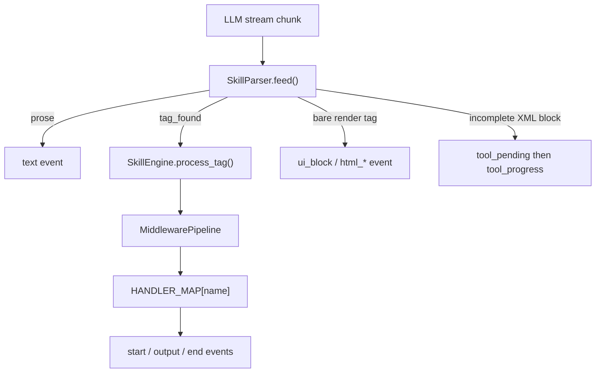

# `engine/skills/` — Tool Parsing & Execution Framework

> [!INFO] Scope
> **8,940 lines across 31 files.** `parser.py` (1,928 L) was read essentially in full. Handlers were read at the level of their public functions and key branches; where a claim is about a handler's internals rather than its contract, this doc says so.

***

## Module map

| File | Lines | Role |
|:--|--:|:--|
| **`parser.py`** | **1,928** | Stream parser — five dialects, chunk-boundary safe |
| `handlers/dil_parser.py` | 989 | Rich-UI DSL parser |
| `handlers/study.py` | 660 | Study-mode tools |
| `handlers/image_generator.py` | 549 | 6-provider image fallback chain |
| `handlers/execute.py` | 498 | Shell execution + background jobs |
| `handlers/browser.py` | 444 | Native Playwright browser tool |
| `handlers/web.py` | 367 | Search / fetch / Context7 docs |
| `handlers/file_ops.py` | 319 | view/edit/create/insert + checkpoints |
| `handlers/agents.py` | 310 | spawn/status/kill agent, teacher guidance |
| `schema_check.py` | 253 | Hand-rolled JSON-Schema validator |
| `engine.py` | 238 | `SkillEngine` orchestrator |
| `handlers/common.py` | 220 | Shared constants + helpers |
| `registry.py` | 213 | Skill discovery + tag ownership |
| `middleware.py` | 207 | Validation → Schema → Execution → Logging |
| `events.py` | 174 | SSE event builders |
| `handlers/io.py` | 152 | `get_file`, `create_note` |
| `handlers/__init__.py` | 136 | `HANDLER_MAP` — 40+ tag → function |
| `handlers/tracknote.py` | 133 | TrackNote CLI bridge |
| `bg_jobs.py` | 132 | Background process manager |
| `json_sanitize.py` | 127 | Transport-level JSON repair |
| `handlers/ask_user.py` | 116 | Structured MCQ |
| `handlers/critique.py` | 114 | Inline critic session |
| `handlers/computer_use.py` | 107 | Desktop control bridge |
| `__init__.py` | 101 | `get_skill_engine()` singleton |
| `handlers/mcp_list.py` | 88 | MCP server listing |
| `json_repair.py` | 85 | Malformed JSON fixup |
| `handlers/memory_manager.py` | 81 | Memory CLI bridge |
| `handlers/grep_search.py` | 74 | grep / glob / list_dir |
| `json_depth.py` | 47 | Structural completeness probe |
| `handlers/load_tool.py` | 44 | Upgrade outer stub → full schema |
| `code_context_guard.py` | 34 | Code-fence awareness |

***

## The pipeline



### Every event type `parser.py` can emit

| Event | Payload | When |
|:--|:--|:--|
| `text` | text | Prose outside any tool block |
| `tool_pending` | tag, attrs | XML block detected, name known |
| `tool_progress` | tag, bytes, preview_lines | XML block still streaming |
| `tag_found` | name, attrs, content | A complete tool call |
| `parse_error` | raw, reason | Structurally complete but unparseable, and body has a tool key |
| `ui_block` | payload/id/partial, or id/remove | Rich UI component |
| `html_start` | id, title, height (+url) | render_html opened |
| `html_chunk` | id, text | Incremental HTML body |
| `html_end` | id (+error) | Pane sealed |

***

# `parser.py` — the stream parser

## Debug logging

```python
_PARSER_LOG = OUTPUT_ROOT / "parser_debug.log"

def _plog(msg: str) -> None:
    ts = datetime.now().strftime("%H:%M:%S.%f")[:-3]
    f.write(f"[{ts}] {msg}\n")
```

Append-only, never raises. Logged events: `BARE_TAG:`, `BARE_JSON_TOOL_CALL:`, `BARE_JSON_PARSE_ERROR:`, `FLUSH_INCOMPLETE_DSML:`, `FLUSH_IN_ACTION:`. First place to look when a tool call vanishes.

## The five dialects

| Dialect | Wrapper |
|:--|:--|
| Hermes | `tool_call` tags |
| Qwen native | `action` tags |
| **DSML** | `DSML tool_calls` / `DSML invoke name=` |
| Legacy XML | `tool_calls` > `invoke name=` > `parameter name=` |
| **MiMo** | `function=name` > `parameter=key` |

### The DSML delimiter class

```python
_D  = r"(?:[｜|_]+)"
_DO = rf"(?:{_D}?DSML{_D}\s*)?"     # optional marker

_DSML_OPEN  = re.compile(rf"<{_D}?DSML{_D}\s*(?:tool_)?calls\s*>", re.I)
_DSML_CLOSE = re.compile(rf"</?{_D}?DSML{_D}\s*(?:tool_)?calls\s*>", re.I)
```

Three deliberate design points, each with a comment recording a real failure:

1. **`_D` accepts fullwidth pipe, ASCII pipe, and underscore** — *"DeepSeek sometimes uses ASCII | instead of fullwidth. Models vary wildly — single pipe, double pipe, mixed. Accept them all."*
2. **`</?` on the close** — *"handles both proper closing tags and bare open-style tags as close."*
3. **`_DO` makes the marker optional on close** — *"models drop it on CLOSE tags constantly."*

> [!WARNING] A source comment warns about a specific regex trap
> *"Use `(?:...)?` for optional delimiter groups. Writing `[chars]+?` creates a lazy quantifier, NOT one-or-more optionally. That breaks matching."* Someone shipped that bug and documented the lesson.

***

## Chunk-boundary machinery

Every one of these exists because a tag can arrive split across arbitrary chunk boundaries.

### `_scan_for_unterminated(s) -> (index, open_quote)`

Finds the first tag that never closes. **Quote-aware and brace-aware**: a `>` inside an open attribute value or inside `{...}` does not close the tag. Only `<` followed by a letter (or `</`) counts as a tag start, so prose like `2 < 3` is ignored.

> [!IMPORTANT] This is the raw-SVG leak fix
> *"a `>` inside an OPEN attribute value does not count as the tag's end. That was the raw-SVG leak — a `markup` attribute containing SVG looked complete because its value is full of `>` while its closing quote was still streaming."*

### `_trim_incomplete_markup(s)`

Makes a partial `render_component` body parseable.

| Case | Action |
|:--|:--|
| Dangling quote mid-attribute | **Close** the quote and the tag, so the partial value parses |
| Half-written tag | **Drop** it — nothing to close |

Also drops a trailing unterminated `{expr}`. Best-effort, never raises.

> [!TIP] Why closing rather than dropping matters
> *"This is what lets a big inline SVG stream: each update renders the SVG-so-far instead of staying blank until the final quote lands."*

### `_scan_tag_end(buf, i)`

Quote-aware `>` finder. A `title` attribute containing `>` does not close the tag early. Returns the index **after** `>` or `-1` if still open.

### `_inside_code_span(buf, pos)`

```python
before = buf[:pos]
if before.count("```") % 2 == 1:  return True
return before.replace("```", "").count("`") % 2 == 1
```

A render tag inside backticks is being **quoted**, not requested.

### `_find_bare_open(buf) -> (name, start, end) | None`

Single left-to-right scan over a lowercased copy. The docstring records the optimisation:

> *"the earlier per-name `str.find` loop was O(N * tags) over the whole (still-growing) buffer, and with the bare UI tags in the set that is a lot of re-scanning for one streamed block."*

And the critical early-return:

> *"This bare tag is still OPEN — its `>` has not arrived. Everything after it is inside the tag, so a later `<` is an attribute value, NOT a new tag. Returning the nested inner tag here is what leaked the outer tag as prose and drew the wrong shape."*

### `_find_bare_start(buf) -> (name, start) | None`

The **earliest incomplete** bare-tag start. Distinct from `_find_bare_open`, which only reports tags whose `>` has arrived.

> [!IMPORTANT] The vanish-on-final-render bug, explained in-source
> *"`_find_bare_open` only reports a tag whose closing `>` has already arrived. While a bare block tag is still being written, that leaves the half-tag with no home — and the prose flush used to dump it into the transcript as literal text. Once text is flushed the buffer is emptied, so the tag could never be recovered when its `>` finally landed. That is what made a bare svg (whose whole drawing lives inside the markup attribute) paint during streaming and then VANISH at the final render."*

It also matches **prefixes**: `elif any(t.startswith(name) for t in _ALL_BARE_TAGS)` — so partial tag names are held rather than flushed.

### `_find_bare_close(buf, name, start)`

Quote-aware closing-tag finder, same boundary check as `_find_bare_open`.

***

## XML attribute parsing

### `_XML_ATTR_RE` — quoted *or* bare

```python
_XML_ATTR_RE = re.compile(r"([A-Za-z_:][\w:.\-]*)\s*=\s*(?:\"([^\"]*)\"|'([^']*)'|([^\s\"'>/]+))")
```

### `_parse_xml_attrs(raw)`

Returns `{"name": str|None, "string": str|None}`. First occurrence wins.

> [!IMPORTANT] Order-independence is the whole point
> *"Order-independent on purpose: models write `string` before `name` as often as after, and the old positional regexes silently dropped those."*

### `_coerce_xml_param(raw_val, type_hint)`

| `string=` hint | Behaviour |
|:--|:--|
| `"true"` | **Keep verbatim** |
| `"false"` | JSON-decode, fall back to raw string |
| absent | Auto-detect: JSON-decode, fall back to raw string |

> [!TIP] The `string="true"` case protects three things
> *"protects `false`, `007`, and JSON-looking payloads from being mangled into bools/ints."* Without it, content `"false"` becomes `False` and `"007"` becomes `7`.

### `_stringify_params(params)`

Handlers receive `dict[str, str]`, so every value is normalized:

| Python type | Becomes |
|:--|:--|
| `None` | `""` |
| `bool` | `"true"` / `"false"` (**lowercase**) |
| `int` / `float` | `str(value)` |
| `str` | unchanged |
| anything else | `json.dumps(value)` |

***

## The four-layer JSON defence

| Layer | File | Function | Fixes |
|:--|:--|:--|:--|
| 1 | `json_sanitize.py` | `sanitize_transport(raw)` | Backslash doubling, mixed quotes, unescaped inner quotes |
| 2 | `parser.py` | `_sanitize_json_escapes`, `_strip_code_fences` | Invalid escapes; bare JSON inside fences |
| 3 | `json_repair.py` | `repair_json` then `aggressive_repair_json` | NaN/Infinity, trailing commas |
| 4 | `json_depth.py` | `json_structurally_complete(raw)` | **The gate** — decides wait vs parse |

### Layer 2 details

Valid JSON escapes are only `\" \ \/ \b \f \n \r \t \uXXXX`. A backslash-escaped single quote is invalid and models emit it constantly — `_sanitize_json_escapes` replaces it explicitly first, then strips any other invalid escape via a negative-lookahead regex.

`_strip_code_fences(text)` removes triple-backtick blocks so a tool-call **example** inside a fence doesn't trigger bare-JSON detection.

### Layer 4 is the gate, and it is non-negotiable

```python
try:
    data = json.loads(raw)
except json.JSONDecodeError:
    if not json_structurally_complete(raw):
        return []                          # wait for more chunks
    try:
        data = json.loads(repair_json(raw))
```

> [!CRITICAL] Repairing an incomplete chunk produces valid-but-wrong JSON
> *"Streaming chunks like a half-written name key are NOT complete — repairing them produces valid-but-wrong JSON that gets consumed as real tool calls."* This is the single most important guard in the file. `json_structurally_complete` tracks brace/bracket depth plus quote and escape state, using character **sets** (`_OPEN = frozenset((chr(123), chr(91)))`) so the source itself doesn't look like JSON.

### `_extract_first_json_array(raw)`

Handles concatenated arrays — two arrays back to back, or an array followed by trailing prose. Returns the substring up to the first balanced `]`.

> [!NOTE] Attributed to a specific model
> *"Models (especially DeepSeek) sometimes emit multiple JSON arrays back-to-back."* This is DeepSeek's retry anti-pattern surfacing in the stream.

### `_parse_action_payload(raw)` — the full ladder

```
raw.strip()
 -> sanitize_transport(raw)                    # layer 1
 -> _extract_first_json_array(raw)             # DeepSeek concatenation
 -> json.loads(raw)
     fail -> if not json_structurally_complete: return []
     fail -> json.loads(repair_json(raw))      # layer 3
         fail -> find outermost object/array in raw, parse that
             fail -> repair the extracted substring
                 fail -> return []
 -> _build_calls(data)
```

### `_diagnose_json_failure(raw)`

Produces an actionable message with **position, a 60-char context window, and a caret marker**, plus this hint:

> *"Backslashes, regex patterns, and `*/` in strings often break JSON transport. Write complex code to a separate file instead."*

> [!TIP] The hint is the useful part
> It tells the model *what to do differently* (write code to a file), not just that it failed. Fed into `resilience.py`'s FORMAT WARNING path.

### `_build_calls(data)` — normalization

| Input variation | Handled |
|:--|:--|
| Single dict vs list | wrapped to a list |
| `name` vs `tool` key | `item.get("name") or item.get("tool", "")` |
| `arguments` vs `params` | `item.get("arguments") or item.get("params")` |
| **Flattened params** | all keys except `name`/`tool` become params |
| Content field | first match of `_CONTENT_PARAM_KEYS = ("body", "content", "command")` |
| `chat_title` | `title` / `text` promoted to content **before** the json.dumps fallback |
| No content match | `json.dumps(params, ensure_ascii=False)` |

> [!IMPORTANT] The `chat_title` special case has an ordering constraint
> *"Must run BEFORE the json.dumps fallback or the whole args dict gets serialized and stored as the literal title string."* A chat would end up titled with the raw JSON of its own arguments.

> [!NOTE] The flattened-params fallback prevents silent data loss
> *"Models sometimes flatten a name plus a command key instead of nesting under arguments."* Without it, the command would be dropped entirely.

### `_find_json_end(raw)`

Brace/bracket depth with string and escape tracking. Returns the index past the closing bracket, or `-1`. Compensates for leading whitespace.

### `_looks_like_bare_tool_call(s)` — the shape gate

| Starts with | Qualifies when |
|:--|:--|
| `[` | Next non-space char is `{` |
| `{` | `"name"`, `"tool"`, or `"tag"` appears in the first 400 chars |
| anything | **No** |

> [!IMPORTANT] A lone `[` deliberately returns `False`
> *"Lone `[` (+ optional whitespace). No evidence of a tool call — holding here would stall the stream waiting for a `{` that may never come. If a `{` does arrive on the next feed, the buffer becomes `[{` and the check below catches it then. So: do NOT hold."*

This is what stops markdown like an admonition opener or `{key: value}` from being held or erroring.

***

## `SkillParser` state

```python
self.buf = ""
self._bt_parity = 0            # backtick parity across the WHOLE fed stream
self._in_action = False
self._in_dsml = False
self._pending_tag: str | None = None
self._last_progress: tuple[int, int] = (0, 0)

self._ui_seq = 0
self._ui_cur_id: str | None = None
self._ui_last_parse_len = 0
self._ui_last_hash: str | None = None

self._html_seq = 0
self._html_cur_id: str | None = None
self._html_sent_len = 0
```

### `_bt_parity` — the stream-wide backtick counter

```python
self._bt_parity ^= (text.count("`") & 1)
```

> [!IMPORTANT] Per-buffer counting does not work, and the comment says why
> *"The buffer is sliced ~20 ways during parsing, so the backtick that opened a code span is usually gone by the time a render tag shows up; counting per-buffer misses it and spawns phantom panes. Stream parity survives every slice."*

### ID generation uses UUIDs, not counters

```python
def _next_html_id(self) -> str:
    self._html_seq += 1
    self._html_cur_id = f"html_{uuid.uuid4().hex[:12]}"
    return self._html_cur_id
```

> [!CRITICAL] A per-instance counter is a correctness bug
> *"MUST be unique across the whole session, not per-parser-instance. A parser is rebuilt every round, so a counter would restart at 1 and hand round N the same id as round 1 — the client keys panes by id and would reuse (and corrupt) the previous pane's node."*

The `_seq` counter is kept for bookkeeping; the id itself is a uuid.

***

## `feed()` — the main loop

### Step 1: bare presentation tags (before any tool logic)

```python
_bare = _find_bare_open(self.buf)
if _bare is not None:
    _bsp = _bare[1]
    _lo = None
    for _m in self._ACTION_OPEN.finditer(self.buf, 0, _bsp):
        _lo = _m
    if _lo is not None and self._ACTION_CLOSE.search(self.buf, _lo.end(), _bsp) is None:
        _bare = None                                    # guard 1
    elif (self._bt_parity ^ (self.buf[_bsp:].count("`") & 1)):
        _bare = None                                    # guard 2
```

**Guard 1 — inside an unclosed tool call.** *"A bare tag inside an UNCLOSED tool-call wrapper is part of the call's arguments (e.g. an edit whose body writes a render block), not a presentation block. Intercepting it corrupts the call and leaks the fragment into the transcript."*

**Guard 2 — odd backtick parity.** *"Odd parity => this tag sits inside a code span that opened in an earlier chunk. Quoted, not requested."*

### Step 2: self-closing detection

```python
_bselfclose = self.buf[max(0, _be - 2):_be] == "/>"
_bclose = (None if _bselfclose else _find_bare_close(self.buf, _bname, _be))
```

> *"A SELF-CLOSING bare tag never gets a close tag, so the tag itself IS the whole block. Without this the block could only seal at end-of-stream, and `flush()` appended the prose that FOLLOWED it into the body."*

### Step 3: dispatch by tag name

| Tag | Handling |
|:--|:--|
| `render_component` | `parse_ui_block(body)` → `ui_block` (seals under the partial's id) |
| any `_BARE_UI_TAGS` | Rebuild open + body + close (**or just open if self-closing**) → `parse_ui_block` |
| `render_html` with `url=` | `html_start(url=…)` + `html_end` — no body streams |
| `render_html` with `src=` | `_read_local_html()` server-side, then chunk it |
| `render_html` inline | `html_start` → `html_chunk`(s) → `html_end` |
| anything else | `tag_found` with empty attrs |

> [!TIP] The self-closing rebuild rule
> *"Self-closing: the open tag alone is the block. Appending a synthetic close would nest the tag inside itself and parse the wrong tree."*

> [!NOTE] Why `url=` skips streaming entirely
> *"The pane loads the real page (local dev server, external site) with its own scripts intact. No body streams; the frame fetches it itself."* And `src=` can't be framed because *"a file URL cannot be framed from an http page, so read it server-side and inline it."*

A failed parse emits `ui_block` with `remove: True` so the client drops whatever partial it already drew.

### Step 4: incomplete bare tag → stream a partial

```python
if _bname == "render_component":
    yield from self._emit_ui_partial(self.buf[_be:])
elif _bname in _BARE_UI_TAGS:
    yield from self._emit_ui_partial(self.buf[_be:], self.buf[:_be])   # open tag as prefix
elif _bname == "render_html":
    if (_bare_tag_attr(self.buf, 0, "src") or _bare_tag_attr(self.buf, 0, "url")):
        break        # source is read/framed at seal time — no body to stream
    yield from self._emit_html_partial(self.buf[_be:], _t, _hgt)
```

Prose before the tag is flushed first, and `_be -= _bs` keeps the body slice aligned after the buffer is trimmed.

> [!TIP] The `_BARE_UI_TAGS` call passes the open tag as a prefix
> *"the open tag itself carries the props — feed it back in as a prefix so the partial tree keeps its attributes (`current="2"`, etc)."*

### Step 5: orphan closing-tag stripping

`_ORPHAN_TAG_RE` removes closing action/tool_call tags, bare `action>` fragments, and DSML `</invoke>`/`</parameter>` from prose. There's an explicit escape: an `</action>` is **not** orphaned when a DSML or legacy-XML wrapper is still open, because those blocks legitimately terminate with a generic close tag.

### Step 6: bare JSON (unwrapped tool call)

Scan for `[` or `{`, apply `_looks_like_bare_tool_call`, then:

| Outcome | Result |
|:--|:--|
| Parses | `tag_found` per call; preceding prose flushed |
| Structurally complete, unparseable, **and** body has a tool key | `parse_error` telling the model to use the wrapped format |
| Structurally complete, unparseable, no tool key | Fall through — left for the prose flush |
| Shape matches but incomplete | `_bare_hold = True`, break, wait for chunks |

> [!IMPORTANT] The `parse_error` is gated on content, not just shape
> *"Only surface a parse_error when the body actually carries a tool-call key (name/tool/tag) — that is a genuinely malformed tool call. Anything else (e.g. a literal empty object, or an object with unrelated keys) is left to flush as prose."*

### Step 7: hold incomplete bare starts, then flush prose

```python
_bstart = _find_bare_start(self.buf)
if _bstart is not None:
    if _bs2 > 0:
        yield {"type": "text", "text": self._strip_orphan_tags(self.buf[:_bs2])}
    self.buf = self.buf[_bs2:]
    break
```

Then a trailing-`<` hold that checks for partial **DSML** prefixes (`dsml`, `|dsml`, `_dsml`, …), delimiter-only tails (`<｜`, `<|`), and legacy prefixes (`action`, `tool_call`, `invoke`, `parameter`).

> [!NOTE] The delimiter-only check is separate on purpose
> A tail of only `｜`/`|`/`_` strips to an empty string after normalisation, so a prefix match would fail. `_is_dsml_delimiters_only` catches it explicitly.

***

## XML progress streaming

`_emit_xml_progress(block)` gives XML-format tool calls the same live card the JSON path has.

> *"The XML path (Hermes / DSML / MiMo) has no partial mode — without this, every XML tool call arrives as one silent lump and only renders once the closing tag lands, while the JSON path streams a live card the whole way."*

### Name resolution, in priority order

1. `_DSML_INVOKE_RE` or `_LEGACY_INVOKE_RE` → `name` attr
2. `_MIMO_FUNCTION_RE` → `function=name`
3. Terminated-attribute fallbacks for a still-streaming invoke/function tag

> [!IMPORTANT] Never emit a half-streamed name
> *"ONLY from a complete, terminated match. A half-streamed name (e.g. `cre` on the way to `create_file`) must not be emitted: it would fire a second `tool_pending` when the real name lands."*

No name resolvable → `return` silently, matching the JSON path.

### Throttle

```python
if last_bytes and p_bytes - last_bytes < 32:
    return
```

32 bytes of growth before re-emitting. Prevents a `tool_progress` per token.

### `_xml_preview_lines(block, p_bytes)`

| Source | Preview line |
|:--|:--|
| `path` / `filename` param | first line, capped 200 chars |
| `command` param | verbatim |
| `content` / `body` / `lines` | **last 3** non-empty lines, 150 chars each |
| nothing available | `streaming… N B` or `streaming… N.N KB` |

`_param_value(*names)` is still-open tolerant — it parses the attribute group via `_parse_xml_attrs` rather than assuming a bare `name=` attribute, and `_trim_partial_close` drops a trailing partial `</para` only when it is a strict prefix of `</parameter`.

> [!TIP] That trim guard is subtle and correct
> *"Only trims when the trailing fragment is a strict PREFIX of the closing tag. Legitimate `<` inside content (HTML, code) is kept."* A naive rfind would eat real code.

***

## `flush()` — end of stream

Order of operations:

1. **Reset progress state** — `_pending_tag = None`, `_last_progress = (0, 0)`, so stale events can't fire after the stream ends.
2. **Open `render_component` / bare UI tag** → render what exists as a **final** block:
   - Source for bare tags is open + `_trim_incomplete_markup(body)`, or just open if self-closing.
   - Parse succeeds → `ui_block` with `partial: False`, sealing the client's partial in the same node.
   - Parse fails **and** a partial was drawn → `{id, remove: True}`.
   - Self-closing with trailing text → the text is re-emitted as `text`, because *"a self-closing block consumed only the tag — the text after it is still prose and must not be dropped."*
3. **DSML / legacy block** at flush:
   - Complete close found → extract normally.
   - **Hybrid fallback**: try the *other* dialect's close tag.
   - Still no close → `_plog("FLUSH_INCOMPLETE_DSML")`, extract what exists, truncate the buffer.
4. **`_in_action` still true** → strip the close tag and run `_extract_json(..., partial=False)`.
5. **Remaining buffer** → orphan-tag strip, flush as text.

> [!IMPORTANT] Step 4 is the safety net for a truncated tool call
> If the model stops mid-call, the closing tag never arrives and `feed()` never fires `tag_found`. `flush()` forces one parse attempt so a nearly-complete call isn't silently discarded.

***

## `engine.py` — `SkillEngine`

238 lines, thin orchestrator.

| Method | Does |
|:--|:--|
| `create_parser()` | New `SkillParser` with live known tags |
| `process_tag(ctx)` | Run one tag through the middleware pipeline |
| `get_registry_prompt(include_defaults=True)` | **Builds the tool catalogue injected into the system prompt every turn** |
| `get_skill_instruction(key)` | Load a skill's `instruction.md` |
| `get_known_tags()` | Live tag list |
| `reload()` | Re-discover skills + clear parser cache |

> [!TIP] `get_registry_prompt()` is the biggest hidden context cost
> It emits every skill's name, description, trigger, and tags. That's why `Brain/disabled_skills.json` matters — it's a context-budget lever, not just a preference.

### `get_known_tags()` — lru-cached with a fallback

```python
@lru_cache(maxsize=1)
def get_known_tags() -> tuple[str, ...]:
    names = {fn["name"] for t in discover_tools() for fn in t.functions}
    if not names:
        return _FALLBACK_TAGS
    return tuple(sorted(names | set(_FALLBACK_TAGS)))
```

> [!WARNING] `KNOWN_TAGS` is a stale alias — do not use it
> The source comments: *"Backwards-compatible alias. Prefer `get_known_tags()` — this snapshot is taken once at import and cannot see tools added later."*
>
> And the `_FALLBACK_TAGS` comment records the bug it already caused: *"`resilience.py` built its repair regex from this tuple directly, so `memory`/`critique`/`generate_image`/`mcp_list`/`study_*` calls were never recognised as repairable malformed tool calls."* Call `reload_tools()` (which clears the cache) after adding a tool at runtime.

***

## `registry.py` — skill discovery

```python
_REQUIRED_FIELDS = ("name", "key", "version", "category", "description",
                    "trigger", "tags", "default", "priority", "scope")
```

| Function | Does |
|:--|:--|
| `discover_skills()` | Walk `skills/`, parse each `skill.json` |
| `validate_registry(skills)` | Return human-readable problems |
| `build_tag_ownership(skills)` | `tag → SkillMeta` by **priority** |
| `_parse_manifest(path)` | One `skill.json` → `SkillMeta` |

Two skills can claim the same tag; higher `priority` owns it. That's how `web_search` and `online_search` both reach one handler while only one skill *owns* the tag.

***

## `middleware.py` — the chain

`TagContext` carries one execution: `tag_id, name, attrs, content, skill, started, events, error, namespace, chat_id, cwd`, with `emit(event)` appending to `events`.

| Middleware | Responsibility |
|:--|:--|
| `ValidationMiddleware` | Tag known? Skill exists? Content non-empty where required? |
| `SchemaValidationMiddleware` | Args match the tool's JSON schema |
| `ExecutionMiddleware` | Call `HANDLER_MAP[name]`, collect yielded events |
| `LoggingMiddleware` | Duration, errors, output size |

`MiddlewarePipeline.execute()` builds the chain inside-out (`for mw in reversed(self._middlewares)`), so the first-added middleware is outermost.

> [!NOTE] Tool-only tags pass validation
> *"Allow tool-only tags (e.g. code_editor tools) that have handlers"* — a tag with no owning skill but a registered handler is allowed through. `skills/` and `tools/` are two registration paths sharing one engine.

***

## `schema_check.py` — hand-rolled validator

No `jsonschema` dependency. Supports `type`, `required`, `properties`, `enum`, `anyOf`/`oneOf`.

```python
_coerce(value, expected)      # "15" -> 15, "true" -> True, "[1,2]" -> [1,2]
_branch_claims(args, branch)  # score fit for each oneOf branch
_branch_label(branch)         # name the winner for errors
validate_arguments(args, schema) -> (ok, errors)
```

> [!TIP] Coercion runs before validation
> XML dialects make every value a string. Coercing first means a correctly-intentioned `timeout="15"` isn't rejected on a type technicality.

***

## `bg_jobs.py`

```python
RESULT_PREVIEW_CHARS = 20_000

class BackgroundJobManager:
    _jobs: dict[str, dict[int, dict]]   # namespace -> pid -> job
```

Logs to `/tmp/ghost_bg_<uuid>.log`, spawned with `popen_kwargs()` and `stdin=DEVNULL`.

> [!WARNING] In-memory only
> *"Jobs are tracked in-memory (lost on server restart — acceptable for dev tooling)."* After a restart, `check_command` on an old PID returns nothing while the process is still running.

Namespacing by session/chat means two chats can both run `npm run dev` without PID collisions.

***

## Handlers

### `execute.py` — shell with three hard blocks

```python
_SABLE_SERVICE_RE = re.compile(r"systemctl\s+(--user\s+)?(restart|stop)\s+sable\.service")
_GIT_CHECKOUT_RE  = re.compile(r"{0}".format(phrase.replace(" ", "\s+")))
_SUDO_TOKEN_RE    = re.compile(r"(?<![\w-])sudo(?![\w-])")
```

| Block | Reason, from the source |
|:--|:--|
| `systemctl restart/stop sable.service` | *"Agent cannot restart/stop sable.service mid-session"* — it would kill its own server |
| the branch-restore command | *"It destroys uncommitted working changes"* — ask the user, or restore targeted files |
| `sudo` | Not blocked — **rewritten** to `sudo -S -p ''` and fed the password on stdin |

> [!TIP] The sudo rewrite is why `sudo` works without a TTY
> `-S` reads from stdin, `-p ''` suppresses the prompt. The password comes from `SABLE_SUDO_PASSWORD` and never appears in `ps`.

| Constant | Value |
|:--|--:|
| `DEFAULT_TIMEOUT` | 15 s |
| `MAX_TIMEOUT` | 180 s |
| `MAX_TEXT_BYTES` | 2 MB |
| `PREVIEW_BYTES` | 64 KB |
| `RESULT_PREVIEW_CHARS` | 20,000 |

Four handlers: `handle_execute_command`, `handle_execute_background_command` (routed by `bg="true"`), `handle_check_command`, `handle_kill_command`. `parse_editor_command(cmd)` detects `nano`/`vim`/`ed` invocations and handles them specially — an interactive editor needs different treatment than a normal command.

### `image_generator.py` — 6-provider chain

```
Cloudflare -> Pollinations -> Puter -> Perchance -> DreamForge -> Advanced SDXL
```

Each `_try_*` returns `dict | None`; the handler walks until one succeeds. `_SHAPES` (aspect ratios) and `_STYLE_PREFIXES` (style → prompt prefix) are lookup tables; `_apply_style(prompt, style)` prepends.

### `web.py`

| Handler | Backend |
|:--|:--|
| `handle_online_search` | SearXNG → providers → scraper fallback |
| `handle_openweb` | Direct fetch + readability |
| `handle_fetch_docs` | **Context7** — `_ctx7_get(path, params)`, `_pick_library(hits, library)`, `_slug(name)` |

### `study.py`

`_MAX_IMAGE_PAGES = 10`, `_MAX_TEXT_PAGES = 30`. `_parse_pages(spec, default, cap)` handles a comma/range spec like `"1-5,9"`. `_resolve_doc_id(attrs, content)` and `_current_page(attrs, default)` keep the four handlers (`study_document`, `study_note`, `study_pdf`, `study_diagnostics`) from re-parsing the same attrs.

### `browser.py`

`DEFAULT_USER_DATA_DIR = ~/sable_output/browser/profile`. `_launch_opts(attrs)` builds launch config, `_save_screenshot(session, attrs)` captures, `handle_browser()` is the entry. Uses `engine/browser/session.py`'s `BrowserSession` — **not** `BrowserManager`.

### `file_ops.py`

`view_file`, `edit_file` (SEARCH/REPLACE blocks), `create_file`, `insert_file`, `list_checkpoints`, `restore_checkpoint`. Backed by `engine/checkpoint.py`'s shadow-git.

### `agents.py`

`handle_spawn_agent`, `handle_agent_status`, `handle_kill_agent`, `handle_teacher_guidance`. `_sync_agent_context(browser_data_dir, system_prompt)` pushes the system prompt into the agent's own browser profile before it starts.

***

## `HANDLER_MAP` — 40+ tags

| Domain | Tags |
|:--|:--|
| Execution | `execute_command`, `check_command`, `kill_command` |
| Files | `view_file`, `edit_file`, `create_file`, `insert_file`, `get_file`/`read_file`, `create_note`, checkpoints |
| Search | `grep`, `glob`, `list_dir`, `online_search`/`web_search`/`web_fetch`, `openweb`, `fetch_docs` |
| Agents | `spawn_agent`, `agent_status`, `kill_agent`, `teacher_guidance` |
| Media | `generate_image`, `browser`, `computer_use` |
| Integration | `mcp_call`, `mcp_list`, `load_tool`, `tracknote`, `memory`/`memory_manager` |
| Study | `study_document`, `study_note`, `study_pdf`, `study_diagnostics` |
| Meta | `ask_user`, `critique`, `chat_title` |

Aliases exist because different models emit different names for the same tool: `read_file → handle_get_file`, `memory_manager → handle_memory`, and three search names all reach `handle_online_search`.

***

## Gotchas

> [!WARNING] Five things that will cost you a debugging session
> 1. **`KNOWN_TAGS` is a stale snapshot.** Use `get_known_tags()`. The stale alias already caused a real bug in `resilience.py`.
> 2. **`bg_jobs` is in-memory.** A restart orphans every background process with no record of its PID.
> 3. **Bare tags inside an action wrapper are arguments, not UI.** Guard 1 in `feed()` handles it, but it's non-obvious when a render block silently becomes file content.
> 4. **Repair requires `json_structurally_complete` first.** Repairing an incomplete chunk yields valid-but-wrong JSON that gets executed as a real tool call.
> 5. **`_next_html_id` uses a uuid on purpose.** A counter would collide across rounds and corrupt the client's pane node.
