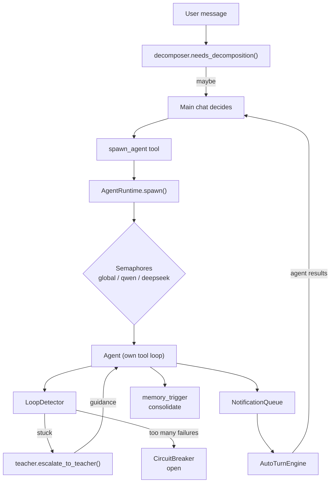

# `engine/agents/` — Multi-Agent Orchestration

> [!INFO] What this is
> **3,094 lines across 12 files.** A hub-and-spoke agent system: the main chat can spawn background sub-agents with specialized roles, each running its own tool loop, with concurrency limits, circuit breakers, loop detection, and an escalation path to a stronger "teacher" model when an agent gets stuck.

***

## Module map

| File | Lines | Role |
|:--|--:|:--|
| `resilience.py` | **798** | Circuit breakers, loop detection, turn caps, main-chat guard |
| `memory_trigger.py` | **772** | Threshold-based memory consolidation for sub-agents |
| `auto_turn.py` | 352 | Signals frontend to run a chat turn with agent results |
| `runtime.py` | 300 | `AgentRuntime` — spawn/track/kill lifecycle |
| `registry.py` | 290 | 9 role definitions + runtime overrides |
| `teacher.py` | 241 | Escalation to a stronger model when stuck |
| `agent.py` | 102 | `Agent` dataclass |
| `loop.py` | 66 | **DEPRECATED** — old LLM loop |
| `protocol.py` | 57 | `AgentStatus`, `AgentResult`, `TaskAssignment`, `AgentEvent` |
| `notifications.py` | 50 | Per-chat notification queue |
| `__init__.py` | 40 | Package exports |
| `decomposer.py` | 26 | Heuristic: does this message need parallel agents? |

***

## Architecture



***

## Roles — 9 defined, 7 primary

`AGENT_ROLES` in `registry.py`:

| Role | Model | Timeout | Max parallel | Allowed skills | Required output sections |
|:--|:--|--:|--:|:--|:--|
| `analyst` | qwen3.8-max | 300s | 4 | — | Topic, Findings, Sources, Summary, Confidence / File Reviewed, Critical Issues, Warnings, Info, Verdict |
| `coder` | qwen3.8-max | 600s | 2 | — | Description, Files Modified, Tests, Notes |
| `writer` | mistral-large | 120s | 2 | — | Title, Document Path, Structure Overview, Word Count, Notes |
| `sysutil` | qwen3.8-max | 300s | 2 | system_repair, phone_control, youtube_downloader | Task, Diagnosis, Actions Taken, Result, Notes |
| `docs` | qwen3.8-max | 300s | 2 | document_skills, text_humanizer | Task, Document Path, Structure Overview, Notes |
| `visuals` | qwen3.8-max | 300s | 2 | graph_master, svg_creator, frontend_design | Task, Output Path, Description, Notes |
| `tester` | qwen3.8-max | 300s | 2 | testing_debugging | Bug Summary, Root Cause, Fix Applied, Verification, Notes |
| `scheduled` | qwen3.8-max | 600s | 2 | telegram, email | Task, Result, Notes |
| `maria` | qwen3.8-max | 600s | 1 | (all) | — |

> [!IMPORTANT] `required_sections` is a real constraint
> The agent's final answer is checked for those `##` headers. It's how a sub-agent's output stays parseable when it comes back to the main chat — instead of a wall of prose, the parent gets structured markdown it can trust.

### Model fallback chains

Every role has a `model_chain` — the primary model plus fallbacks. When the primary is exhausted or its breaker is open, the next in the chain runs. Default if unspecified:

```python
_DEFAULT_MODEL_CHAIN = ["deepseek-instant", "gemini-2.5-flash"]
```

### Runtime overrides

`system/agent_config.json` overrides everything at runtime — `apply_role_overrides()`, `apply_account_assignments()`, `get_role_config(role)`. The live config currently sets:

```json
"concurrency": {"global_max": 10, "deepseek_max": 5, "qwen_max": 5},
"limits": {"max_iterations": 100, "max_consecutive_tool_calls": 70, "max_total_tool_calls": 100},
"resilience": {"circuit_breaker_threshold": 5, "circuit_breaker_reset_seconds": 60},
"teacher": {"enabled": true, "model": "qwen3.8-max"}
```

**Account assignments** pin each role to a pool of browser profiles (currently `acc104–acc107`), with a **different rotation order per role** — so `analyst` and `sysutil` don't collide on the same profile. `get_next_account(role, in_use)` picks the first pool entry not already in use, `get_account_pool(role)` returns the list.

> [!NOTE] The configured max_iterations is 100, the code default is 25
> `agent_config.json` overrides it upward. If you're debugging "why did this agent run 80 turns", the answer is in the config file, not the code.

***

## `runtime.py` — `AgentRuntime`

One instance per process (`get_runtime()` singleton).

```python
_agents: dict[str, Agent]              # agent_id → Agent
_tasks: dict[str, asyncio.Task]        # agent_id → asyncio task
_spawn_lock: asyncio.Lock
_max_agents: int                        # global_max
_max_depth: int = 3                     # nested spawn depth

_ds_sem, _qwen_sem, _global_sem         # per-backend + global semaphores
_breakers: dict[str, CircuitBreaker]    # one per backend
_limits: dict[str, int]                 # max_iterations
_event_callback: EventCallback          # SSE push
_loop: asyncio.AbstractEventLoop        # for thread-pool dispatch
```

### Lifecycle rules

| Rule | Value |
|:--|:--|
| Stale agent pruning | `_PRUNE_AFTER_SECONDS = 3600.0` (1 h) |
| Max spawn depth | 3 (agent spawning agent spawning agent) |
| `update_config()` | Hot-reload — recreates semaphores in place |
| `set_event_callback()` | Wired by the API layer for SSE |

> [!TIP] Why `_loop` is stored explicitly
> Handlers run in a **worker thread pool**, not the event loop. `run_coroutine_threadsafe(..., self._loop)` is the only safe way to dispatch back. Losing that reference means silent `RuntimeError: no running event loop`.

**Hot-reload note:** `update_config()` recreates `asyncio.Semaphore` objects rather than mutating them. Safe because a Semaphore holds no external state — but any coroutine currently awaiting an old semaphore keeps waiting on the *old* object.

***

## `resilience.py` — 798 lines of guardrails

The most important file in the subsystem. Four independent mechanisms:

### 1. `CircuitBreaker` — per backend

```
closed → (failures >= threshold) → open
open   → (reset_timeout elapsed) → half-open   (ONE probe allowed)
half-open → success → closed
half-open → failure → open
```

The half-open state allows exactly **one** probe call; concurrent calls are blocked (`can_execute()` returns `False`). This prevents a thundering herd on recovery.

Breakers exist for: `deepseek`, `qwen`, `gemini`, `groq`, `mistral`.

### 2. `LoopDetector` — three detectors + structural

| Detector | Warns at | Hard-stops at |
|:--|--:|--:|
| Exact failure (same tool + args + **same error**) | 2 | 5 |
| Same-tool failure (same tool, any error) | 3 | 8 |
| No-progress (read-only tool, same args, same result) | 2 | 5 |
| Consecutive identical calls | — | 5 (warn only) |

```python
_READ_ONLY_TOOLS = frozenset({"view_file", "get_file", "grep", "glob", "list_dir",
                              "read_file", "search", "web_search", "fetch_url",
                              "list_checkpoints", "agent_status"})
_POLLING_EXEMPT_SUFFIXES = ("_get_result", "_poll")
_POLLING_EXEMPT_EXACT = frozenset({"process", "bfl_flux3_get_result"})
```

> [!IMPORTANT] Why the polling exemption exists
> A legitimate async job poll (`process_get_result` every 5 s) looks *exactly* like a no-progress loop. Without the exemption, the detector would block a job that's genuinely still running. The suffix convention (`_get_result`, `_poll`) is the contract.

The messages are deliberately instructional, not just blocking — `"This will not succeed by retrying. Change your approach entirely."` The point is to steer the model, not punish it.

### 3. `TurnCapTracker` — per-turn ceilings

```python
MAX_WEB_SEARCHES   = 50
MAX_SUBAGENT_SPAWNS = 50
```

> [!WARNING] These are **hard** ceilings
> The docstring says: *"Hard ceiling regardless of hard_stop_enabled flag."* Reset happens at the start of each turn (`reset()`). This is the anti-runaway-cost guard — 50 web searches in one turn means something went badly wrong.

### 4. `MainChatGuard` — the main loop's mirror

Same detection as `LoopDetector` but **warnings injected as feedback instead of hard stops**, because the main chat can't be silently blocked — Sifat would just see nothing happen.

### `GuardrailDecision` — the shared return type

```python
action: Literal["allow", "warn", "recover", "block"]
message: str | None
recovery_key: str | None
tool_name: str | None
```

`recover` is the interesting one — reset the session, inject `build_recovery_prompt()`, give one more attempt. It's a soft reset instead of a hard failure.

***

## `teacher.py` — escalation

```python
DEFAULT_TEACHER_MODEL = "qwen3.8-max"
MAX_TEACHER_INTERVENTIONS = 2
```

When an agent is stuck, `escalate_to_teacher(agent, stuck_reason)` sends the agent's conversation to a **stronger model** with a mentor prompt that must return:

```json
{ "diagnosis": "What the agent is doing wrong (1-2 sentences)",
  "guidance": "Specific actionable instructions (2-4 sentences)" }
```

That guidance is injected back into the stuck agent's context. Max 2 interventions per agent, then it's allowed to fail.

**Backend routing** — `_call_teacher_qwen()`, `_call_teacher_deepseek()`, `_call_teacher_api()` are chosen by `get_model_config(teacher_model)["api_backend"]`.

> [!TIP] The teacher prompt is unusually disciplined
> *"Keep guidance concrete and actionable. No vague 'try harder' advice."* and *"Respond ONLY with the JSON object."* Both matter — a chatty teacher response would blow the stuck agent's remaining context budget.

***

## `memory_trigger.py` — sub-agent consolidation

A separate, lighter memory pipeline just for sub-agents.

```python
THRESHOLD_DISTINCT_TOOLS = 4
THRESHOLD_TOTAL_CALLS = 12
THRESHOLD_ERROR_RECOVERIES = 3
_MAX_AGENT_CONV_CHARS = 30_000
_MERGE_SIMILARITY_THRESHOLD = 0.7
```

`should_trigger(agent)` fires when **any** threshold is crossed — the agent did enough distinct work to have learned something. Then `_format_agent_conversation(agent)` builds a ≤30 K char transcript and runs `_AGENT_CONSOLIDATION_PROMPT` against it, writing to `Brain/Memory.json` / `Procedural.json` with the same schema as the main pipeline.

Everything is logged to `system/consolidation.txt` via `_log_consolidation(section, content)` — that's the 80 MB file.

> [!NOTE] `_MERGE_SIMILARITY_THRESHOLD = 0.7`
> Above 0.7 similarity, a new memory **merges** into the existing entry instead of being appended. That's how `Memory.json` stays at ~170 KB instead of growing without bound.

***

## `auto_turn.py` — closing the loop

`AutoTurnEngine` is how agent results reach the main chat without the user asking again.

```python
_TeacherRequest    # pending teacher escalation
_ChatState         # per-chat agent tracking
```

Flow: agent completes → `NotificationQueue` (per-chat) → `AutoTurnEngine` decides → signals the frontend to **run a normal chat turn** with the agent results as input. That's the "auto-turn" — the model continues the conversation on its own because a background agent finished.

***

## `protocol.py` — the data contract

```python
class AgentStatus(str, Enum):
    SPAWNED, RUNNING, COMPLETED, FAILED, TIMED_OUT, KILLED, DEGRADED

@dataclass
class AgentResult:
    agent_id, role, status, summary
    artifacts: list[str]
    tokens_used: int
    error: str | None
    duration_seconds: float
    skills_used: list[str]
    @property success → COMPLETED or DEGRADED
    def to_plaintext() → summary  # "Agents now produce markdown natively"
```

> [!NOTE] `DEGRADED` counts as success
> An agent that finished with a partial result is more useful than a hard failure. `success` returns `True` for both `COMPLETED` and `DEGRADED` — so partial work still flows back to the parent.

```python
@dataclass
class TaskAssignment:
    task, role
    context, instruction, model, browser_data_dir, timeout
    collect: bool = False          # wait for result inline vs fire-and-forget
    parent_agent_id: str | None    # nesting
```

`AgentEvent.type` ∈ `agent_spawned | agent_progress | agent_completed | agent_failed`.

***

## `decomposer.py` — the 26-line heuristic

```python
_PARALLEL_PATTERNS = re.compile(...)
def needs_decomposition(message: str) -> bool
```

Just a regex pre-filter. It doesn't spawn anything — it only **hints** to the main chat that a message *might* benefit from parallel agents. Cheap, fast, no LLM call. False positives are harmless because the main chat still decides.

***

## `loop.py` — deprecated, still present

```python
"""Agent LLM loop — DEPRECATED."""
async def run_agent_llm_loop(...)
```

66 lines, unused. The real loop moved into `engine/agents/agent.py` + the chat service. Left in place rather than deleted — a tombstone, not live code.

***

## Gotchas

> [!WARNING] Things that will cost you an hour
> 1. **`max_iterations` = 100 in config, 25 in code.** Always check `agent_config.json` before blaming the loop.
> 2. **Semaphore recreation on `update_config()`** — in-flight awaits keep the old object. Not a bug, but a surprise if you change concurrency mid-run.
> 3. **Polling tools must be named `*_get_result` or `*_poll`** or the loop detector will block them at 5 identical calls.
> 4. **Only 2 teacher interventions per agent.** After that it fails even if the teacher could still help — deliberate cost control.
> 5. **`TurnCapTracker` ignores `hard_stop_enabled`.** It's the one guard you cannot turn off.
