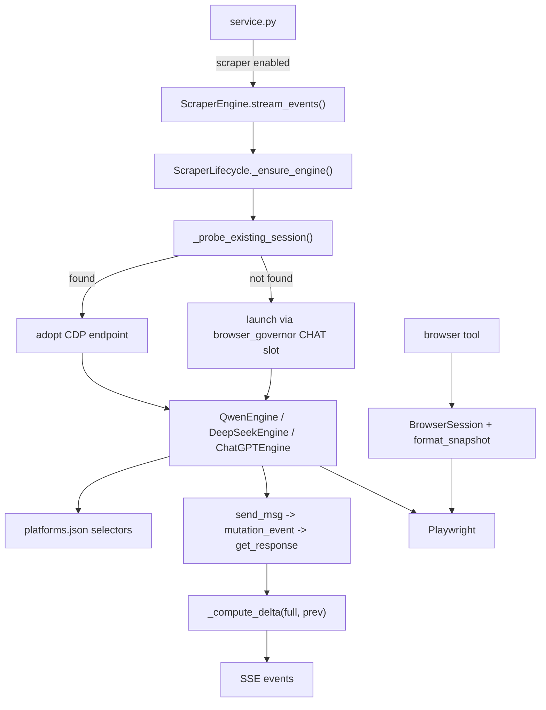

# `engine/browser/` + `engine/scraper/` + `engine/scraper_engines/` — Browser Automation

> [!INFO] Scope
> **7,667 lines across 21 files.** `scraper/core.py` (975 L) and `scraper/stream.py` (496 L) were read line-by-line. The three provider engines were read at the level of their class structure and key methods. One live bug was found during this read — documented at the end.

***

## Three layers, one goal

Drive a real Chromium so Sable can talk to providers that only expose a web UI.

| Layer | Path | Lines | What |
|:--|:--|--:|:--|
| Framework | `engine/scraper/` | 2,319 | Base class, lifecycle, streaming, settings |
| Provider engines | `engine/scraper_engines/` | 3,977 | Qwen, DeepSeek, ChatGPT |
| Browser tool | `engine/browser/` | 1,371 | In-process Playwright + accessibility snapshots |

> [!IMPORTANT] Not the same as `engine/session.py`'s `BrowserManager`
> That one manages **persistent per-account auth profiles** for HTTP token capture. These three manage **content generation via DOM automation**. Different problem, different code, no shared base class. A fix in one never fixes the other.

***

# 1. `engine/scraper/` — the framework

| File | Lines | Role |
|:--|--:|:--|
| `core.py` | 975 | `BaseScraperEngine` — the ABC |
| `stream.py` | 496 | `ScraperEngine` — streaming chat |
| `lifecycle.py` | 418 | `ScraperLifecycle` — load/start/probe/kill |
| `settings.py` | 145 | Engine registry + settings persistence |
| `provider_config.py` | 76 | Shared `platforms.json` loader |
| `loader.py` | 36 | Dynamic module import |

## `core.py` — `BaseScraperEngine`

### The four abstract methods

```python
send_msg()          # type a message into the provider UI
get_response()      # read the completed response out of the DOM
new_chat()          # click "new chat"
stop_generation()   # click the stop button
```

Everything else is overridable.

### Capability declaration

```python
PROVIDER_CAPABILITIES = {
    "has_thinking_toggle": False,
    "has_model_switch":    False,
    "stop_via_api":        False,
    "has_file_upload":     True,
    "has_clipboard_paste": True,
    "has_diary":           False,
    "has_persona_sync":    False,
    "has_bridge_session":  False,
    "has_commands":        False,
}
PROVIDER_NAME = "base"
```

Each engine flips the flags it supports. The UI and service layer read these to decide what to expose.

### Constructor state

| Field | Purpose |
|:--|:--|
| `port, viewer, show_thoughts` | Config |
| `user_data_dir` | Defaults to `~/.local/share/ghostchat/chrome-data` |
| `chrome_process` | The `subprocess.Popen` handle |
| `_slot` | **`browser_governor.Slot`** — the concurrency ticket |
| `pw, browser, context, page` | Playwright handles |
| `last_instruction_hash` | Skip re-injecting an unchanged system prompt |
| `last_thought_expand_at` | Throttle for expanding reasoning blocks |
| `last_tokens` | Dedup marker |
| `mutation_event` | `asyncio.Event` fired by the DOM observer |
| `clipboard_tool` | Detected `wl-paste` / `xclip` |
| `system_injected`, `image_attached` | One-shot flags |

### Port diversion — Obsidian collision

```python
if not use_obsidian_config and port == 9222:
    if self._is_obsidian_running_on_port(9222):
        port = 9225
```

`_is_obsidian_running_on_port(port)` does a 0.3 s socket probe, then fetches `http://127.0.0.1:{port}/json` and checks each page URL for `obsidian.md/index.html` or `app://obsidian.md`.

> [!TIP] 9222 is the default Chrome debug port
> And Obsidian's Electron app also grabs it. Rather than fail with a confusing CDP error, the engine detects the collision and diverts to 9225.

### `_detect_clipboard_tool()`

```python
if shutil.which("wl-paste"): return "wl-paste"
if shutil.which("xclip"):    return "xclip"
return None
```

Wayland first, then X11. Pasting a huge prompt via clipboard is faster and more reliable than typing it character by character.

### Platform config access

`get_platform_config()`, `get_platforms_config()`, `get_selector(key, default)`, `get_key(key, default)`, `get_ui_config(key, default)` — all read `platforms.json`. Same engine code works against a changed provider UI without a code edit.

### Debug logging

`_log_debug(event, **fields)` writes JSON-lines to `output/logs/response_capture_<timestamp>.log`. One file per session.

## `launch_chrome()` — the launch path

```python
if await self._is_own_headed_session():
    logger.info("Found existing headed session with matching profile")
    return

for name in ("SingletonLock", "SingletonCookie", "SingletonSocket"):
    path = os.path.join(self.user_data_dir, name)
    if os.path.exists(path) or os.path.islink(path):
        os.remove(path)
```

> [!IMPORTANT] `_is_own_headed_session()` is a three-way check, not just a port probe
> 1. Port open?
> 2. `userDataDir` from `/json/version` matches `os.path.realpath(self.user_data_dir)`?
> 3. `BrowserCommandLine` does **not** contain `--headless`?
>
> All three must pass. A headless browser on the same port is useless — it can't render the way a headed one does.

### WSL2 branch

```python
from engine.wsl_browser import is_wsl2, launch_windows_chrome
if is_wsl2():
    wsl_session = launch_windows_chrome(
        self.user_data_dir, port=self.port, headless=not self.viewer,
        extra_args=["--force-dark-mode", "--enable-features=WebUIDarkMode"],
    )
```

Lets Sable in WSL drive the **Windows** Chrome — real GPU, real display, real fingerprint.

### Browser resolution and governor admission

```python
chrome_path = resolve_browser_for_profile(profile_name) or find_best_chrome()
slot = await browser_governor.acquire(
    profile_name,
    priority=browser_governor.PRIORITY_CHAT,
)
```

> [!NOTE] CHAT priority, not EPHEMERAL
> `session.py`'s header browsers acquire with `PRIORITY_EPHEMERAL` — they get evicted. A scraper browser backs a live chat session, so it acquires with `PRIORITY_CHAT` and is the one that *causes* eviction.

The slot is attached to the PID and released on any launch failure:

```python
try:
    self.chrome_process = subprocess.Popen(cmd, stdout=log_file, stderr=subprocess.STDOUT, **popen_kwargs())
except BaseException:
    slot.release()
    raise
slot.attach(self.chrome_process.pid, user_data_dir=self.user_data_dir)
```

## Mutation polling — how responses are captured

```python
async def _poll_mutations(self) -> None:
    while True:
        mutations = await self.page.evaluate("window.__ghost_mutations || []")
        if mutations:
            await self.page.evaluate("window.__ghost_mutations.length = 0;")
            self.mutation_event.set()
        await asyncio.sleep(0.5)
```

An injected `MutationObserver` (via `_inject_mutation_observer()`) pushes into `window.__ghost_mutations`. A Python task polls that array every 500 ms and sets `mutation_event` when anything changed. That event is what wakes `get_response()`.

> [!TIP] Why poll rather than use CDP DOM events
> Playwright's `page.on("console")` / mutation bindings are unreliable across providers, and the array approach survives page navigations. 500 ms polling is cheap and provider-agnostic.

## `_setup_page(page)` — the ghost layer

```python
await page.emulate_media(color_scheme="dark")
for pattern in ["**/*analytics*", "**/*telemetry*", "**/gtm.js*",
                "**/feedback.js*", "**/play.google.com/log*", "**/collect?*"]:
    await page.route(pattern, lambda route: route.abort())
await page.add_init_script(...)   # injects _GHOST_CSS as a <style id="ghost-engine-styles">
```

`_GHOST_CSS` hides provider UI chrome so screenshots and text capture are clean. The init script re-injects on `DOMContentLoaded` because SPA navigation wipes `<head>`.

## `_paste_large_message(field, message)` — two JS strategies

The docstring is explicit: *"Inject text via JS directly — never touches the OS clipboard."*

**Method 1 — direct assignment + event dispatch:**

```javascript
const el = document.activeElement;
if (el.isContentEditable || el.tagName === 'TEXTAREA' || el.tagName === 'INPUT') {
    el.value = msg;                                  // or el.textContent for contentEditable
    el.dispatchEvent(new Event('input', { bubbles: true }));
    el.dispatchEvent(new Event('change', { bubbles: true }));
}
```

Then a keyboard nudge (`End`, type a space, `Backspace`) to force the framework to notice, then verification:

```python
val = await field.input_value()
if val and len(val) >= len(message) * 0.8:
    await self._resume_observer()
    return True
```

The 0.8 threshold — not 1.0 — because some providers trim or normalize whitespace.

**Method 2 — React/Angular prototype value setter:**

```javascript
const tracker = element._valueTracker;
const setter = Object.getOwnPropertyDescriptor(window.HTMLTextAreaElement.prototype, 'value').set;
if (setter) setter.call(element, msg); else element.value = msg;
if (tracker) tracker.setValue(msg);
```

> [!IMPORTANT] Why the prototype setter is necessary
> React binds a synthetic `input` handler and keeps its own `_valueTracker`. A plain `element.value = x` updates the DOM but React sees no change and won't enable the send button. Calling the **native prototype setter** and then updating `_valueTracker` makes React believe a real user typed it.

The observer is disconnected before the write (`window.ghost_observer.disconnect()`) and resumed after, so the paste doesn't register as a mutation and trigger a spurious response capture.

## Response cleaning

| Method | Purpose |
|:--|:--|
| `_clean_garbage(text)` | Strip `_UI_GARBAGE_WORDS` and provider chrome from captured text |
| `_is_meaningful_response_text(text)` | Reject empty / whitespace-only / known-noise captures |
| `_clean_thoughts_text(text)` | Strip `_THOUGHT_IGNORED_EXACT` reasoning noise |
| `_get_element_text(element)` / `_get_element_text_direct(element)` | Two extraction strategies |

> [!WARNING] `_clean_garbage` can make text **shorter**
> It dedups repeated halves. That's exactly why `_compute_delta()` in `stream.py` has to handle the shrinking case — see below.

## Other notable methods

| Method | Does |
|:--|:--|
| `_wait_for_send_enabled(timeout=10.0)` | Poll until the send button is clickable |
| `_is_stop_active()` | Is the provider still generating? |
| `_scroll_to_bottom()` | Keep the newest content in view |
| `_auto_skip_preference_vote()` | Dismiss the provider's "was this helpful?" prompt |
| `_load_instructions()` | Read the persona file for injection |
| `upload_file(path, has_msg)` | Attach a file through the UI |
| `upload_from_clipboard(has_msg)` | Attach via clipboard (Linux/Wayland) |
| `extract_thoughts(initial_count, force_expand)` | Pull the reasoning block out |
| `get_response_count()` | How many responses are on screen |

***

## `stream.py` — `ScraperEngine`

```python
_LOCK_ACQUIRE_TIMEOUT = 30.0
```

### `_stream_get_response()` — the delta problem

The browser gives you the **full** response text on every poll. The stream needs **incremental** chunks. `_compute_delta(full, prev)` handles three cases, each with a comment:

| Case | Condition | Returns |
|:--|:--|:--|
| Normal growth | `full.startswith(prev)` | `full[len(prev):]` |
| **Text shrank** | `prev.startswith(full)` | `''` — do not re-emit |
| Mid-text reformat | longest common prefix > half of `prev` | `full[common:]` |
| Too little overlap | otherwise | `''` — treat as full replacement |

> [!IMPORTANT] Case 2 exists because of `_clean_garbage`
> The cleaner dedups repeated halves, so the text legitimately gets shorter mid-stream. A naive delta would either emit nothing forever or re-emit everything.

> [!WARNING] The "too little overlap" case silently drops content
> If the provider rewrites more than half the response (rare, but possible on a model switch or a retry), `_compute_delta` returns `''` and that rewrite never reaches the client. The final `tail` flush recovers the *last* state, but intermediate rewrites are lost.

### Queue-based streaming

```python
answer_queue: asyncio.Queue[str] = asyncio.Queue()
thought_queue: asyncio.Queue[str] = asyncio.Queue()
task = asyncio.create_task(engine.get_response(**kwargs))

while not task.done():
    while not thought_queue.empty():  yield {'type': 'thinking', 'text': ...}
    try:
        delta = await asyncio.wait_for(answer_queue.get(), timeout=0.15)
        yield {'type': 'answer', 'text': delta}
    except asyncio.TimeoutError:
        pass
```

The sync callbacks `live_display` and `thoughts_callback` are passed into the engine, which calls them from Playwright's thread. They `put_nowait` into the queues. The 0.15 s timeout keeps the generator responsive to `task.done()`.

### Capability negotiation

```python
if not _accepts_arg(engine.get_response, 'live_display'):
    answer = await engine.get_response(**response_kwargs)
    state['answer'] = str(answer or '')
    state['streamed'] = False
    return
```

An engine that doesn't accept `live_display` gets no streaming at all — it degrades to a single await. `_accepts_arg` inspects the signature, so a third-party engine without the callback still works, just without live updates.

### Final flush

```python
tail = _compute_delta(answer_text, last_answer)
if not tail and not state.get('streamed'):
    tail = answer_text      # nothing streamed at all — emit everything
```

That guard is the safety net: if the engine never called `live_display` (or every delta was suppressed), the complete answer is still delivered.

## `lifecycle.py` — `ScraperLifecycle`

| Method | Does |
|:--|:--|
| `reset()` / `stop(kill_browser)` / `_cleanup_engine(kill_browser)` | Teardown |
| `_find_engine_class(module)` | Locate the `BaseScraperEngine` subclass in a module |
| `_load_engine_class(path)` | Import a `.py` from `scraper_engines/` |
| `_instantiate_engine(cls, settings)` | Build it |
| `_ensure_engine(settings)` | Get-or-create |
| `_is_browser_alive(engine)` | CDP probe |
| **`_probe_existing_session(settings)`** | **Adopt a running browser instead of launching a second** |
| `prelaunch()` | Warm the browser ahead of the first message |
| `switch_model(model_type)` | Change the provider's model selector |
| `get_ui_metadata()` | Capabilities for the frontend |
| `get_session_info()` | Chat id, model, etc. |
| `kill_session()` | Hard kill |

> [!IMPORTANT] `_probe_existing_session()` is load-bearing
> Without it, every chat turn would spawn a fresh Chromium — 10 s startup, a new profile lock, a login check. Instead it probes for a live CDP endpoint and **adopts** it. This is why Sable feels fast despite being browser-driven.

## `settings.py` — engine registry

```python
SETTINGS_PATH = system/scraper_settings.json
ENGINES_DIR   = engine/scraper_engines
DEFAULT_ENGINE_TYPE = "qwen"
```

`get_settings()`, `list_engines()` (scans `ENGINES_DIR`), `save_settings()`, `update_settings(payload)`, `_resolve_engine_path(type)`, `_as_bool(value, default)`.

**Live settings:**

```json
{ "enabled": false, "engine_type": "qwen", "port": 9333,
  "headless": true, "show_thoughts": true, "chatgpt_headless": false }
```

> [!NOTE] `enabled: false` right now
> The scraper path is dormant — Sable is using HTTP connectors. Flip `enabled` to route Qwen/DeepSeek through DOM automation instead. Editing scraper engine code has **no effect** until this flips.

***

# 2. `engine/scraper_engines/` — per-provider engines

Same shape per provider:

```
<provider>/
  engine.py          # the BaseScraperEngine subclass
  platforms.json     # selectors, keys, ui_config
  config.py          # path/config shim
  exceptions.py      # ResponseCaptureError
```

| Provider | engine.py | Notes |
|:--|--:|:--|
| **Qwen** | 1,369 | `_QWEN_INPUT_SELECTORS`, `_CaptureState`, `ProxyHTTPHandler`, `collect_session_markdowns_chronological()` |
| **DeepSeek** | **1,487** | `GhostChat` class, `_detect_clipboard_tool()`, memory injection into the prompt |
| **ChatGPT** | 451 | Simplest — newest engine |

## DeepSeek — `GhostChat`

```python
_MEMORY_PATH = "Brain/Memory.json"
def _get_relevant_memories(message: str) -> str
_GHOST_CSS = "..."
_UI_GARBAGE_WORDS = (...)
_THOUGHT_IGNORED_EXACT = {...}
```

`_get_relevant_memories()` injects semantically-relevant Brain entries directly into the prompt text — the scraper path has no system-prompt channel, so memory has to ride along with the user message.

## Qwen — `ProxyHTTPHandler`

Beyond DOM scraping: an HTTP proxy for inspecting CDP traffic, plus

```python
collect_session_markdowns_chronological(sessions_base) -> list[str]
```

Reads archived session markdown files in **chronological order** to reconstruct conversation history for context injection.

> [!TIP] The archive *is* the memory
> The scraper saves each session as markdown. That archive is what gets replayed into a new session — there is no server-side history to fetch.

## `platforms.json` — the selector contract

```json
{
  "active": "chat",
  "platforms": {
    "chat": {
      "selectors": { "input": "...", "send": "...", "response": "...", "stop": "..." },
      "keys": { "send": "Enter", "newline": "Shift+Enter" },
      "ui_config": { }
    }
  },
  "use_obsidian": true
}
```

When a provider changes its DOM, you edit `platforms.json` — not Python. That's the entire reason the framework and the engines are separate.

***

# 3. `engine/browser/` — the browser tool

1,362 lines, one `BrowserSession` class (line 292) plus module helpers.

```python
_MAX_LOG = 500
SNAPSHOT_JS   = r"""..."""     # accessibility-tree extraction
ANNOTATE_JS   = r"""..."""     # overlay numbered labels on interactive elements
UNANNOTATE_JS = "() => { document.querySelectorAll('.__sable_annot').forEach(e => e.remove()); return true; }"
```

## `format_snapshot(items, url, title)`

Turns the accessibility tree into **text the model can read**:

```
[1] button "Submit"
[2] input "Email" placeholder="you@example.com"
[3] link "Forgot password"
```

The model then acts by index — "click [2]".

> [!IMPORTANT] `ANNOTATE_JS` produces two views of one page
> It overlays a visible numbered badge on every interactive element for the **human's screenshot**, and `format_snapshot` separately produces the text tree for the **model**. Both views, one page, no duplicate work.

## `BrowserSession`

Persistent in-process Playwright. `get_session()` (line 1356) is the module-level singleton — one browser for the `browser` tool, reused across calls so cookies and tabs survive.

Browser discovery: `system_chrome_candidates()`, `find_browser_binary(name="chrome")`.

***

## How the layers connect



***

## Bug found during this read — FIXED

> [!SUCCESS] `engine/scraper/core.py:480` — `NameError`, resolved
> ```python
> provider_sel = self.get_selector("input")      # defined provider_sel
> if provider_selector:                          # read provider_selector
> ```
> The variable was defined as `provider_sel` and read as `provider_selector`. Every call to `_find_input_field()` on an engine whose `platforms.json` defines an `input` selector raised `NameError` on the first line inside the `try` — caught by the bare `except Exception: pass`, so the provider-specific selector **silently never ran** and everything fell through to the generic `_INPUT_SELECTORS` list.
>
> **Fixed:** line 480 renamed to `provider_selector`. Verified three ways — `py_compile` clean, AST scope scan resolves the name, and a runtime probe with a stub page confirms the provider selector is now tried **first** and returned.
>
> This compiled fine before the fix, which is exactly why it went unnoticed. It was also dormant in practice because `scraper_settings.json` has `enabled: false`.

***

## Gotchas

> [!WARNING] Five things that will bite you
> 1. **`scraper_settings.json` has `enabled: false`.** The whole scraper subsystem is dormant. Changing scraper code has no effect until that flips.
> 2. **Port 9222 collides with Obsidian.** The engine diverts to 9225, but if you debug CDP manually you'll connect to the wrong thing.
> 3. **Three engines, three separate `platforms.json` files.** A selector fix for Qwen does nothing for DeepSeek.
> 4. **`_probe_existing_session()` adoption means `stop()` may not close the browser** — it might be shared. Use `kill_browser=True` explicitly.
> 5. **`_compute_delta` silently drops large rewrites.** More than half the text replaced means no delta is emitted; only the final tail recovers it.

> [!NOTE] Why DOM scraping at all
> Qwen and DeepSeek's web APIs are signed (WAF tokens, PoW challenges, device fingerprints). The scraper bypasses all of it by being a literal browser. It's slower and uglier, but it **cannot be signature-broken** — only selector-broken, which is a `platforms.json` edit.
