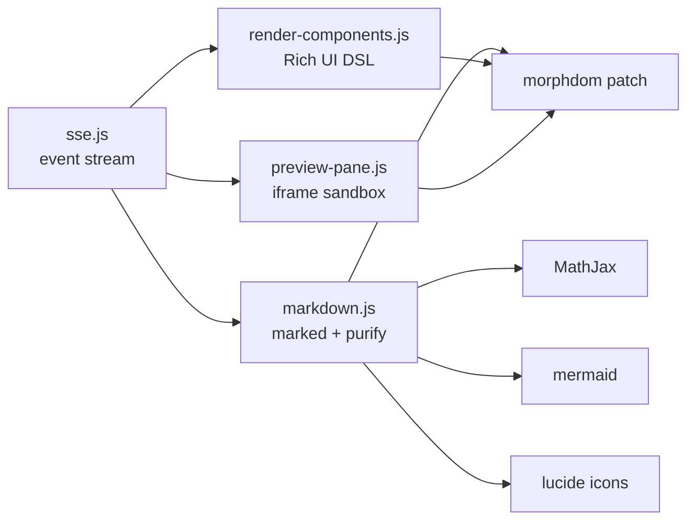

# `web/` — Frontend PWA

> [!INFO] Scope
> **52,114 JS lines + 25,863 CSS lines + a 2,542-line `index.html`.** No framework, no bundler, no build step. Vanilla JS, hand-written CSS, vendored libraries. Read at the module and load-order level; individual DOM handlers are documented by module responsibility.

***

> [!IMPORTANT] There is no build step, and that is deliberate
> `index.html` lists ~60 `<script src>` tags in explicit load order, each with a `?v=N` cache-buster. No webpack, no Vite, no transpile. What the browser runs is what you edit.
>
> The cost: **load order is load-bearing.** A module that references another module global at parse time will throw if it is listed earlier. The order in `index.html` is the dependency graph.

***

## Vendored libraries

`web/vendor/`, loaded before any app code:

| Library | Purpose |
|:--|:--|
| `marked.min.js` | Markdown to HTML |
| `purify.min.js` | DOMPurify — XSS sanitization |
| `morphdom.min.js` | DOM diffing (streaming renders) |
| `lucide.min.js` | Icon set |
| `cytoscape.min.js` + layout plugins | Knowledge graph rendering |
| `xterm.js` + fit/web-links addons | In-browser terminal |
| `monaco/vs/loader.js` | Code editor |
| `mathjax-tex-chtml.js` | Math rendering |
| `mermaid.min.js` | Diagrams |
| `smd.min.js` | Streaming markdown |
| `pdfjs/` | PDF viewer (Study reader) |

> [!NOTE] `morphdom` is why streaming does not flicker
> Each SSE chunk re-renders a message. A naive `innerHTML =` would reset scroll position, kill text selection, and restart CSS transitions on every token. `morphdom` patches only the changed nodes.

***

## `app.js` — a manifest, not code

`web/app.js` is 18 lines: a comment block listing the module load order. It documents the split that happened when the original monolithic `app.js` was broken up.

```
js/core.js              — MathJax config, DOM refs, auth gate, global state
js/tts.js               — TTS stream player, model capabilities
js/markdown.js          — Markdown renderer, mermaid, MathJax, lucide icons
js/chat.js              — Toast, dialog, tabs, panes, streaming, skill cards
js/tracknote.js         — File edit sidebar, Todo & Agent Ops panel
js/sse.js               — SSE processing, message rendering, typewriter
js/sidebar.js           — Chat list, selectChat, project banner
js/statusbar.js         — Status bar, context breakdown, model selector
js/settings-projects.js — Projects settings, folder dropdown, data management
js/settings-init.js     — Service controls, consolidation, main init IIFE
js/settings-ui.js       — Settings overlay, keyboard shortcuts, universal save
js/library.js           — Library panel
js/telegram.js          — Email + Telegram mini client
js/memory-panel.js      — Brain/Memory panel, consolidation settings
js/skills-panel.js      — Skills management, tools, context pass
js/appearance.js        — Accounts, fonts, themes, MCP, mode, browser, context menu
```

> [!WARNING] `app.js` is not loaded by `index.html`
> `index.html` loads each `js/*.js` module directly. `app.js` is dead documentation kept as a map. Do not add code to it expecting it to run.

***

## The 12 largest modules

| File | Lines | Responsibility |
|:--|--:|:--|
| `sse.js` | **3,753** | SSE event processing, message rendering, typewriter |
| `study-reader.js` | 3,190 | PDF reader, highlights, page navigation (**ES module**) |
| `agents.js` | 2,824 | Agent panel, live tree, status |
| `render-components.js` | 2,562 | The Rich UI DSL renderer |
| `study.js` | 2,154 | Study mode shell |
| `appearance.js` | 2,110 | Accounts, fonts, themes, MCP, context menu |
| `filesystem.js` | 2,091 | File tree, editor, uploads |
| `skills-panel.js` | 2,088 | Skills/tools management, context pass |
| `library.js` | 1,735 | Study library grid |
| `knowledge.js` | 1,498 | Knowledge graph (cytoscape) |
| `preview-pane.js` | 1,210 | HTML/PDF/image preview |
| `study-notes.js` | 1,205 | Notes editor |

> [!NOTE] `study-reader.js` is the only ES module
> It is loaded as `<script type="module">`. Everything else is a classic script sharing globals. That is why it can import `pdfjs` cleanly while the rest relies on load order.

### `sse.js` — the heart of the frontend

3,753 lines. Consumes the SSE stream from `POST /api/chat` and turns events into UI:

| Server event | Frontend action |
|:--|:--|
| `answer` | Typewriter append into the message |
| `thinking` | Collapsible reasoning block |
| `tool_pending` | Spinner card with tool name |
| `tool_progress` | Live preview lines in the card |
| `tool_found` / output | Expandable output panel |
| `ui_block` | Delegate to `render-components.js` |
| `html_start` / `html_chunk` / `html_end` | Delegate to `preview-pane.js` |
| `no_slot` | Browser-slot kill card |
| `rate_limited` | Account-exhausted banner with countdown |
| `status` | Status bar message (e.g. `qwen_delay_2.3s`) |

> [!TIP] The typewriter is server-configured
> `TYPEWRITER_CHARS_PER_TICK = 3` and `TYPEWRITER_TICK_MS = 12` live in `server/config.py` and reach the client via `/api/env`. Changing reveal speed does not require touching JS.

***

## CSS — 25,863 lines, hand-written

| File | Lines |
|:--|--:|
| `panels.css` | **5,119** |
| `study-reader.css` | 2,012 |
| `study.css` | 1,955 |
| `components.css` | 1,829 |
| `layout.css` | 1,759 |
| `chat.css` | 1,719 |
| `drive.css` | 1,014 |
| `agents.css` | 950 |
| `knowledge.css` | 949 |
| `cookbook.css` | 851 |
| `dashboard.css` | 760 |
| `ide.css` | 708 |
| `render-components.css` | 684 |
| `variables.css` | 662 |

`panels.css` at 5,119 lines is the outlier — every settings panel, side panel, and overlay shares it. `variables.css` holds the theme tokens (light/dark/custom).

> [!NOTE] `render-components.new.css` and `render-components.new.js` exist alongside the originals
> Both `.new` variants are present but `index.html` loads the non-`.new` versions. They are abandoned rewrites — dead weight in the tree, not live code.

***

## PWA assets

```
web/assets/manifest.json      # PWA manifest
web/assets/sw.js              # service worker
web/assets/icon-512.png       # app icon (referenced by README)
```

The service worker caches the shell so the app opens offline — the SSE stream still requires the server, but the UI does not flash blank.

***

## Render pipeline — three layers



| Layer | Handles |
|:--|:--|
| `markdown.js` | Prose, code fences, tables, MathJax, mermaid, icons |
| `render-components.js` | The `<render_component>` DSL — cards, quizzes, charts, steps |
| `preview-pane.js` | `<render_html>` — sandboxed iframe panes |

> [!IMPORTANT] Every path ends at DOMPurify
> Model output is untrusted. Markdown HTML goes through `purify.min.js` before insertion; `<render_html>` runs in a sandboxed iframe with `allow-scripts` but **no** `allow-same-origin`. A prompt-injected `` cannot reach the host DOM.

***

## Gotchas

> [!WARNING] Five things that will bite you
> 1. **`app.js` is dead documentation.** It is never loaded. Edit `web/js/*.js` directly.
> 2. **Script order in `index.html` is the dependency graph.** Moving a `<script>` tag breaks things at parse time, not at call time.
> 3. **`?v=N` cache-busters are manual.** After editing a JS file, bump its `?v=` or the browser serves the old one.
> 4. **`study-reader.js` is the only ES module** — it has real `import` statements; everything else shares globals.
> 5. **`.new` CSS/JS files are abandoned** — `render-components.new.*` is not loaded by anything.

> [!TIP] Debugging a missing UI update
> Check, in order: (1) is the event arriving — Network tab, SSE frames; (2) does `sse.js` have a case for it; (3) did the `?v=` bump; (4) is the render path going through `markdown.js` vs `render-components.js` (different sanitizers).
