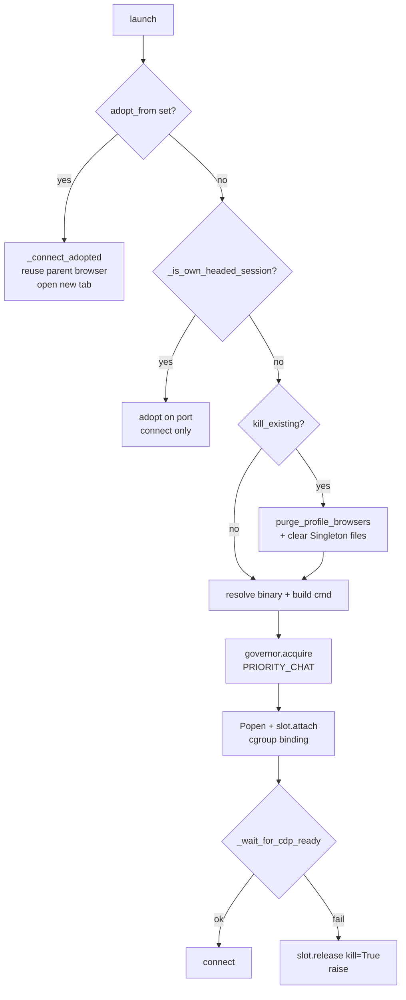

# 27 — `connectors/common/browser_scraper.py`

> [!INFO] Why this file exists
> Priority 1 on the README's coverage list. **1,517 lines**, shared by every scraper connector — DeepSeek, Claude, Qwen, Kimi, Gemini-web all ride this engine. [[06-engine-browser-scraper]] covers `engine/scraper/core.py`, a *different* engine with a confusingly similar name; this one was never opened.
>
> Read end to end. The three subclasses (`deepseek_scraper`, `claude_scraper`, `qwen_scraper`) were checked only for contract compliance — they are not documented here, only the base contract they depend on.

***

## 1. What it is

One **headed** Chrome per account, driven over CDP with Playwright. Everything provider-specific — selectors, the SSE endpoint to tap, the delta parser — arrives through a `ScraperSpec` plus two overridable hooks, so the same browser plumbing serves any chat SPA.

```
ScraperSpec  ──►  BaseBrowserEngine  ──►  BaseScraperConnector  ──►  connector
   (data)        (browser + SSE + DOM)      (retries, rotation)
```

The engine emits exactly three event types, and that is the whole contract with the connector layer:

```python
{"type": "thinking", "text": "..."}
{"type": "answer",   "text": "..."}
{"type": "error",    "message": "..."}
```

> [!IMPORTANT] Four browser engines in this tree
> - `engine/scraper/core.py` — the original, documented in [[06-engine-browser-scraper]]
> - `connectors/common/browser_scraper.py` — **this one**, the one connectors use
> - `engine/scraper_engines/deepseek/` + `qwen/` — a second generation, documented in [[28-engine-scraper-engines]]
> - `connectors/*_scraper/client.py` — thin subclasses of this file
>
> The same concepts (fetch patch, `__ghost_mutations`, SSE reset) exist in all three lineages with three slightly different implementations.

***

## 2. `ScraperSpec` — the provider contract

| Field | Purpose |
|:--|:--|
| `provider` | log prefix + instruction-builder key |
| `url` | the SPA to load |
| `selectors` | `input`, `send_btn`, `stop`, `content`, `thoughts`, `response`, `attach_btn` |
| `keys` | send key, default `Enter` |
| `sse_target` | URL substring; the patches only tee requests whose URL contains it |
| `stealth_mode` | chooses the mutation-signal mechanism — see §12 |
| `instruction_provider` | override the key used for `build_instructions` |
| `old_mark_selector` | extra selector marked stale before Send |
| `error_text_markers` | soft-rate-limit banner substrings |

### 2.1 `old_mark_selector` must be provider-specific

The field docstring records that the generic default used to be a hardcoded DeepSeek selector list, which matched **nothing** on claude.ai or qwen. Every previous turn then stayed unmarked, the capture query `:not([data-ghost-old='true'])` matched stale panels, and `.last` returned the **previous answer**.

That is the worst shape a bug can take here — no exception, no empty response, just a confident wrong answer exactly one turn behind.

### 2.2 `error_text_markers` exists because DeepSeek does not use a toast

> *"DeepSeek does NOT use a toast or modal for 'Messages too frequent. Try again later.' — it appends a bare `<span>` as a SIBLING of the assistant `.ds-message` bubble."*

The chain when undetected:

<flow>
  <flow-item title="Assistant bubble is empty" text="The banner is a sibling, not a child — the content element carries nothing."/>
  <flow-item title="No SSE frame emitted" text="Nothing to parse, so net_content stays empty."/>
  <flow-item title="Turn classified as empty" text="The connector retries and rotates accounts."/>
  <flow-item title="User-visible symptom" text="\"Sable repeats the same reply forever\" — a rate limit masquerading as an empty completion."/>
</flow>

***

## 3. Process hygiene — the profile is single-tenant

Chromium allows **one** process per `--user-data-dir` (`SingletonLock`). Three helpers exist because that constraint is enforced by the OS, not by politeness.

### 3.1 `_pid_is_running` — `os.kill(pid, 0)` is not a liveness test

```python
state = data[rparen + 2:rparen + 3]   # from /proc/<pid>/stat
return state not in ("Z", "X", "x")
```

> *"`os.kill(pid, 0)` returns success for zombies, so it is NOT a liveness test."*

This matters two paragraphs later: a zombie still answers `getpgid()`, and `killpg()` on it can take out **live siblings**. Hence the liveness check before every kill.

### 3.2 `_pids_using_profile`

Walks `/proc/[0-9]*/cmdline`, splits on NUL, matches the argument against both `realpath` and `abspath` of the profile dir. Linux-only, returns `∅` elsewhere. Both path forms are tried because a browser may have been launched through either.

### 3.3 `_singleton_pid`

Reads the `SingletonLock` symlink (`<hostname>-<pid>`), parses the pid, returns `None` if that pid is a zombie or gone — *"a stale symlink must never be allowed to seed a kill."*

### 3.4 `purge_profile_browsers`

Union of §3.2 and §3.3, minus self and `exclude_pid`, liveness-filtered, killed via `kill_process_tree`, then the three `Singleton*` files unlinked. Returns the victim list so the caller can log it.

***

## 4. `launch()` — four paths



### 4.1 Adoption compares launch *mode*, not just identity

```python
remote_headless = "--headless" in (data.get("BrowserCommandLine", "") or "")
return remote_headless != bool(self.viewer)
```

> *"A headed engine must not adopt a leftover headless browser (no window to drive), and a headless engine must not adopt a leftover headed one. Without the second half, headless mode killed and relaunched the browser on every single turn."*

Profile identity is compared too (`realpath(remote) != realpath(self.user_data_dir)`), so a browser on the right port with the wrong profile is rejected.

### 4.2 Headless spoofs a headed UA

```python
if not self.viewer:
    cmd += ["--headless=new", "--window-size=1920,1080"]
    _ua, _ = get_account_ua_fingerprint(self.profile_name)
    cmd.append(f"--user-agent={_ua}")
```

Headless Chromium advertises `HeadlessChrome/<ver>` and bot-aware CDNs (DeepSeek/CloudFront) 403 the request before the SPA loads. The UA comes from the profile, so it is stable per account.

### 4.3 The governor slot is acquired *before* the spawn

```python
slot = await browser_governor.acquire(..., priority=PRIORITY_CHAT)
try:
    self.chrome_process = subprocess.Popen(...)
except BaseException:
    slot.release(); raise
slot.attach(self.chrome_process.pid, user_data_dir=self.user_data_dir)
```

Reserving first stops a fleet of processes each deciding there is room for one more. `PRIORITY_CHAT` means a live chat is never evicted to make room for a token-refresh browser ([[15-deep-dive-corrections]] §1). Failure after spawn releases with `kill=True`, so a browser that never came up cannot hold a slot — every `acquire` has exactly one matching release on every path.

> [!WARNING] `--no-sandbox` is unconditional
> The launch command always includes `--no-sandbox` and `--disable-blink-features=AutomationControlled`, on every platform, with no opt-out and no `--disable-dev-shm-usage`. Mirrors `scraper/core.py`, so not a regression — but recorded because it is a headed browser with the sandbox off by default.

***

## 5. Adoption — sub-engines share one browser

`_connect_adopted` attaches to the parent's Playwright driver, browser and **context**, then opens a **new tab**:

```python
self.page = await self.context.new_page()
```

Sharing the context is the point — same cookies, same login, same profile — without fighting over the parent's page or spawning a second browser on a lock-exclusive `user-data-dir`. Used for critique/agent sub-chats. The parent is polled up to 20× 0.5s for `browser`/`context` to appear.

> [!IMPORTANT] `cleanup()` is asymmetric on purpose
> An adopted engine closes **only its own tab** and nulls its handles — it does not close the browser, stop Playwright, kill the process, or release a slot, because it owns none of those. Closing the shared browser would tear down the parent chat mid-stream. The `_slot` release is correctly a no-op for adopted engines (`self._slot is None`).

***

## 6. The SSE interceptor — two patches, because SPAs disagree

`_FETCH_PATCH_JS` installs **both** a `window.fetch` wrapper and an `XMLHttpRequest` wrapper, returning `'patched'` / `'already_active'`.

| Patch | Why |
|:--|:--|
| `fetch` | streaming `ReadableStream` — `response.clone()`, `getReader()`, `TextDecoder` with `{stream:true}` |
| `XHR` | DeepSeek streams over XHR; hooks `readystatechange` at `readyState 3` **and** `4`, emitting the delta since the last offset |

The XHR patch keeps a per-request byte offset (`xhr.__ghost_idx`) and slices `responseText`, because XHR hands you the whole accumulated body on each event rather than incremental chunks. It bails when `responseType` is anything but `''`/`text`, since `responseText` throws otherwise.

The JS is installed twice — `add_init_script` (survives navigation) and an immediate `page.evaluate` (covers the already-loaded page). `send_msg` calls `_ensure_fetch_patched()` again before every send, because an SPA that soft-navigates can replace `window.fetch`.

Idempotency is guarded in **JS**, not Python: `__ghost_fetch_patched` / `__ghost_xhr_patched` flags plus a `toString().includes('originalFetch')` check, so a second patch over an already-patched fetch is skipped rather than stacked.

***

## 7. `_reset_sse_capture` — rebind, never clear

```python
def _reset_sse_capture(self) -> None:
    self._sse_chunks = []      # REBIND, not .clear()
    self._sse_done.clear()
    self._sse_wake.clear()
    self._sse_active_req_id = None
    self._stream_finished = False
```

> *"A capture task from a previous (stopped) turn may still hold a reference to the old list. Rebinding freezes that old list, so the orphan can only ever see its own turn's chunks and can never steal the NEXT turn's deltas."*

`.clear()` would have made an orphaned Python task write into the *new* turn's list. `get_response` mirrors this from the other side by pinning `chunk_list = self._sse_chunks` at entry.

> [!CAUTION] …but the rebind does not cover the JS bridge
> `_on_sse_chunk` is invoked *from JavaScript* via `expose_function`. It reads `self._sse_chunks` **at call time**, so a late XHR callback from the previous turn lands in whichever list is current. The rebind protects against a stale *Python* task; it cannot protect against a stale *browser* callback.
>
> `_on_sse_chunk` records `self._sse_active_req_id = req_id`, but **nothing ever filters on it** — the drain loop calls `parse_sse_delta(chunk_list[idx])` with no req-id check. A stopped turn whose XHR was still in flight can inject its tail into the next turn's answer.

***

## 8. `send_msg` — ordering is the function

Three separate fixes are encoded in the sequence:

1. `ensure_warmup()` before anything touches the composer (§8.1)
2. instruction injection exactly once, gated by `system_injected` (§8.2)
3. mark existing turns stale, **then** send (§8.3)

### 8.1 Warmup must precede attachment loading

> *"A bare 'hello' sent while a file sits in the composer carries that file out with it, so the real turn arrives with no attachment."*

`ensure_warmup()` is idempotent, no-ops when `system_injected`, and sets `_hello_warmed = True` **before** dispatching — so a provider whose warmup throws internally cannot loop forever.

### 8.2 Instruction injection

```python
override = getattr(self, "_override_instructions", None)
if override:
    return override          # caller's directive wins, injected once
...
build_instructions(provider=self.spec.instruction_provider or self.spec.provider, ...)
```

A study/agent stream supplies its own full directive; it must replace the builder output rather than stack on top of it. `_TOOL_REMINDER` is a constant that is **empty** — every line inside it is commented out.

### 8.3 Stale marking unions four selectors

```python
for _key in ("response", "content", "thoughts"):
    ...
if self.spec.old_mark_selector:
    _mark_parts.append(self.spec.old_mark_selector)
```

Reasoning panels are included deliberately: capture reads them through `:not([data-ghost-old='true'])`, so an unmarked panel from a previous turn matches the filter, `.last` returns the stale text, and it is emitted as **this** turn's thinking.

### 8.4 Send falls back to Enter

`_wait_for_send_enabled()` asks the DOM for the real enabled state — `disabled`, `aria-disabled`, computed `pointer-events` — rather than substring-matching `class`. The comment explains why: Claude's composer permanently carries Tailwind tokens like `disabled:opacity-40`, so a class test never passes and the old loop burned its full 10s on every send. If the button still is not actionable, `keyboard.press("Enter")` is used, which is the composer's own submit path.

`_paste_large_message` sets the value through the native prototype setter, dispatches `input` + `change`, then types a space and a backspace to trigger framework reactivity, and verifies `len(val) >= len(message) * 0.8`. The 0.8 is a heuristic — it tolerates a framework trimming whitespace, and it is the reason a genuinely failed paste still falls through to `field.fill()`.

***

## 9. `get_response` — the capture state machine

> [!NOTE] It deliberately does not reset
> `send_msg` already reset immediately before clicking Send, and the gap between that click and this call is non-zero (the connector invokes this via `asyncio.create_task`). Resetting here would wipe chunks that arrived in the gap (lost beginning) and reset fragment-type state mid-stream, routing THINK deltas as answer text — *"the 'thinking mixed into the real message' symptom, most visible on the first turn where the gap is largest."*

### 9.1 Phase 1 — wait for generation to start

Breaks on any of: stop button visible, a non-stale `content` element exists, a non-stale `thoughts` element exists, `chunk_list` non-empty, soft error detected. 60s deadline → `return ""`.

The thoughts check exists because reasoning often renders before any answer text. The soft-error check exists because a rate-limit banner can appear **instead of** any generation — without it the loop burns the full 60s and returns `""`, indistinguishable from a genuine empty completion.

### 9.2 Phase 2 — stream loop

Completion is driven by the **network** first, with the stop button as a secondary signal:

| Signal | Meaning |
|:--|:--|
| `_stream_finished` | subclass parser saw an explicit terminal marker (Qwen `{"status":"finished"}`) |
| `_sse_done` set **and** all chunks drained | JS `DONE` callback fired and we caught up |
| stop button was visible, now is not | model finished rendering |
| 30s idle | nothing new |
| 300s hard deadline | absolute cap |

The stop-button logic is careful: it only breaks on disappearance if it was **previously seen visible**. Gating completion purely on that selector silently skipped all live streaming whenever it did not match, and the answer then only appeared at the end via the DOM fallback — *"exactly the 'sluggish and broken' symptom."*

`_drain()` runs at the top of every iteration. Reasoning is passed to `thoughts_callback` **raw**, never through `_clean_thoughts_text`: that helper rebuilds the line list and re-joins with blank lines, so its return value is not a prefix-extension of the previous tick — and the connector derives a suffix delta by common-prefix diff. A non-monotonic value makes that diff return `""`, and chunks of thinking silently vanish.

DOM fallbacks are gated on `not streamed_reasoning` / `not net_content`, so the two sources never interleave. `_wait_for_sse_activity(0.3)` replaces a blind sleep, so a delta renders the moment the CDP binding fires.

### 9.3 Post-loop settle

Three separate catch-up windows, in order:

1. `wait_for(_sse_done, 2.0)` — the final `readyState=4` delta may still be crossing the JS→Python bridge
2. `sleep(0.4)` — let late callbacks land
3. drain loop for 1.5s — late chunks may still arrive

Then, if **nothing at all** landed, a further 6s window: *"This is the difference between a spurious CAPTURE_EMPTY error and a real answer, on fast models where the whole turn fits between two polls."*

Finally the `_sse_line_buf` flush (§11.1), the DOM fallback, and `_clean_garbage`.

### 9.4 Empty capture → is it "said nothing" or "refused"?

```python
if not cleaned:
    soft = await self.detect_soft_error()
    if soft:
        raise SoftRateLimitError(soft, provider=...)
```

Raising is what stops the 3× empty-retry loop from hammering a locked endpoint on every account. `SoftRateLimitError` is the one exception this engine raises out of `get_response`.

### 9.5 Baseline bookkeeping

`_last_response_text` is updated every turn. `_last_thinking` is updated only when there was reasoning, and `_last_reasoning_seen` folds in `dom_thinking`:

> *"dom_thinking matters on a RE-CAPTURE: the SSE buffer was reset and the network produced nothing, yet this turn's reasoning panel is still in the DOM. Without folding it in, the flag flips back to False on the retry and the connector tears down the very browser it just decided to keep."*

The comment records that `_last_thinking` was once initialised and never updated, so a turn with no fresh reasoning fell through to `last_thinking == ""`, matched the previous turn's panel, and re-emitted it.

***

## 10. DOM readers

Both read through `:not([data-ghost-old='true'])` and take `.last`.

| Reader | Mechanism | Why |
|:--|:--|:--|
| `_read_thoughts_dom` | `cloneNode` → strip buttons → `<br>`→`\n` → `textContent` | `textContent`, not `innerText`, so a collapsed or height-clamped panel still yields the full chain of thought |
| `_read_response_dom` | `cloneNode` → strip `.ds-think-content` + buttons → `innerText` | The reasoning panel is nested **inside** the assistant block, so a naive `inner_text()` returns thinking glued to the answer |

`detect_soft_error` walks only the siblings **after** the last assistant bubble and caps at 300 chars, so an old banner cannot poison a healthy turn.

***

## 11. Text cleaning

| Helper | Does |
|:--|:--|
| `_strip_ui` | removes a leading `text\n` and a `markdown\nCopy\nDownload\n` prefix — cheap, used during streaming |
| `_clean_garbage` | strips leading/trailing UI words, a trailing `12.3s`, then **dedupes an exact doubled body** if `text[:half] == text[half:]` |
| `_clean_thoughts_text` | drops exact-match UI lines, strips `🧠 Model Thoughts` repeats, collapses 3+ newlines |

The halving dedupe in `_clean_garbage` is a heuristic for an SPA that rendered the same message twice. It only fires above 20 chars and only on an **exact** half match, so a legitimately repetitive answer is safe.

### 11.1 The `_sse_line_buf` contract the base class does not declare

```python
if self._sse_line_buf:                        # browser_scraper.py:1192
    content_delta, reasoning_delta = self.parse_sse_delta("\n")
```

**`BaseBrowserEngine.__init__` never sets `_sse_line_buf`.** It is defined in `QwenScraperEngine`, `ClaudeScraperEngine` and `DeepSeekScraperEngine` — every current subclass — so the flush works today. The base class reads an attribute it does not own and does not document.

> [!WARNING] Latent `AttributeError` for the next provider
> Any new subclass that overrides `parse_sse_delta` to buffer a partial line but forgets `self._sse_line_buf = ""` in `__init__` will raise `AttributeError` inside `get_response` — after the turn has already been sent and streamed. A `getattr(self, "_sse_line_buf", "")` would make the contract optional.

***

## 12. `stealth_mode` — a switch that controls nothing here

```python
if self.spec.stealth_mode:
    asyncio.create_task(self._poll_mutations())
else:
    await self.page.expose_function("on_dom_mutation", lambda: self.mutation_event.set())
```

Both branches wire up `mutation_event`. **Nothing in this file ever awaits it.** `_poll_mutations` reads `window.__ghost_mutations`, and no script installed by this file ever writes to that array.

It is dead wiring: an `asyncio.Event` allocated, set from two directions, polled forever at 0.5s in stealth mode, and never read. `deepseek_engine.py:1434` does define `__ghost_mutations`; this file's copy of `_poll_mutations` was inherited without the matching injection.

Also, `asyncio.create_task` here violates the README's own convention #5 — a bare `create_task` with no module-level `set` and no `add_done_callback(discard)`.

***

## 13. Portability leaks — DeepSeek in a generic engine

The file is provider-agnostic everywhere **except** the two DOM probes, which hardcode DeepSeek class names:

| Location | Hardcoded |
|:--|:--|
| `detect_soft_error` | `document.querySelectorAll('.ds-message')` |
| `_read_response_dom` | `.ds-think-content`, `[class*="ds-think"]`, `[class*="think-content"]` |
| `new_chat` | `[aria-label="New chat"]` |

The first is the important one. `error_text_markers` is spec-provided **data**, but the container it searches is DeepSeek's class. So `detect_soft_error` can only ever work for DeepSeek — for Claude, Qwen or Kimi it returns `""` unconditionally, and a soft rate limit degrades back into the 3× empty-retry loop §2.2 was written to fix.

`_read_response_dom`'s think-stripping has the same shape but a smaller blast radius: it only runs when the network produced nothing, and a non-DeepSeek provider simply gets its reasoning panel left in the text.

***

## 14. Findings

| # | Finding | Severity | Status |
|--:|:--|:--|:--|
| 32 | `get_response` reads `self._sse_line_buf`; `BaseBrowserEngine.__init__` never defines it. Works only because all three subclasses happen to set it. | 🟡 latent | **not fixed** |
| 33 | `_sse_active_req_id` is recorded on every chunk and **never used to filter the drain**. A stopped turn's in-flight XHR can append its tail to the next turn's answer. | 🟡 narrow | **not fixed** |
| 34 | `mutation_event` is allocated, set from two paths, polled at 0.5s — and never awaited. `__ghost_mutations` is read but never written by this file. | 🔵 dead | **not fixed** |
| 35 | `detect_soft_error` searches a hardcoded `.ds-message`; `_read_response_dom` strips hardcoded `.ds-think-*`. Spec supplies markers, not the container → soft-error detection is DeepSeek-only. | 🟠 medium | **not fixed** |
| 36 | `get_response(initial_count=...)` is never read. `get_response_count()` exists but is vestigial — capture uses stale-marking + `.last`, not counters. | 🔵 dead | **not fixed** |
| 37 | `_TOOL_REMINDER` is an empty string; every line inside it is commented out. | 🔵 dead | **not fixed** |
| 38 | Launch always passes `--no-sandbox`, on every platform, no opt-out. | 🟡 security | **not fixed** |

None of these are 🔴. The engine's core — SSE rebinding, stop-button-as-secondary, the settle windows, soft-error-vs-empty — is the most carefully reasoned code read in this documentation so far, and each of those behaviours carries a comment explaining the specific symptom it was written to kill.

***

## 15. What this changes upstream

- `documentation/README.md`: coverage tables, ledger #32–#38, priority list.
- [[28-engine-scraper-engines]]: documents the sibling engines; correction is that they diverged *before* this file's last round of fixes.

**Next on the list:** `web/js/markdown.js` (809) and `engine/skills/handlers/` (5,401).
