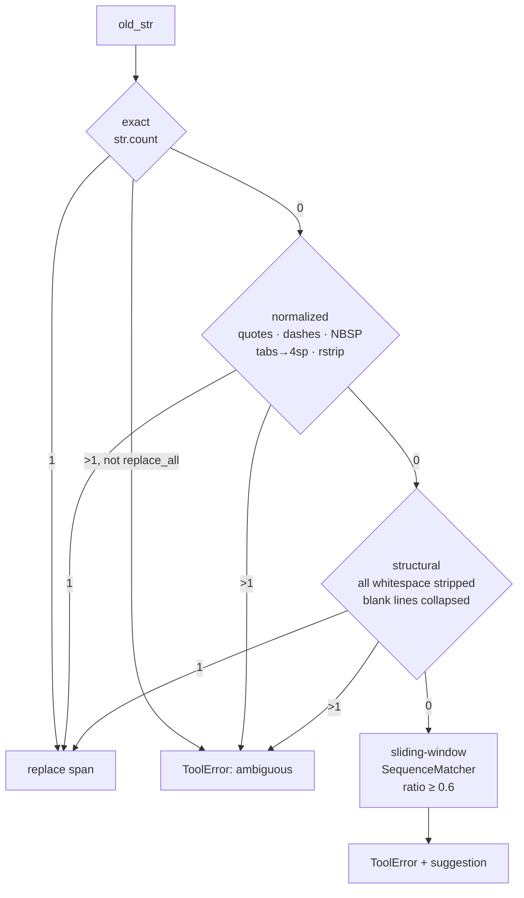
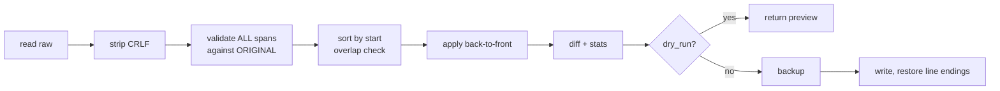

# 34 — Code Editor Toolkit

> The CLI every `edit_file` / `view_file` / `create_file` / `insert_file` tag in Sable ends up calling — plus the 343-line handler that wraps it, parses its output, and turns the diff into an SSE event.

Two files, two jobs:

| Layer | File | Lines | Job |
|:--|:--|--:|:--|
| Tool | `tools/code_editor/scripts/editor_tools.py` | 1,017 | Read, create, edit, insert. All disk mutation in the agent loop goes through here |
| Handler | `engine/skills/handlers/file_ops.py` | 343 | Unwrap tag attrs, call the tool, parse the diff into a `file_edit` event |

Shared plumbing lives in `engine/skills/handlers/common.py` — `make_backup()`, `build_file_edit_event()`, `RESULT_PREVIEW_CHARS`. Those three are where most of this doc's findings land.

***

## The contract

The module docstring states six design principles. Five are true as written. One is not.

| # | Principle | Holds? |
|--:|:--|:--|
| 1 | Files are never modified except through `create_file` / `edit_file` / `insert_file` | ✅ |
| 2 | `view_file()` adds line numbers ONLY in the returned string | ❌ **false** — it returns raw text |
| 3 | Each `old_str` must match exactly one location unless `replace_all` | ✅ |
| 4 | Matching is layered: exact → normalized → structural, never fuzzy | ✅ |
| 5 | Every successful mutation writes a timestamped backup first | ✅ — **twice**, see §6 |
| 6 | Raw code never survives a hand-typed JSON escaping pass | ✅ — see §5 |

> [!WARNING] Principle #2 is stale — and the code is right
> `view_file` returns `"\n".join(selected)`. No numbers, anywhere. That is *correct* for the contract it serves: the edit-failure message tells the model to *"copy old_str exactly from the output — do not retype it from memory."* If the output carried `  42| ` prefixes, every copy would poison `old_str` and every edit would fail.
>
> But three sites still assume numbers exist: the docstring itself, the variable named `numbered` in `_find_nearest_match` (it joins lines, it does not number them), and the `"at lines X–Y"` header built from a span that does not correspond to the match. The author wrote a numbering feature, removed it, and left the scaffolding.

***

## 1. `view_file`

```python
text = _read_raw(path).replace("\r\n", "\n")
lines = text.split("\n")
if lines and lines[-1] == "":
    lines = lines[:-1]
```

Strips the phantom trailing empty line so line counts match what an editor shows. Then two modes:

### Default (no `start`/`end`, `full=False`)

If the joined output exceeds `MAX_VIEW_CHARS` (**16,000**), returns the first 60 lines, an omission marker, and the last 60 lines. The marker states the real total and tells the model to re-call with a range.

### Explicit range or `full=True`

**No cap at all.** `view_file(path, full=True)` on a 5 MB file returns 5 MB. The handler then silently slices to `RESULT_PREVIEW_CHARS` (75,000) — with no `[truncated]` marker. See finding #90.

`start` beyond EOF raises; `end` beyond EOF is clamped. Asymmetric, but the error message only fires for `start`, which is the case a model actually hits.

### Directory passthrough

```python
if os.path.isdir(path):
    return list_dir(path)
```

`list_dir` walks 2 levels, skipping `node_modules`, `__pycache__`, `venv`, `.git` and any dotfile. Permission errors become an inline `[permission denied]` line rather than raising.

***

## 2. `create_file`

Refuses to overwrite unless `overwrite=True`. Creates parents. Then:

```python
if content.startswith("#!"):
    st = os.stat(path)
    os.chmod(path, st.st_mode | stat.S_IXUSR | stat.S_IXGRP | stat.S_IXOTH)
```

Shebang → executable for all three classes. Reasonable, and the only place in the file that touches the mode bits.

The handler layers a `dry_run` on top that never calls the tool — it just reports `would create` / `would overwrite` / `BLOCKED: file exists and overwrite=false`. That means a dry-run create does **not** validate writability or that the parent path is creatable. Cosmetic, but the dry-run is a weaker promise than `edit_file`'s, which does full validation.

***

## 3. `edit_file` — the matcher

This is the file's reason to exist. `old_str` → a unique span, or a hard error.



Edit-distance is **never** used to make the replacement — only to write the error message. That is the correct call, and worth stating plainly: a fuzzy matcher that silently replaces the wrong block is worse than a failure the model can retry.

### The offset arithmetic that looks wrong and isn't

Layer 2 and 3 match on **normalized lines** but must replace the **original** characters. The conversion:

```python
start_idx = len("\n".join(content_lines[:i])) + (1 if i > 0 else 0)
end_idx   = start_idx + len("\n".join(content_lines[i:i + n]))
```

Joining `lines[0:i]` yields `sum(len) + (i-1)` characters. The `+1` accounts for the newline *after* line `i-1`. Net offset = `sum + i` — the exact character index of line `i`. The `if i > 0` guard stops line 0 from getting a phantom leading newline.

It reads like an off-by-one and is correct. Worth preserving in the doc so nobody "fixes" it.

### Atomicity

Every edit in a batch is validated against the **original** content first. Only after all spans are collected does the write happen, applied **back to front** so earlier offsets stay valid.



Consequence: a two-edit batch can be authored as if the file were unedited. That is the right contract for an LLM, which cannot reliably reason about offsets shifting under it.

Overlap detection runs `all_spans[j][0] < all_spans[j-1][1]` on the **sorted** list. Checking only adjacent pairs is sufficient — any overlap implies at least one adjacent pair overlaps after sorting by start. Correct, and non-obvious enough to note.

### `replace_all`

Skips uniqueness, collects every span via `_find_all_spans`, reports the count. Used for renames and import-path changes.

Two limits:

- It is a **whole-batch** flag. One call cannot mix "edit this once" with "rename every occurrence".
- `_find_all_spans` **returns at the first layer that finds anything** (finding #88). A file with one exact match and one quote-normalized match gets only the exact one replaced — silently, with the header reporting `1 replacement`.

### `dry_run`

Validates all spans, computes the real diff, returns it, writes nothing, takes no backup. This is the strongest dry-run in the codebase — it exercises the actual matcher rather than approximating it.

***

## 4. `insert_file`

Exactly one of `at_line` / `after_str`. The `after_str` path reuses `_find_unique_span`, so an ambiguous anchor fails the same way an ambiguous edit does.

```python
insert_pos = text[:end].count("\n")
if not text[:end].endswith("\n"):
    insert_pos += 1
```

If the anchor ended on a newline, the count *is* the line to insert after. If it ended mid-line, the `+1` moves past the partial line. Both cases land correctly.

`at_line == total + 1` appends. Trailing-newline presence is preserved across the insert.

***

## 5. The SEARCH/REPLACE parser

The block format the model writes:

```
<<<<<<< SEARCH
old code
=======
new code
>>>>>>> REPLACE
```

The interesting part is the **damage repair**, because the tool-argument transport mangles these markers.

### Why the repair exists

A run of `n` less-than characters in tool arguments arrives expanded to `2n-1`. Seven becomes thirteen, and a thirteen-`<` line no longer parses as `<<<<<<< SEARCH`.

```python
def _repair_marker_run(run_len: int) -> int:
    if run_len > 7 and run_len % 2 == 1:
        return (run_len + 1) // 2
    return run_len
```

Inverts the transform. `_repair_doubled_lt_runs` applies it **only** to lines whose first non-space character is `<` and whose remainder is empty or `SEARCH` — so ordinary code containing `<` runs (templates, bitshift chains) is never rewritten.

That scoping is the whole trick. A naive global repair would corrupt C++ and HTML; this one cannot.

### Escaped-newline repair

```python
if marker in text and text.count(_LF) <= 1 and (_NL_ESC in text or _CRLF_ESC in text):
    text = text.replace(_CRLF_ESC, _LF).replace(_NL_ESC, _LF).replace(_TAB_ESC, _TAB)
```

If the whole block arrived as one physical line with `\n` escapes, un-escape everything. This is the "raw code never survives a JSON escaping pass" principle in practice — but see finding #93: it cannot tell a transport escape from a source escape.

### Unterminated blocks

If parsing ends mid-block, it raises with the missing marker named in `repr()`. If no block is found at all, the error includes the first six lines actually received — which is the single most useful thing an error message can do here.

***

## 6. Backups — twice

Two independent backup systems run on every edit:

| System | Location | Retention | Who writes it |
|:--|:--|:--|:--|
| `_backup()` | `<file's dir>/.editor_tools_backups/` | 20 newest per file | `editor_tools.py` |
| `make_backup()` | `<repo>/.sable_backups/` | unbounded | `handlers/common.py` |

The handler calls `make_backup()` **and** passes `backup=True` to the tool, so both fire. That is ledger #49 for `edit_file` — and finding #91 extends it to `insert_file`, which has the same shape and was not previously noted.

> [!CAUTION] The in-tree backup dir has already leaked into other tools
> `.editor_tools_backups/` appears in `documentation/`, `tools/`, `tools/code_editor/scripts/`, `tools/grep_search/scripts/`, and `engine/skills/handlers/`. `grep_search.py` had to add it to **two** separate ignore lists (`:159`, `:352`). When one component's storage strategy forces another component to special-case its directory name, the storage strategy is in the wrong place.

The pruning loop keeps the 20 newest by mtime and silently swallows `OSError` on delete — a backup that cannot be pruned is forgotten, not retried.

***

## 7. What the model sees back

Every mutation returns a header, a unified diff, and a stats block:

```
Edited '/path/file.py' (2 changes)
@@ -12,7 +12,8 @@
 context
-old
+new
── stats ──
lines_before: 40
lines_after: 41
added: 2
removed: 1
net: +1
affected_range: L12–L15
```

The diff is capped at `MAX_DIFF_LINES` (400) for display but the **full** body is used to compute stats, so `added`/`removed` are always accurate even when the visible diff is truncated. That split — full data for math, capped data for display — is the right pattern and should be copied.

`affected_range` is the one weak number — it computes `first_hunk + added + removed`, which overstates the range in the new file. See §9, `_compute_stats`.

***

## 8. The handler layer

`file_ops.py` is thin, and mostly right:

- `view_file` — path from `attrs["path"]` or, if absent, from the tag body. `expandvars` + `expanduser` on every path.
- `edit_file` — refuses an empty body before touching disk; `replace_all` and `dry_run` read with the same `in ("true", "1", "yes")` idiom used across all 18 handlers.
- `create_file` — `dry_run` short-circuits entirely, reporting `would create` / `BLOCKED` without calling the tool.
- `insert_file` — accepts both `at_line` and `at-line` spellings, and **rejects the both-given case explicitly** rather than silently preferring one. That is better than most of the handler set.

Then `build_file_edit_event()` parses the text output back into a structured `file_edit` SSE payload for the diff sidebar — recounting `added`/`removed` from the diff lines rather than parsing the stats block. For `create`, it re-reads the file from disk (capped at 64 KB) and emits every line as an `add`. Each diff line is truncated to 500 chars for transport.

One asymmetry worth knowing: the handler caps `view_file` output at 75,000 chars with no marker, but `edit_file` output is naturally bounded by `MAX_DIFF_LINES`. Only the view path can silently lose text.

***

## 9. Findings

**No 🔴.** 1,017 lines of the most safety-critical code in the agent loop — every write goes through it — and the strongest issue is a partial replacement under `replace_all`. That is not luck: the file's comments name the exact failure each guard prevents, which means the guards were added *after* the failures were observed.

### 🟡 Correctness

**#86 — Design principle #2 is false.** The docstring promises line numbers that `view_file` does not emit. Three sites still assume they exist: the docstring, the `numbered` variable in `_find_nearest_match`, and the `lines X–Y` header. Harmless today because the code is right and the docs are stale — but a maintainer reading the docstring will "fix" the code and break every edit.

**#87 — Nearest-match suggestion reports the wrong span.** `ws` is reassigned after the window loop to `min(n + NEAREST_MATCH_WINDOW_SLACK, …)`, so the snippet and the `lines X–Y` header describe a forced window, not the window that produced `best_ratio`. The suggestion can be four lines longer than the actual nearest match — and it is the thing the model is told to copy from.

**#88 — `_find_all_spans` under-replaces across matching layers.** Returns at the first layer that finds anything. Exact finds one, normalized would find another → only the exact one is replaced, and `total_replacements` reports `1`. Silent, and worst in `replace_all` renames where the caller is explicitly asking for every occurrence.

**#89 — `handle_view_file` parses `int()` outside its `try`.** `attrs["start"]="1-5"` raises `ValueError` out of the generator body before any `_end_event` is yielded. Same shape as ledger #52. Whether the turn recovers depends on middleware behaviour I did not verify.

**#90 — `view_file(full=True)` is uncapped, handler truncation is silent.** `MAX_VIEW_CHARS` guards only the default head/tail path. A full read of a large file is sliced to 75,000 chars with no marker — and the error message tells the model to copy spans exactly from that output.

**#91 — Double backup on `insert_file`.** Handler `make_backup()` plus `_insert_file(backup=True)` default. Extension of #49, which covered `edit_file` only.

**#92 — Backups taken before validation.** `make_backup()` runs before `_parse_search_replace_blocks` and before `_insert_file` validates `at_line`. A parse failure or an out-of-range line leaves an orphan backup of an unchanged file.

**#93 — Escaped-newline repair is all-or-nothing.** A single-line block containing `\n` escapes has **every** `\n` and `\t` un-escaped — including literal ones in the source. Writing Python `print("a\nb")` through this path produces a real newline.

### 🔵 Dead / cosmetic

| Where | What |
|:--|:--|
| `_structural_span_count` | Fallback `span_count = len(old_lines)` when reconciliation is incomplete — guesses where an exception belongs. Unreachable given `_structural_lines_match`'s precondition, but it is a silent wrong-span path if that ever changes |
| `_compute_stats` | `affected_range` uses `first_hunk + added + removed`, overstating the new-file range; also emits an en-dash in machine-readable output |
| `common.parse_editor_command` | Value-flag set `{--content-file, --json-file, --start, --end}` omits `--after-file`, so shell invocations of the CLI's insert path mis-parse the token after it as the file path |
| `_count_occurrences` | `str.count` is non-overlapping: `old_str="aa"` in `"aaa"` is judged unique, `content.index` replaces the first, the second survives |
| `_backup` prune | Swallows `OSError` — an undeletable backup is forgotten rather than surfaced |
| `build_file_edit_event` | Recounts `added`/`removed` from diff lines while the stats block already has them; two sources of truth for one number |

***

## 10. What's right, and worth copying

1. **Three matching layers, zero fuzz in the replacement path.** Tolerance for whitespace and smart quotes; no tolerance for guessing.
2. **Validate everything against the original, apply back-to-front.** Makes multi-edit batches safe for a caller that cannot track offsets.
3. **Marker-repair scoped by line shape.** Repairs transport damage without touching code that legitimately contains `<` runs.
4. **Full diff for math, capped diff for display.** Stats stay accurate under truncation.
5. **`dry_run` that runs the real matcher.** Not an approximation — the same code path, minus the write.
6. **Error messages that name the failing marker and echo the first six lines received.** The two things a retrying model actually needs.

***

## Cross-references

- [[29-engine-skills-handlers]] §3 — `file_ops.py` at handler level; ledger #49 (double backup) originates there
- [[30-markdown-compat-humanizer]] — the same "correct on the author's machine" pattern in `humanize.py`
- [[32-tools-computer-use]] — the other large tool with its own CLI contract
- [[33-online-search-dil-parser]] — the sibling tool read immediately before this one
