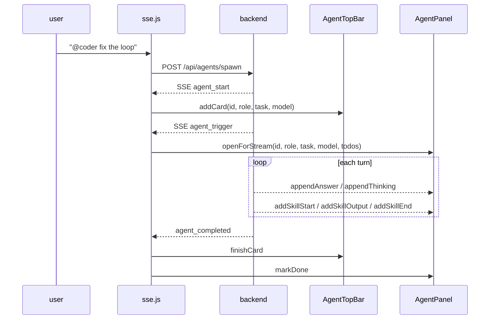

# 35 — Agent UI, HTML Pane, Message Toolbar

> The three frontend modules doc 25 referenced but never read. Together they own the multi-agent surface, the sandboxed `<render_html>` pane, and the one toolbar builder that replaced four.

| File | Lines | Owns |
|:--|--:|:--|
| `web/js/render-html.js` | 363 | Sandboxed iframe for `<render_html>` — isolation, not sanitisation |
| `web/js/msg-actions.js` | 186 | The single message toolbar (copy / TTS / regenerate / speed) |
| `web/js/agents.js` | 2,824 | Agent top bar, panel, SSE, `@`-mention spawn, plus TTS/STT/voice settings |

`agents.js` is three files wearing a trenchcoat: ~1,100 lines of agent UI, ~1,400 lines of TTS/STT/voice-input settings that have nothing to do with agents, and ~300 lines of dead stream consumer (§4). Worth knowing before you go looking for agent code in it.

***

## 1. `render-html.js` — the security model is stated, and it holds

The file opens by naming its own contract, and unlike `editor_tools.py`'s docstring, every claim in it is true:

```
We NEVER inject it into the host DOM. It goes into an <iframe sandbox="allow-scripts">
WITHOUT allow-same-origin, which gives it an opaque origin: no access to the parent
DOM, no cookies, no localStorage on our origin, no fetch to our app.
That is the whole security model — isolation, not sanitisation.
```

That is the right call. Sanitising arbitrary model-written JS is unwinnable; an opaque-origin iframe is a real boundary. The CSP in `shell()` backs it up:

```
default-src 'none'
script-src 'unsafe-inline' cdnjs + jsdelivr
style-src  'unsafe-inline' cdnjs + jsdelivr
img-src    data: https:
connect-src 'none'
base-uri 'none'
form-action 'none'
```

`'unsafe-inline'` is mandatory — the bridge script is inline — but `connect-src 'none'` means even with script execution, the pane cannot exfiltrate. The two together are the reason this is safe.

### 1.1 Two modes, two sandbox tiers

| Mode | Sandbox | Body |
|:--|:--|:--|
| Inline (`<render_html>…</render_html>`) | `allow-scripts` | `srcdoc` = `shell()` + streamed chunks |
| `url=` (live dev server / site) | `allow-scripts allow-forms allow-popups allow-modals allow-downloads` | `src` = the URL |

Neither gets `allow-same-origin`. The `url=` tier is wider because ordinary pages break without it, but the framed page is still in an opaque origin — it cannot reach the host DOM.

### 1.2 The bridge, and why it's an array-join

```js
return [
  'var root=document.getElementById("root");',
  …
].join("\n");
```

The comment says it: *"Built as an array join so the source never fights JS string escaping."* The bridge is itself a string being written into an inline `<script>`; building it from an array avoids a second escaping layer. Same instinct as `editor_tools.py`'s use of `chr(60)` for `<`.

The `stripIncomplete` helper is the one genuinely clever piece:

```js
var lt = html.lastIndexOf("<");
if (lt > html.lastIndexOf(">")) html = html.slice(0, lt);
```

Streaming HTML is cut mid-tag on almost every chunk. Truncating at the last unmatched `<` means the browser never sees a half-written `<div class="foo` — which would otherwise eat the rest of the render as an attribute value. Without this, every streamed pane flickers its tail into a tag.

### 1.3 Inbound messages are source-checked

```js
for (var id in blocks) {
  var blk = blocks[id];
  if (!blk.frame.contentWindow || ev.source !== blk.frame.contentWindow) continue;
```

A `postMessage` from any other frame is dropped. With N panes on screen this is O(N) per message but it is the only check that matters, and it is present.

> [!NOTE] Verified, not assumed — `msg-actions.js`'s TTS globals
> `msg-actions.js` references `_ttsActive`, `TTSStreamPlayer`, `stopGlobalTTS`, `_activeTTS`, `_ttsGeneration`, `_ttsStopping`, `_ttsLastAction`, and `TTS_DEBOUNCE_MS` as **bare identifiers**, none of which it declares. That looked like eight `ReferenceError`s.
>
> It isn't. `tts.js` has no IIFE wrapper, so its top-level `let` / `const` / `class` declarations land in the **global lexical environment** — visible to every later classic script as bare identifiers, just not as `window.*`. Load order in `index.html` is `tts.js` (2445) before `msg-actions.js` (2446), so no TDZ. The dependency is real but satisfied. It is still fragile — move either file into a module or an IIFE and all eight break at once, silently, only when a user clicks Read aloud.

### 1.4 Desktop-mode scaling is inert

```js
var MAX_SCALE = 1.0;
…
var k = Math.max(pw / vw, 1 / MAX_SCALE);
box.style.setProperty("--rc-scale", String(1 / k));
```

The comment above the constant explains the intent — *"1.25 → never below 80%"* — and the surrounding prose describes a virtual viewport that lays out at browser width and scales down into a narrow chat column.

At `MAX_SCALE = 1.0`, `1 / MAX_SCALE` is `1`, so `k = Math.max(pw / vw, 1)`. Since a chat pane is always narrower than the virtual width, `pw / vw < 1`, so **`k` is always exactly 1**. `--rc-scale` and `--rc-inv` are always `1`. Nothing scales; the frame lays out at pane width.

The ceiling was lowered to disable the feature without deleting it. See finding #98 — the `ResizeObserver`, the two CSS custom properties, and the per-width recompute all still run on every resize to compute `1`.

***

## 2. `msg-actions.js` — the de-duplication that stuck

The header comment is a small post-mortem worth keeping:

> *There used to be FOUR separate toolbar builders … Each carried its OWN copy of the copy-button and the ~50-line TTS click handler, all poking the same globals … which is why the toolbar kept ending up stranded mid-message whenever a rich UI card mounted after it.*

Two fixes, both correct:

1. **One builder.** `attach(msgEl, kind, opts)` is now the only entry point; `chat.js` and `sse.js` both call it.
2. **`ensureToolbar` moves the node.**

```js
var tb = msgEl.querySelector(":scope > .msg-toolbar");
if (!tb) { tb = document.createElement("div"); tb.className = "msg-toolbar"; }
msgEl.appendChild(tb); // appendChild moves an existing node — intentional
```

`appendChild` on an existing child relocates it rather than duplicating. So the toolbar is always last in DOM order regardless of when it was first created — which is exactly what fixes "stranded mid-message" when a render block mounts later. The `:scope >` selector matters too: without it, a nested message's toolbar would be matched.

CSS then pins `order: 9999` as belt-and-braces, so layout does not depend on DOM position at all.

The TTS handler is the only part with real logic: a 400 ms debounce, a generation counter so a stale `onStateChange` from a previous utterance self-invalidates, and a `_ttsStopping` flag that distinguishes *"user hit stop"* from *"audio ended naturally"* — only the natural end clears `_ttsActive`.

***

## 3. `agents.js` — the agent surface

### 3.1 Lifecycle, end to end



The important architectural detail is in the comment on `spawnAgentFromMention`:

> *Single-trigger architecture: the backend emits agent_spawned + agent_trigger via SSE. We rely solely on the SSE path to fire `_runAgentTurn` — no direct trigger here, eliminating the race condition that caused double-streaming.*

That is a fix for a real class of bug — two paths both deciding to start the same turn — and it is documented at the site where someone would otherwise add a third.

### 3.2 Two event vocabularies, one switch

`handleAgentEvent` handles **two different naming conventions** in one `switch`:

| Runtime events | Manual-spawn events |
|:--|:--|
| `agent_spawned`, `agent_progress`, `agent_completed`, `agent_failed`, `auto_turn_trigger` | `agent_start`, `agent_trigger` |

The `// --- Events from POST /api/agents/spawn (manual @-mention spawn) ---` comment marks the boundary, and both feed the same `AgentTopBar`. It works, but it means the event contract is split across two producers that agree on nothing but the card API. A new event type has to be added in two places with two spellings.

### 3.3 The panel has two rendering paths, and only one is live

This is the structural finding of the file.

**Path A — `open()` → `_connectStream()` → `_consumeStream()`** (~200 lines). Opens an `AbortController`, `fetch`es `/api/agents/{id}/stream`, hand-parses SSE, and renders skill cards into `<details>` elements it builds inline.

**Path B — `openForStream()` / `appendAnswer()` / `addSkillStart()` / `markDone()`** (~180 lines), introduced `2026-09-10` per the section comment. Called by `sse.js`'s `_runAgentTurn` to stream agent output through the **normal `POST /api/chat` pipeline** — the same one `critique` uses.

`_connectStream` has **no caller**. Verified by grep: two hits in `agents.js`, both its own definition and the internal call from `_consumeStream`. Path B is what runs.

So `_consumeStream` is ~200 lines of a second, divergent SSE consumer — with its own `FORBID_TAGS` list (duplicated from `_renderHistory`), its own skill-card rendering (duplicating `window.createSkillCard`), and its own markdown pipeline. It is dead, but it is dead *code that looks live*, which is worse than deleted code. See finding #94.

### 3.4 The `@`-mention popup

```js
el.addEventListener("keydown", (e) => { … }, true);  // capture phase
```

Capture phase is the correct choice and the comment says why — Enter/Tab must be intercepted **before** the main send handler, or typing `@coder` and hitting Enter would send `@coder` as a message instead of completing the mention.

The popup is appended to `document.body` with `position` computed from `getBoundingClientRect`, and `mousedown` (not `click`) is used with `preventDefault()` so the textarea keeps focus. Both are the right call for a composer overlay.

`_selectMention` does `el.value = "@" + role + " "` — it **replaces** the whole input rather than completing the token. Fine for the `^@(\w*)$` anchor it only ever triggers under, but it means the popup cannot be extended to mid-message mentions without a rewrite.

### 3.5 TTS / STT / voice — the 1,400 lines that aren't about agents

Four separate subsystems, each with its own lifecycle, none of them sharing code with the agent surface:

| Object | Owns |
|:--|:--|
| `TTSSettings` | Kokoro/Edge provider switch, model download with progress, voice prefs |
| `STTSettings` | Whisper model download, file transcription, prefs |
| `STTMicRecorder` | One-shot record → transcribe → fill result box |
| `GlobalVoiceInput` | Status-bar mic + `Ctrl+Space` hold-to-talk, silence auto-stop |
| `LiveVoiceChat` | Continuous 2s-chunk transcription → auto-send on silence |

That is four microphone paths. They agree on the MIME-type cascade (`webm;codecs=opus` → `webm` → `mp4`) and on the `/api/stt/transcribe` endpoint, and on nothing else. `STTMicRecorder` and `GlobalVoiceInput` each build their own `AudioContext` and `AnalyserNode`; `LiveVoiceChat` builds a third. See finding #96.

***

## 4. Findings

**No 🔴.** Consistent with the rest of the frontend: the failure modes here are *dead code that looks live*, *listeners that never stop*, and *features disabled by a constant* — not corruption.

### 🟡 Correctness / resource leaks

**#94 — `_connectStream` / `_consumeStream` are dead but look live.** ~200 lines. Zero callers. Diverged from the live path (Path B) in `FORBID_TAGS`, skill-card construction, and markdown pipeline. Anyone debugging agent rendering will find this first and fix the wrong function.

**#95 — `connectAgentEvents` reconnects forever on a fatal error.** `onerror` checks `readyState === CLOSED` and re-arms a 3 s timer unconditionally. A 401 (expired token) or a 404 (wrong chat id) also closes the stream, so the client retries every 3 s for the life of the tab. There is no attempt counter and no distinction between "dropped" and "rejected".

**#96 — `STTMicRecorder` leaks an `AudioContext` per recording.** `this._stream.getAudioContext?.()` is not a `MediaStream` method — it is always `undefined` — so the fallback branch runs every time and constructs a fresh `AudioContext` that is never `close()`d. Browsers cap concurrent contexts at ~6; after that, recording stops working and the failure looks like a mic permission problem.

**#97 — `LiveVoiceChat.stop()` races its own last chunk.** `stop()` calls `this._mediaRecorder.stop()` (which fires `onstop` → async `_transcribeChunk()`) and then **immediately** calls `_flushAndSend()` on `_accumulatedText`. The final chunk's transcript has not arrived yet, so the last thing the user said is dropped — or worse, sent on the *next* flush.

**#98 — `MAX_SCALE = 1.0` disables the desktop-mode scaling it documents.** `k = Math.max(pw/vw, 1/MAX_SCALE)` is always `1` for a narrow pane, so `--rc-scale`/`--rc-inv` are always `1`. The `ResizeObserver`, both custom properties, and the recompute on every width change all still run to produce a constant. Either raise the constant or delete the machinery — the current state is a feature that costs work and does nothing.

**#99 — `openForStream` never clears `panel-done` / `panel-failed`.** `open()` clears them via `close()`. `openForStream()` calls `init()` only, so a panel previously marked failed keeps `panel-failed` until the next `open()`. Styling-only, but the next agent's panel opens red.

**#100 — `_agentTodosRaw` is never pruned, and its sweep expires.** The Map is keyed by agent id, written in `handleAgentEvent`, and never deleted. Separately, the injection sweep runs once a second for 30 iterations then `clearInterval`s — an agent that spawns 31 s after page load never gets its todo line injected into the spawn card. Both are small; together they mean the feature works only in the first 30 s of a session.

**#101 — `AgentTopBar.addCard` can no-op during the 400 ms fade.** `removeCard` starts a 400 ms fade and only deletes from `this.cards` inside the timeout. An agent re-spawned with the same id inside that window hits `if (this.cards.has(agentId)) return;` and gets no card.

### 🔵 Dead / cosmetic

| Where | What |
|:--|:--|
| `render-html.js` `Copy` | Copies `blk.src`, which is `""` in `url=` mode — silently copies nothing |
| `GlobalVoiceInput.init` | `isInput` computed, never read — dead variable left from an abandoned "don't trigger in inputs" guard |
| `highlightJSON` | `json` computed by `JSON.stringify` then never used; `parsed` is re-stringified into `pretty` |
| `stripToolJson` | Name says it strips tool JSON; the body only collapses blank lines. The comment admits it — the name should follow |
| `AgentPanel.open` | `agentFinished` set from `data.status`, but `_startTimer(createdAt, completedAt)` already handles the ended case; two paths to "is this done" |
| `_renderRoles` | `makeChip` and the `chainHtml` template build the same chip two different ways |
| `LiveVoiceChat` / `GlobalVoiceInput` | Identical `STOP_PHRASES` array, duplicated; identical MIME cascade, duplicated three times |

***

## 5. What's right, and worth copying

1. **Isolation over sanitisation, stated as the contract.** The iframe comment is the clearest security rationale in the frontend, and the CSP enforces the same claim.
2. **`stripIncomplete` truncates at the last unmatched `<`.** The single detail that makes streaming HTML render instead of flicker.
3. **`appendChild` to reorder.** `ensureToolbar` fixes four divergent toolbars with one line and a comment explaining the non-obvious part.
4. **Single-trigger architecture, documented at the call site.** The comment on `spawnAgentFromMention` exists to stop the next person from adding the second path back.
5. **Capture-phase keydown for the mention popup.** Correct, and the reason is written down.
6. **Generation counter in the TTS handler.** A stale `onStateChange` from a cancelled utterance cannot un-set the current one's UI.

***

## 6. What this changes upstream

- Doc 25's module map listed these three as "referenced but not read" — that gap is now closed. The `tw*` typewriter symbols remain in `core.js`, not here.
- `web/js` coverage: **7,124 → 10,497 / 52,114 = ~20%**.
- The remaining large unread JS is `render-components.js` (read in doc 25), `sse.js` (doc 25), and the `chat.js` / `settings` cluster.

***

## Cross-references

- [[25-web-frontend-sse-and-components]] — `sse.js` and `render-components.js`; the SSE path `openForStream` plugs into
- [[20-engine-ui-format]] — the server side of `<render_html>` / `<render_component>`
- [[33-online-search-dil-parser]] — `dil_parser.py`, the server half of the component language this file's panes display
- [[13-web-frontend]] — module map and load order
