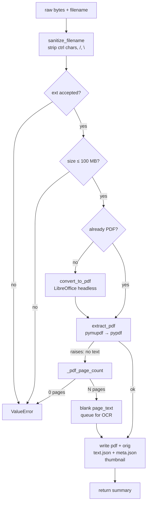

# 36 — The Library Stack

> The four `engine/library_*` modules docs 19/22/26 consumed but never opened, plus the router that fronts them. Together: where a document goes when you upload it, and how the dashboard knows you studied.

| File | Lines | Role |
|:--|--:|:--|
| `engine/library_ingest.py` | 490 | Normalise + convert + extract + persist. **The** document entry point |
| `engine/library_upload.py` | 337 | Upload-job state machine, staging, cooperative cancel |
| `engine/library_sessions.py` | 224 | Study-time analytics — dwell, streaks, per-doc totals |
| `engine/library_catalog.py` | 212 | Derived topic→doc table in SQLite. Rebuildable, never source of truth |
| `server/api/routes/library.py` | 314 | Browse/read/delete + PDF→markdown import |

> [!NOTE] The README's priority list had the wrong paths
> It named `engine/catalog.py`, `upload.py`, `sessions.py`, `ingest.py` (~1,810 lines). Those files do not exist. The real names carry a `library_` prefix and total **1,263** lines, not 1,810. Worth fixing at the source — a priority list that points at nonexistent paths wastes a batch.

This is the best-written cluster in the codebase. Four of the five files open with a paragraph naming the problem the file exists to solve, and the non-obvious lines carry the symptom they prevent. Findings below are correspondingly light — mostly *"one path doesn't match its siblings"* rather than *"this is wrong."*

***

## 1. `library_ingest.py` — the document entry point

The docstring states the design goal precisely:

> *Both the Study upload endpoint and remote sources (Google Drive) funnel through here, so a downloaded file becomes indistinguishable from an uploaded one: same PDF normalization, same extracted text, same meta record.*

### 1.1 The pipeline



The scanned-PDF branch is the subtle one and it is right:

```python
try:
    extracted = extract_pdf(pdf_bytes)
except ValueError:
    pages = _pdf_page_count(pdf_bytes)
    if pages <= 0:
        raise ValueError("could not read PDF")
    extracted = {"pages": pages, "page_text": [""] * pages, ...}
```

A scanned PDF has no text layer — `extract_pdf` raises for exactly that reason. Treating it as a failure would reject the one case OCR exists for. Only a genuinely unreadable PDF (zero pages) is an error. The distinction is made at the catch site, with a comment saying so.

`has_text` is then computed honestly from the extracted pages rather than assumed, and the comment says why: *"Claiming has_text=True for it would tell the UI it's already searchable."*

### 1.2 `clean_meta_title` — three shapes of LibreOffice garbage

LibreOffice stamps a generic `/Title` when the source Office file has none. This function handles all three forms it emits:

| LibreOffice emits | After cleaning |
|:--|:--|
| `PowerPoint Presentation` | filename stem (generic set) |
| `Microsoft PowerPoint - deck.pptx` | `deck` (prefix + ext stripped) |
| `deck - PowerPoint` | `deck` (suffix stripped) |

Three regexes, a generic-title frozenset, and an extension strip. The comment names the exact user-visible symptom — *"an uploaded deck lands in the library as 'PowerPoint Presentation' instead of its own name"* — which is what makes it maintainable.

### 1.3 `pdf_tool()` — the `.com` vs `.exe` comment is the best in the file

```python
# .com is the CONSOLE-subsystem binary: it blocks until the conversion
# finishes and captures stdout/stderr. .exe is GUI-subsystem — Windows
# can detach it, so the process may report exit before the background
# conversion completes, yielding a phantom "could not convert" with no
# PDF produced. Prefer .com, fall back to .exe on older builds.
```

That is a bug that could only have been found on Windows, written down so nobody reverts it. Pair it with `_kill_process_group`'s `taskkill /F /T` vs `os.killpg` split and the Windows handling here is more careful than anything in `computer_use`.

### 1.4 The one inconsistency: bytes are not written atomically

```python
(LIBRARY_PDF_DIR / f"{doc_id}.pdf").write_bytes(pdf_bytes)
if converted:
    (LIBRARY_ORIG_DIR / f"{doc_id}{ext}").write_bytes(raw)
...
_write_json_atomic(LIBRARY_TEXT_DIR / f"{doc_id}.json", extracted["page_text"])
_write_json_atomic(LIBRARY_META_DIR / f"{doc_id}.json", meta)
```

The module defines `_write_bytes_atomic` and uses it for the thumbnail — but the PDF and the original go through bare `write_bytes`. README convention #2 says `.tmp` → `replace()` on every write path; two of the five writes in this function skip it. See finding #104.

### 1.5 `ingest_bytes` does not touch the catalog

The function writes meta, text, pdf, orig, and thumb — but never calls `library_catalog.upsert_doc`. Every catalog row in the system comes from `study.py` calling `_catalog.upsert_doc(...)` **after** ingest returns.

That is fine for the upload path, which does exactly that. It is a trap for any *new* caller — a Drive import that calls `ingest_bytes` and stops will produce a document that is browsable and searchable but invisible to `docs_in_topic`, i.e. it will never widen a topic context. The docstring's promise ("indistinguishable from an uploaded one") is true of the files and false of the catalog.

***

## 2. `library_upload.py` — job state, and the best liveness logic here

The cleanest module in the batch. Two design choices are worth copying wholesale.

### 2.1 Liveness is process-local, deliberately

```python
# Uploads with a pipeline actually executing in THIS process. A job file that
# says "running" with no entry here belongs to a process that died.
_active: set[str] = set()
```

and then, in `status_for`:

```python
if status == "running" and not is_live(upload_id):
    status = "error"
```

A job JSON that says `running` proves nothing — the server may have been restarted. The in-memory set is the only evidence that something is actually driving the job, and when it's absent the status is downgraded to `error` rather than left as a spinner that never moves. The comment even explains why resuming is not an option: *"the staged bytes may be gone."*

This is the same class of bug as doc 19's ledger #5 (`run_job`'s `finally` reporting every exit as `done`), solved the opposite way — instead of trusting a persisted status, verify against live state. `mark_active` is called **before** the task is spawned, which closes the race where a poll lands between spawn and registration.

### 2.2 The percent bar spans two subsystems

```python
PHASE_START = {"converting": 5, "extracting": 30, "persisting": 50, "indexing": 60}
INGEST_CEILING = 60
```

Ingest owns 0–60. Indexing owns 60–100, and `status_for(index_percent=…)` folds the index job's own progress into that tail:

```python
span = 100 - INGEST_CEILING
percent = INGEST_CEILING + int(max(0, min(100, index_percent)) * span / 100)
```

The comment states the reason: *"so a row shows one number for the whole upload instead of resetting to zero when ingest hands off to indexing."* Two independent state machines, one monotonic bar for the user. Good.

### 2.3 Smaller, all correct

- `_valid_id` is `re.fullmatch(r"[0-9a-f]{32}", …)` — convention #1, on every read and write path.
- `save_job` writes `.json.tmp` → `replace()` **and** logs on failure, unlike `library_index.save_job` (ledger #22) which swallows.
- `list_jobs` **deletes** expired terminal jobs rather than skipping them, so the directory cannot grow.
- `_sweep_stale_staging` reclaims staged bytes older than 6 h on every job creation — crash recovery without a daemon.
- `_TERMINAL_TTL = 120` keeps a finished row visible for two minutes so the sidebar can show "done" before it vanishes.

***

## 3. `library_sessions.py` — study analytics

The docstring frames the whole reason the file exists: *"instead of a localStorage counter that dies with the browser cache."* Storage is one JSON file behind an `exclusive_lock`, `.tmp` → `replace()`, with a retention window — conventions #2 and #3, followed.

### 3.1 Guard rails with stated reasons

| Constant | Value | Comment |
|:--|--:|:--|
| `_MIN_SECONDS` | 5 | *"almost always an accidental open"* |
| `_MAX_SECONDS` | 6 h | *"a session longer than this is a forgotten tab"* |
| `_MAX_SESSIONS` | 20,000 | hard cap after retention |
| `_RETENTION_DAYS` | 400 | rolling window |

Each one is a real failure mode named. `seconds` is clamped rather than rejected at the top end (a forgotten tab still counts as 6 h of study, which is generous but bounded) and dropped at the bottom end.

### 3.2 `_streak` — correct, but by identity

```python
for point in reversed(series):
    if point["seconds"] >= 60:
        streak += 1
    elif streak == 0 and point is series[-1]:
        continue  # today not started yet - keep looking back
    else:
        break
```

`point is series[-1]` compares **dict identity**, which works only because `reversed(series)` yields the same objects. It is correct and it is fragile — copy the list anywhere and the `is` silently stops matching. Finding #108. The intent (a not-yet-studied today should not break yesterday's streak) is right.

### 3.3 Reads happen outside the lock

`record()` and `clear()` take `_lock()`. `stats()` and `doc_stats()` call `_read()` bare. That is *safe* because `_write` uses `replace()`, which is atomic on POSIX — a reader sees either the old file or the new one. It is worth stating explicitly because the asymmetry looks like an oversight.

What is not free: `stats()` parses the whole sessions file on every dashboard poll, up to 20,000 entries. Finding #107.

***

## 4. `library_catalog.py` — derived, and honest about it

The docstring opens with the performance argument and closes with the contract:

> *Retrieval used to answer "which docs share this topic?" by globbing `library/meta/*.json` and parsing every record on each question. That is O(library) work per query … Like every other index here it is rebuildable from the meta store, so it is never a source of truth.*

All true. Two things do not quite match the promise.

### 4.1 A "rebuild" that only adds

```python
conn.executemany(_UPSERT, rows)
```

`rebuild_from_meta` upserts every doc present in the meta store and **never deletes** rows for docs that are gone. Its own docstring says it is used *"on first run, after a schema bump, or lazily when a lookup finds the catalog empty"* — all three are additive cases, so today it is correct. But the name promises a rebuild, and the failure mode is quiet: delete a document while `remove_doc` doesn't fire (a crash, a manual `rm`, a meta file written by a path that predates the catalog) and the catalog keeps serving a topic link to a document that is not there. Finding #102.

### 4.2 `upsert_doc` opens two connections per document

```python
def upsert_doc(...):
    ensure_catalog()          # connect → CREATE TABLE IF NOT EXISTS → CREATE INDEX → commit → close
    conn = _connect()         # connect again
    conn.execute(_UPSERT, ...)
```

`ensure_catalog()` is idempotent but not free: it opens a connection, runs two DDL statements, commits, and closes — on **every single call**. `study.py:225` calls `upsert_doc` inside a loop over every document in the library. A 500-doc library therefore performs 1,000 connections and 500 redundant `CREATE TABLE IF NOT EXISTS` round-trips during what the caller thinks is a bulk index. Finding #103.

The fix is one line — an `_ensured` module flag — or batching the loop. `rebuild_from_meta`, which does the same job, already gets it right by calling `ensure_catalog()` once.

### 4.3 What is right

- `_UPSERT` deliberately **omits `added`** from the `DO UPDATE SET` — a document's original add time is immutable. Easy thing to get wrong.
- `docs_in_topic` returns `[]` for `Others`, with the reason in the docstring: the unfiled bucket would glue unrelated books together. A catch-all that does not behave like a topic is the correct call, and it is stated at both the function and its caller (`study_ai.py:302` repeats it).
- Every function catches `sqlite3.DatabaseError` and returns a safe default — a broken catalog degrades retrieval, never breaks a request.

***

## 5. `routes/library.py` — the router

### 5.1 What it does

Six browse endpoints (`agents` / `research` / `notes` / `prompts` / `gallery` / `skills`) that scan markdown dirs and parse frontmatter, one read endpoint, one delete, one PDF→markdown import.

`library_asset_delete` is the most carefully written handler in the file and the comment explains why it looks the way it does:

```python
name = Path(body.get("filename", "")).name      # strip any directory part → defeats ../
if Path(name).suffix.lower() not in _IMAGE_EXTS: …
for base in (ASSETS_DIR, UPLOAD_DIR):
    target = (base / name).resolve()
    if target.parent != base.resolve():          # symlink escape → refuse
        continue
```

`Path.name` kills traversal, the extension allowlist kills non-images, and the **parent-equality** check (not a prefix check) kills symlinks. Three layers, and the comment records the bug that motivated the second directory — *"This route used to search only ASSETS_DIR, so deleting any uploaded image answered 'Not found' even though it was on screen."*

### 5.2 `library_read_file` uses a prefix check, and it's the weaker one

```python
target = dir_map[section] / filename
if not str(target.resolve()).startswith(str(dir_map[section].resolve())):
    return {"error": "invalid path"}
```

This is the exact check `library_asset_delete` avoids. `str.startswith` has no path-component boundary, so a sibling directory with the right prefix passes:

```
NOTES_DIR          = /home/sifat/sable_output/notes
candidate          = /home/sifat/sable_output/notes_backup/secret.md
str(candidate).startswith(str(NOTES_DIR))  →  True
```

`resolve()` also means a symlink inside `notes/` pointing anywhere is followed *before* the check — so it passes too. The mitigating factors are real: the route requires a `.md` suffix, and there must be a sibling directory whose name extends the section name. That makes it a narrow bug rather than an open door, but it is the same class as ledger #13 (lexical path check in `filesystem.py`), and the fix is already written twelve lines above it. Finding #105.

### 5.3 `library_import_pdf` writes unescaped frontmatter

```python
frontmatter = (
    "---\n"
    f"title: {base_title}\n"
    f"source: {file.filename}\n"
    "type: pdf-import\n"
    "---\n\n"
)
```

`base_title` comes from a form field and `file.filename` from the upload — neither is sanitised, and `ingest_bytes`'s `sanitize_filename` is **not** in this path. A filename containing a newline and `---` closes the frontmatter early, and everything after it becomes parsed keys on the next `_scan_md_dir` pass. It is stored markdown, not executed, so this is content injection rather than RCE. Finding #106.

The write itself is also a bare `target.write_text(...)` — convention #2 skipped, in the same codebase that ships `_write_json_atomic`.

### 5.4 Smaller items

| Where | What |
|:--|:--|
| `library_read_file` | Returns `{"error": …}` with **HTTP 200** for every failure — unknown section, invalid path, not found, read failed. The frontend cannot tell them apart from success |
| `library_gallery` | `f.stat()` unguarded inside the loop — a broken symlink in `uploads/` 500s the whole gallery |
| `_extract_pdf_text` | Uses `import fitz`, the legacy alias. Every other caller in the tree uses `import pymupdf` — same library, two pinning styles |
| `_scan_md_dir` | Swallows `read_text` failures silently, so an unreadable note vanishes from the list rather than showing as broken |
| `library_import_pdf` | `_dedupe_path` caps at 1000 collisions then returns the **original** target — overwrites silently at that point |

***

## 6. Findings

**No 🔴.** Four of the five files are actively well-built — the liveness downgrade, the scanned-PDF branch, the phase-bar folding, and the delete-path triple check are all better than the surrounding codebase's average. The findings are of three shapes: *one path doesn't match its siblings* (#104, #105), *a name promises more than the body does* (#102), *a guard runs per-item when it should run once* (#103).

### 🟡 Correctness / security

**#102 — `rebuild_from_meta` never deletes.** Upserts only. Docs removed without `remove_doc` firing stay in the catalog forever, and `docs_in_topic` keeps widening topic context with a document that no longer exists. Today's three call sites are all additive, so this is latent — but the name promises a rebuild.

**#103 — `upsert_doc` runs `ensure_catalog()` on every call.** Two connections and two `CREATE TABLE IF NOT EXISTS` statements per document. `study.py:225` calls it in a loop over the whole library. `rebuild_from_meta` already does it correctly (once); `upsert_doc` does not.

**#104 — `ingest_bytes` writes the PDF and the original non-atomically.** Text, meta, and thumbnail all go through `_write_json_atomic` / `_write_bytes_atomic`; the two largest writes in the function use bare `write_bytes`. A crash mid-write leaves a truncated PDF whose meta was never written — an orphan file the gallery will list and the reader cannot open.

**#105 — `library_read_file` uses a string-prefix path check.** `str(target.resolve()).startswith(str(base.resolve()))` has no component boundary; `notes_backup/` passes as `notes/`. `resolve()` also follows a symlink before the check. Narrow (needs a `.md` suffix and a prefix-sharing sibling dir) but the correct check is twelve lines above in the same file.

**#106 — `library_import_pdf` interpolates unsanitised values into YAML frontmatter.** A newline in `filename` or `title` closes the frontmatter early and turns the rest into parsed keys on the next scan. Content injection, not execution. The write is also non-atomic.

**#107 — `stats()` parses the full session store on every poll.** Up to 20,000 entries, JSON-parsed per dashboard refresh. Safe (atomic replace), not free. No cache, no mtime check.

### 🔵 Cosmetic / latent

| Where | What |
|:--|:--|
| `library_sessions._streak` | `point is series[-1]` relies on dict identity surviving `reversed()` — correct, but any copy breaks it silently |
| `library_upload._cancel_requests` | Set only shrinks via `clear_cancel`. A cancelled job whose pipeline never runs again leaves its id forever |
| `routes/library.library_read_file` | Every error path returns HTTP 200 with `{"error": …}` — indistinguishable from success |
| `routes/library._extract_pdf_text` | `import fitz` while the rest of the tree uses `import pymupdf` |
| `routes/library._dedupe_path` | After 1000 collisions returns the original path — silent overwrite |
| `library_ingest` | `len(raw) > _MAX_BYTES` is checked after the whole file is in memory, same as `online_search` |

***

## 7. What's right, and worth copying

1. **Liveness over persisted status.** `_active` is process state, and a persisted `running` with no live entry is downgraded to `error` instead of showing a spinner that can never move.
2. **Register before spawn.** `mark_active` runs before the task starts, so no poll can observe the gap.
3. **Two subsystems, one monotonic bar.** `INGEST_CEILING` folds the index job's percent into the tail rather than resetting at handoff.
4. **Scanned PDF is not an error.** The `except ValueError` branch distinguishes "no text layer" from "unreadable" and only the second one raises.
5. **`.com` over `.exe`, with the reason.** A platform bug found once and written down at the line that fixes it.
6. **`Path.name` + extension allowlist + parent equality** on the delete path — and the comment explaining the second directory.

***

## 8. What this changes upstream

- **The README priority list had four wrong paths.** `engine/catalog.py` etc. do not exist; the real files are `engine/library_{catalog,upload,sessions,ingest}.py` and total 1,263 lines, not 1,810. Fixed in the README in the same pass.
- Python coverage: **~65,220 → ~66,800 / 122,900 = ~54%**.
- Overall: **~37% → ~38%**.
- Docs 19 and 22 both call into this stack; neither had read it. Where they describe behaviour that originates here, this document wins.

***

## Cross-references

- [[19-engine-library-index]] — the indexing pass these files hand off to
- [[22-server-study-routes]] — the upload pipeline that drives `library_upload`'s state machine
- [[26-engine-library-rag]] — consumes the meta/text files `ingest_bytes` writes
- [[31-library-search-browser-session]] — the FTS index that shares the SQLite file with `doc_catalog`
- [[24-remaining-routers]] — `library.py` was grouped there as "a remaining router"; it is read in full here
