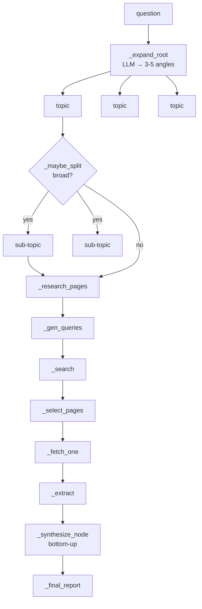

# 37 — The Deep-Research Engine

> Doc 09 covered this at method level. This is the actual read: the fractal tree, the fallback ladder, the trace log, and the timeout budget that three of the four phases ignore.

974 lines, one class. `DeepResearcher` takes a question, recursively splits it into sub-topics until they are atomic, researches the leaves over the web, and synthesises back up into a report. It streams `graph_node` / `graph_status` / `progress` events so the frontend can draw a live tree.

The structure is sound and the fallback discipline is genuinely good — three of the four LLM call sites have a defined degradation path. The problems are almost all in the **budget**: `max_time` is enforced in some places and not others, and where it is not enforced is exactly where the wall clock goes.

***

## 1. The shape



Every step is an LLM call or a subprocess. For a 3-depth run with 14 topics and 3 pages each, that is roughly 50–80 model calls and 40+ page fetches.

***

## 2. The model/account fallback ladder

This is the most carefully built part of the file.

```python
attempts: List[Tuple[Optional[str], Optional[str]]] = []
for model in models:
    if model and resolve_backend(model):
        attempts.append((model, None))   # API model → keys, not profiles
    else:
        for account in accounts:
            attempts.append((model, account))
```

Each model contributes either **one** attempt (API providers authenticate with a key, so the browser profile is irrelevant) or **N** attempts (Qwen, one per profile). Then a circuit breaker:

```python
healthy = [(m, a) for m, a in attempts if self._is_healthy(m, a)]
pool = healthy if healthy else attempts  # if ALL are broken, try anyway
```

Three consecutive failures opens the breaker on a `model:account` key. The `healthy if healthy else attempts` line is the important one — a fully-broken pool still gets tried, so the breaker degrades the *order* rather than deadlocking the run.

And `_attempt_idx` remembers where it left off:

```python
k = self._attempt_idx % len(pool)
ordered = pool[k:] + pool[:k]
```

So the next call starts from whichever combo last worked instead of re-trying the dead one at the head of the list. That is a rotation, not a retry, and it is the right design for a run that makes 60 calls.

> [!NOTE] `_record_success` resets to 0, not decrement
The breaker is pure consecutive-failure counting: one success clears the key entirely. For a flaky provider that alternates success/failure this means the breaker never opens. Probably intended (a working combo is a working combo), but it means the counter measures *streaks*, not health.

### 2.1 The `default` account label is a lie in one path

```python
self._active_account = account or (resolve_backend(model) or "default")
```

For an API-model attempt, `account` is `None` by construction (line 271), so `_active_account` becomes `resolve_backend(model)` — the **backend name**, e.g. `"deepseek"`. That is emitted as `progress.account` and displayed in the UI next to a Qwen profile name. Cosmetic, but it means the field means two different things depending on the model. Finding #113.

***

## 3. The timeout budget is enforced in one of four phases

`max_time` defaults to 1,500 s. `_stop()` is `self._cancelled or self._time_exceeded()`. Where it is actually checked:

| Phase | Checks `_stop()`? |
|:--|:--|
| `_process_topic` — before split | ✅ line 691 |
| `_process_topic` — before leaf research | ✅ line 711 |
| `_research_pages` — between pages | ✅ line 744 |
| `_research_pages` — retry loop | ✅ lines 773, 784 |
| **`_expand_root`** | ❌ |
| **`_llm_json` retry (2 attempts)** | ❌ |
| **`_synthesize_node` recursion** | ✅ only at entry (line 813) |
| **`_final_report` (3 attempts)** | ❌ |

The gap that matters is the last one. `_final_report` makes up to **three** `_complete` calls at 180 s each — 540 s of wall clock — with no `_stop()` check between them. A run that has already blown its budget still spends up to nine more minutes writing the report.

Worse, the synthesis pass runs *before* it:

```python
await self._set_status(root, "writing")
await self._synthesize_node(root)      # recursive, entry-only check
report = await self._final_report(root)
```

`_synthesize_node` checks `_stop()` once at entry, then recurses through `asyncio.gather` over every child topic, each of which makes its own 180 s call. By the time control reaches `_final_report`, the elapsed time may be several multiples of `max_time`.

> [!WARNING] `max_time` bounds the *research* phase, not the run
> The docstring and the parameter name both read as a wall-clock ceiling on the whole operation. It is really a ceiling on the tree walk. `cancelled` is honoured correctly at every site — this is specifically a timeout gap.

Finding #109.

***

## 4. The resume path restores findings but not the graph

`manager.py:390-393` passes four resume arguments:

```python
resume_findings=saved.get("findings", []),
resume_sources=saved.get("sources", []),
resume_nodes=saved.get("nodes", []),
resume_completed_topics=completed_topics,
```

In the engine, three of them are used:

| Argument | Used for |
|:--|:--|
| `resume_findings` | seeds `self.findings` ✅ |
| `resume_sources` | seeds `self.sources` ✅ |
| `resume_completed_topics` | `_is_topic_completed()` skip ✅ |
| **`resume_nodes`** | **only `bool(...)` in `_resumed_from_checkpoint`** ❌ |

The saved node list is never replayed. `research()` starts with `self.add_node(None, 0, "root", …)` and rebuilds the tree from scratch, so:

1. The frontend, which draws the tree from `graph_node` events, shows a **blank graph** for a resumed run until the new root and its expansion arrive — every node from the previous run is gone.
2. `_resumed_from_checkpoint` is true if *any* of the three lists is non-empty, including the unused one. A checkpoint carrying only nodes reports *"resuming with 0 findings, 0 sources, 0 completed topics"* — technically true, visibly wrong.

Finding #110.

***

## 5. The concurrency semaphore is scoped correctly, and the comment says why

```python
# Acquire semaphore ONLY for the split-check phase. Children must be
# able to acquire their own slots independently — holding the sem
# across gather() causes deadlock when concurrency slots are exhausted.
async with self._sem:
    subs = await self._maybe_split(node["label"], node["depth"])

if subs:
    …
    await asyncio.gather(*(self._process_topic(c) for c in children))
```

A semaphore held across a recursive `gather` deadlocks as soon as every slot is occupied by a parent waiting on children that can never acquire one. Releasing before the `gather` is the fix, and the comment exists so nobody "optimises" the two acquisitions into one. This is the single most valuable comment in the file.

Note the consequence: the semaphore bounds *concurrent LLM split calls* and *concurrent page research*, but not the recursion itself. That is the right trade — the recursion is cheap, the leaves are not.

***

## 6. `_select_pages` — the empty-list branch is correct and unusual

```python
if not selected:
    # Model saw the pool and judged nothing relevant — trust it, retry path will suggest URLs
    return []
if not selected:
    # unreachable: parse failed, falling back to top N
    selected = candidates[: self.pages_per_topic]
```

The first `if` fires when the model **returned a valid list but picked nothing** — the model looked at all 15 candidates and said none are relevant. Returning `[]` there is right: the caller then seeds `failed_urls` with the whole pool and asks for alternative URLs, which is a better outcome than fetching junk.

The second `if` is the parse-failure fallback, and it **cannot be reached** — `selected` is still empty only if the first branch did not return, which is impossible. Dead branch, harmless, but it means "parse failed" silently produces an empty selection and routes into the alternative-URL path rather than the top-N fallback the comment promises. Finding #111.

***

## 7. The trace log

```python
entry = {"ts": …, "elapsed_s": …, "stage": stage}
entry.update(fields)
for k in ("prompt", "response", "content"):
    if k in entry and len(entry[k]) > 4000:
        entry[k] = entry[k][:4000] + f"\n… [truncated, {len(entry[k])} chars total]"
```

JSON-lines appended under a per-run `asyncio.Lock`, with prompt/response/content capped at 4,000 chars. Tailable mid-run, which is the point.

Two notes. It writes to `OUTPUT_ROOT/research/trace_<slug>_<ts>.jsonl` — never cleaned up, so a year of research leaves a directory of traces. And the `content` cap means the trace records the *first* 2,000 chars of every fetched page (`_trace("fetch_ok", content=page.get("content", "")[:2000])`), which is the right amount for debugging extraction and not the whole page.

This is the same class as ledger #15 / #58 (unbounded debug dumps) but bounded and opt-in-by-existing, so it is fine. Finding #114 is the cleanup gap only.

***

## 8. `_run_search_script` — subprocess with a real timeout

```python
proc = await asyncio.create_subprocess_exec(*cmd, stdout=PIPE, stderr=PIPE)
out, err = await asyncio.wait_for(proc.communicate(), timeout=timeout)
…
except asyncio.TimeoutError:
    try:
        proc.kill()
    except Exception:
        pass
    return False, "search timed-out"
```

`wait_for` plus an explicit `kill()` — which is more than `browser/session.run()` does (ledger #69, where `fut.result(timeout)` expires without cancelling). Compare with `library_ingest._kill_process_group`, which kills the whole group: `proc.kill()` here kills only the direct child. `online_search`'s fetch stage can spawn a Playwright browser, and on a timeout that browser is orphaned. Finding #112.

`_fetch_one` passes `timeout=15` for a call that renders pages through Playwright on a JS-challenge fallback. Fifteen seconds is generous for a static fetch and tight for a rendered one, so challenge pages will usually time out and be recorded as failures rather than waited out.

***

## 9. The three-stage report fallback

```
1. FINAL_PROMPT with synthesis + findings   → 180 s, accept if > 100 chars
2. Short prompt with synthesis only          → 180 s, accept if >  50 chars
3. Assemble from raw findings + sources      → never empty
```

The comment on the method is explicit — *"never returns empty"* — and stage 3 delivers on it: title, summary, key findings, sources, all from data already in memory. A run whose models all died still produces a readable report.

This is the correct pattern for a long-running generation, and it is the reason this file has no 🔴. The same discipline is missing from the *timeout* checks (§3), not from the *failure* handling.

***

## 10. Findings

**No 🔴.** The failure ladder is well-built; the budget is not. Every finding below is either a timeout gap or a path that does not match its siblings.

### 🟡 Correctness

**#109 — `max_time` is not enforced during synthesis or the final report.** `_final_report` makes up to three 180 s calls with no `_stop()` between them, and `_synthesize_node` checks only at entry before recursing over every child. A run that has exhausted its budget still spends up to ~9 additional minutes. `cancelled` is honoured everywhere; this is specifically the timeout.

**#110 — `resume_nodes` is accepted and never used.** The saved graph is not replayed, so a resumed run emits `graph_node` events for a brand-new tree while the frontend still holds the old one — a blank or duplicated graph until the rebuild catches up. Also makes `_resumed_from_checkpoint` true for a checkpoint containing only nodes.

**#111 — `_select_pages` has an unreachable fallback.** The second `if not selected:` can never run, so "model returned garbage" produces an empty selection and routes into the alternative-URL retry instead of the documented top-N fallback. Silent behaviour change, not a crash.

**#112 — `_run_search_script` kills only the direct child.** `online_search` can spawn a Playwright browser during the fetch stage; on timeout that browser survives as an orphan. `library_ingest._kill_process_group` does this correctly (`killpg` / `taskkill /T`).

**#113 — `_active_account` mixes two meanings.** API models get the *backend name* (`"deepseek"`) because `account` is `None` for them by construction; Qwen gets a profile name. Same field, two vocabularies, shown in the UI next to each other.

### 🔵 Cosmetic / housekeeping

| Where | What |
|:--|:--|
| `_record_success` | Resets the failure counter to 0 rather than decrementing — an alternating success/failure provider never trips the breaker |
| `_fetch_one` | `timeout=15` for a call that may route through Playwright; JS-challenge pages time out rather than render |
| `research()` | `OUTPUT_ROOT/research/trace_*.jsonl` never pruned — same class as ledger #15, bounded per-file but unbounded across runs |
| `_llm_json` | Retries once on unparseable JSON *and* once on exception, giving up silently with `None`; every caller then falls back independently |
| `_process_topic` | `async with self._sem:` is written twice in the same function with different bodies — correct, but the two blocks are easy to merge wrongly during a refactor |

***

## 11. What's right, and worth copying

1. **Semaphore released before the recursive gather.** The deadlock it prevents is not obvious and the comment says exactly why.
2. **Rotation, not retry.** `_attempt_idx` starts the next call from the last-working combo instead of the head of the list.
3. **A circuit breaker that still tries when everything is open.** Degrades order, never deadlocks.
4. **Three-stage report fallback that cannot return empty.** The most important property of a 25-minute operation.
5. **Trusting the selector's empty list.** "The model looked and found nothing" is a real answer, and the retry path handles it better than fetching junk would.
6. **JSON-lines trace with per-field caps.** Tailable mid-run, bounded per entry.

***

## 12. What this changes upstream

- Doc 09 covered `research/engine.py` at method level and listed it as 974 lines unread. That gap is closed; where the two disagree, this document wins.
- `engine/research/` total is 1,686 lines. `llm.py` (157) and `manager.py` (550) remain method-level only — the manager is the resume/checkpoint layer that produced finding #110, and is the natural next read.
- Python coverage: **~66,800 → ~67,800 / 122,900 = ~55%**. Overall: **~38% → ~39%**.

***

## Cross-references

- [[09-memory-search-and-research]] — method-level treatment this supersedes for the engine itself
- [[33-online-search-dil-parser]] — the script `_run_search_script` shells out to; finding #112 is its orphaned Playwright browser
- [[36-library-stack]] — `library_ingest._kill_process_group`, the correct version of #112
- [[31-library-search-browser-session]] — `browser/session.run()`, ledger #69, the same timeout-without-cancel shape
