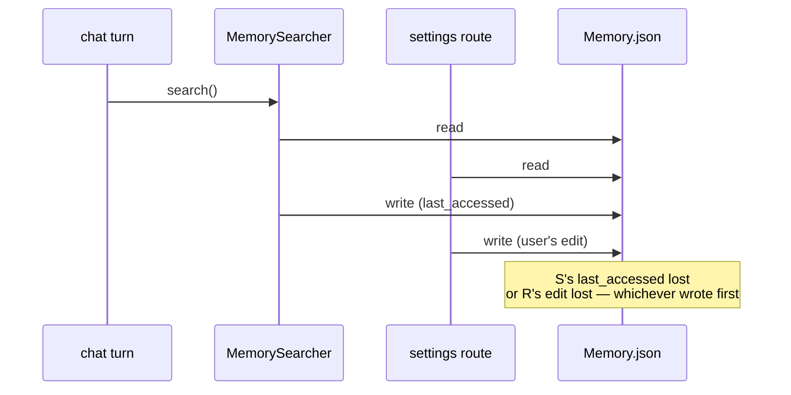

# 39 — The Memory Route, Second Pass

> Doc 23 read this file for behaviour. This read was for one specific question raised by doc 38's finding #116: *how many shared JSON stores does this file write, and how many of them are locked?* Answer: **seven stores, fourteen bare `write_text` calls, zero locks.**

```
$ grep -c 'write_text' server/api/routes/memory.py
14
$ grep -c 'exclusive_lock' server/api/routes/memory.py
0
```

That is the finding. Everything below is the detail that makes it actionable, plus three dead functions the first pass did not classify.

***

## 1. The seven unguarded stores

| Store | Written by | Read by |
|:--|:--|:--|
| `Brain/Memory.json` | `update_memory`, `delete_memory_entry`, `_consolidation_apply` | `get_memory`, `_consolidation_prep`, `MemorySearcher` |
| `Brain/Protected.json` | `update_protected_memory`, `delete_protected_entry`, `_consolidation_apply` | `get_protected_memory`, `MemorySearcher` |
| `Brain/Procedural.json` | `delete_memory_entry`, `_consolidation_apply` (×2) | `get_memory`, `MemorySearcher` |
| `Brain/user_personality.json` | `_run_personality_assessment` (disabled) | `get_personality` |
| `instruction/personal.md` | `update_personal_preferences` | `get_personal_preferences` |
| `system/memory_search_settings.json` | `update_memory_search_settings` | `get_memory_search_settings` |
| `Brain/skills.json` | `_save_user_skill` | `routes/library.py` `library_skills`, `engine/config` |

Every one is a plain `read_text` → mutate → `write_text`. No `.tmp` → `replace()`, no flock. README conventions #2 and #3, violated fourteen times in one file.

### 1.1 Why this is worse than it looks

The write in `searcher._persist_episodic_access` (doc 38, #116) happens on **every memory retrieval that touches an episodic entry** — i.e. on most chat turns. So the interleaving is not hypothetical:



Both sides are doing full-file read-modify-write. A lost `last_accessed` degrades episodic decay ranking; a lost settings write is a user-visible "my change didn't save."

### 1.2 The fix already exists in the tree

`engine/study/store.py` (doc 38) does this correctly for a different store — `_mutate_meta` under `exclusive_lock`, `.tmp` → `replace()`. `engine/library_upload.save_job` does it correctly. `engine/library_sessions._write` does it correctly. The pattern is not missing from the codebase; it is missing from this file.

***

## 2. `_run_personality_assessment` — #10 confirmed at the exact line

```python
if previous:
    try:
        prev_data = json.loads(previous)
    except (json.JSONDecodeError, TypeError):
        prev_data = {}
else:
    prev_data = {}
```

`previous` is **never assigned in this function**. Line 713, inside the outer `try: … except Exception: return False`. So the `NameError` is swallowed and the function returns `False` — silently, no log, no counter.

Doc 23's ledger #10 said this was latent because both call sites are commented out:

```python
# ponytail: personality assessment disabled — was doubling LLM calls per consolidation
# asyncio.create_task(_run_personality_assessment(conv_text, model, prep["browser_profiles"]))
```

Confirmed — both are still commented (lines 1110 and 1220). The finding is unchanged; this pass just pins the line and notes that the whole 120-line function is **unreachable and would crash if it were reached**.

***

## 3. Two dead functions, one with a lying docstring

### 3.1 `sanitize_message_content` (~50L) has no callers

```python
def sanitize_message_content(content: str, max_chars: int = 10_000) -> str:
    """…
    Used by both _format_conversation (consolidation) and _build_switch_context.
    """
```

The docstring names two callers. Neither calls it:

- `_format_conversation` does its own inline stripping — `_MEM_BLOCK_RE.sub`, `_TS_RE.sub` — but **not** `_TS_CTX_RE` (timestamps with `| cwd:`), **not** `_SWITCH_CTX_RE`, **not** `_UI_GARBAGE_RE`, **not** `_UI_CLOSE_RE`.
- `_build_switch_context` is not in this file at all.

So the function that handles all five artifact classes exists, is documented as the shared entry point, and is bypassed by the one call site that needs it. `_format_conversation` strips two of five. The other three patterns are compiled at module scope and used nowhere. Finding #122.

This matters because the docstring's stated purpose is *"prevent Qwen data_inspection_failed"* — a specific, observed failure. The stripping that reaches the prompt is a subset of the stripping that was designed for it.

### 3.2 `_dedup_and_resolve_adds` (~100L) has no callers

```python
# Dedup disabled — the LLM already sees existing memory and decides what to add.
# Post-hoc vector similarity was overriding correct model decisions.
dedup_skipped = 0
dedup_updated = 0
```

That comment sits in `_consolidation_apply` exactly where the call used to be. The function is intact — cosine thresholds `MERGE_THRESHOLD = 0.88` / `UPDATE_THRESHOLD = 0.80`, in-place mutation of matched entries, retrieval-field preservation — and nothing calls it. Finding #121.

It also carries a stale self-contradiction: its own docstring says `>= 0.82` skip / `>= 0.65` update, while the code says `0.88` / `0.80`. The docstring predates a threshold change.

> [!NOTE] Keeping it is defensible
> The disable comment gives a real reason — vector dedup was second-guessing the model. Leaving the code in place so it can be re-enabled is a legitimate choice. What is *not* legitimate is leaving it callable-but-uncalled with a docstring that disagrees with its constants. A `# dead: see _consolidation_apply` header would cost one line.

***

## 4. `_consolidation_apply` writes three files in sequence, atomically per file

The function is ~180 lines and is the only place consolidation mutates disk. Order of writes:

```
1. Procedural.json   (if deletes hit procedural, or new procedural entries)
2. Protected.json    (if new protected entries)
3. Memory.json       (always, at the end)
```

Each write is independently correct — the content is built in memory first, then written once. But a crash between (1) and (3) leaves procedural entries added while the memory entries they belong with are not. There is no transaction and no ordering guarantee that makes partial application safe.

In practice this is low risk: consolidation is a background task triggered per chat, the writes are milliseconds apart, and a retry re-derives the same additions. Finding #123, 🔵.

The good parts of this function are worth recording:

- **`delete_keys` is filtered against `protected_keys` first** — protected entries cannot be deleted by a model that asks for it. `{str(k) for k in deletes if k} - protected_keys`. One line, and it is the only place in the file where a model-supplied instruction is bounded by a server-side rule.
- **Retrieval fields are preserved on every new entry** — `source_query`, `tags`, `triggers` are carried through in all four category branches, with the same normalisation (`lower().strip()` for tags, plain strip for triggers). Duplicated four times, but consistent.
- **`existing.pop("procedural", None)`** runs before the write, so a legacy `Memory.json` that still had procedural entries is cleaned rather than perpetuated.

***

## 5. Smaller items

| Where | What |
|:--|:--|
| `update_memory` | `memory.pop("procedural", [])` mutates the **caller's** payload dict — FastAPI's parsed body, harmless here, wrong habit |
| `update_memory_search_settings` | Reads cfg, merges, writes — no lock, and it is the one store a settings tab polls while writing |
| `_save_user_skill` | Returns `False` on any exception with no log; a failed skill save is invisible |
| `_consolidation_apply` | `adds = new_entries.get("add") if "add" in new_entries else {k: v …}` — two supported response shapes, undocumented |
| `_try_consolidation_call` | `print()` for the call banner, `logger` for everything else. A 1,233-line module with one `print` |
| `_consolidation_llm_phase` | Accepts `browser_profiles`, ignores it — the comment says so. Third instance of an accepted-and-ignored parameter in this batch (#113, `list_active(owner)`) |
| `_run_personality_assessment` | Merges via `_IDENT_FIELD` keyed on `trait`/`claimed`/`pattern`; if the model renames a field the merge silently keeps duplicates |

***

## 6. Findings

### 🟡 Correctness / data integrity

**#119 — `_run_personality_assessment` NameError confirmed at line 713.** `previous` is never assigned; the `NameError` is swallowed by the outer `except Exception: return False`. This is ledger #10, now pinned to the exact line and confirmed still unreachable (both call sites commented). The whole ~120-line function is dead **and** broken.

**#120 — fourteen unguarded `write_text` calls across seven shared JSON stores, zero `exclusive_lock`.** `Memory.json` is written here and concurrently by `MemorySearcher._persist_episodic_access` on every retrieval that touches an episodic entry. Full-file read-modify-write on both sides; one of the two writes is lost. Convention #3, and `study/store.py` in the same tree does it correctly.

**#122 — `sanitize_message_content` has no callers and a docstring naming callers that don't call it.** `_format_conversation` strips 2 of the 5 artifact classes the function handles; `_TS_CTX_RE`, `_SWITCH_CTX_RE`, `_UI_GARBAGE_RE` and `_UI_CLOSE_RE` are compiled at module scope and used nowhere. The function exists to prevent `Qwen data_inspection_failed`, and the path that reaches Qwen uses a subset of it.

### 🔵 Dead / cosmetic

| Where | What |
|:--|:--|
| `_dedup_and_resolve_adds` (~100L) | Zero callers — disabled deliberately per the comment in `_consolidation_apply`. Docstring says 0.82/0.65, code says 0.88/0.80 (**#121**) |
| `_run_personality_assessment` (~120L) | Zero reachable callers, and broken if reached (**#119**) |
| `_consolidation_apply` | Three sequential file writes with no cross-file transaction — partial application possible on a crash (**#123**) |
| `update_memory` | `.pop()` mutates the caller's payload |
| `_try_consolidation_call` | The only `print()` in a `logging`-based module |

***

## 7. What's right, and worth copying

1. **`delete_keys - protected_keys`.** The one place a model-supplied delete list is bounded by a server-side rule. A model cannot delete a protected memory, and it takes one line.
2. **Prep and apply both run in `asyncio.to_thread`.** Every DB read and file write is off the event loop, with the async LLM call deliberately left on it. The split is named in both docstrings.
3. **Retrieval fields preserved consistently across all four category branches.** Duplicated, but identically — no branch forgets `triggers`.
4. **API-only consolidation, enforced.** `_resolve_api_backend` returns falsy → the model is skipped, with a comment saying why (*"scraper mode not allowed"*). A policy the code enforces rather than documents.

***

## 8. What this changes upstream

- **#120 supersedes the framing of doc 38's #116.** #116 was "the searcher writes unguarded"; the accurate statement is "this file has fourteen unguarded writes and the searcher is the one that fires on every turn." Both point at the same fix.
- **#119 closes ledger #10.** It was recorded as latent; it is now confirmed at the line, still latent, and the function is additionally unreachable.
- Python coverage: **~69,600 → ~70,800 / 137,031 = ~52%** of all Python (~57% of application). Overall: **~40% → ~41%**.

***

## Cross-references

- [[23-server-memory-and-chats]] — the first pass; behaviour and endpoints. Ledger #10 and #28 originate there
- [[38-research-manager-study-store-memory-searcher]] — #116 and #118, the searcher side of #120; `study/store.py` is the correct pattern
- [[02-brain-instruction-system]] — ledger #14, plaintext credentials in `Brain/Protected.json`, one of the seven stores here
- [[36-library-stack]] — `library_sessions._write`, another correct implementation in the same tree
