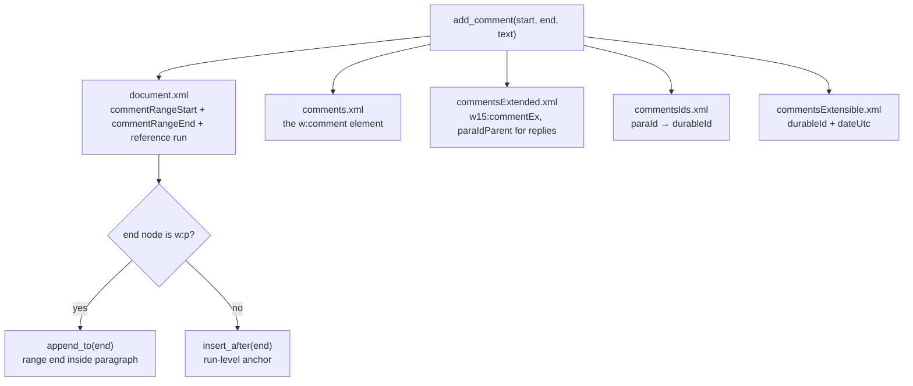
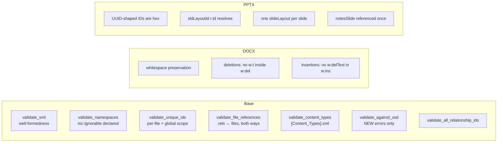
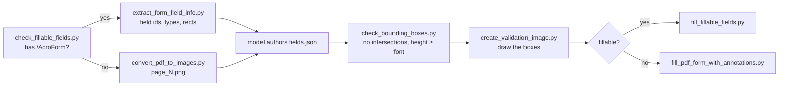

# 60 — Document Skills (`docx` / `pptx` / `xlsx` / `pdf`)

> [!INFO] Scope
> `skills/document_skills/` — **8,926 lines across 32 files**, of which **1,845 are a byte-identical duplicate tree**. Ten distinct programs: a Word tracked-changes library, an OOXML validator stack, three PowerPoint manipulation scripts, an Excel recalculation driver, eight PDF form scripts, and a pack/unpack pair. Every file read in full.

These are the only skills in Sable that write binary Office formats. Everything here shells out to LibreOffice or manipulates zipped XML directly, which makes them the highest-blast-radius leaf code in the tree — a corrupt `.docx` is indistinguishable from a malicious one to the user.

***

## 1. Inventory and the duplicate tree

| Area | Lines | Nature |
|:--|--:|:--|
| `docx/scripts/document.py` | 1,276 | Tracked changes + comments library |
| `pptx/scripts/inventory.py` | 1,020 | Text extraction, overflow/overlap detection |
| `*/ooxml/scripts/validation/base.py` | 951 ×2 | Shared validator (identical) |
| `pptx/scripts/thumbnail.py` | 451 | Slide grid renderer |
| `pptx/scripts/replace.py` | 385 | Text replacement driver |
| `docx/scripts/utilities.py` | 374 | `XMLEditor` + line-tracking parser |
| `*/ooxml/scripts/validation/pptx.py` | 315 ×2 | PPTX validator (identical) |
| `*/ooxml/scripts/validation/redlining.py` | 279 ×2 | Redlining validator (identical) |
| `*/ooxml/scripts/validation/docx.py` | 275 ×2 | DOCX validator (identical) |
| `pptx/scripts/rearrange.py` | 231 | Slide reorder/duplicate |
| `xlsx/recalc.py` | 179 | LibreOffice recalc + error scan |
| `pdf/scripts/*.py` (8 files) | 683 | Form field extract/fill/verify |
| `*/ooxml/scripts/pack.py` | 159 ×2 | Directory → Office file |

> [!WARNING] The `docx/ooxml/` and `pptx/ooxml/` trees are identical, not merely similar
> All five files (`base.py`, `docx.py`, `pptx.py`, `redlining.py`, `__init__.py`, `pack.py`, `unpack.py`, `validate.py`) verify as identical by `md5sum`. A fix to the shared validator must be applied **twice**, and there is nothing in the code that says so. This is a maintenance trap, not a bug — but it is why the two trees can silently diverge under edit.

***

## 2. `docx/scripts/document.py` — the tracked-changes library

### 2.1 Object model

Two classes, one inheriting the other:

```
XMLEditor            (utilities.py)   — parse, find-by-line, insert/replace, save
   └── DocxXMLEditor (document.py)   — adds RSID / author / date injection
         └── used by Document       — comment plumbing, validation, save
```

`DocxXMLEditor._inject_attributes_to_nodes` is the whole value-add: every inserted fragment gets `w:rsidR`/`w:rsidRDefault`/`w:rsidP` on paragraphs, `w:rsidDel` (not `w:rsidR`) on runs **inside** a `w:del`, `w:id`/`w:author`/`w:date` on revision marks, and `xml:space="preserve"` on any `w:t` with leading or trailing whitespace. Word rejects documents missing any of these, usually with a generic "unreadable content" dialog.

The `is_inside_deletion` walk is the subtle part — it ascends `parentNode` looking for `w:del`, because a run inside a deletion needs `w:rsidDel` and a run outside needs `w:rsidR`. Getting that backwards produces a document Word opens and then silently un-tracks.

### 2.2 Comment plumbing — four XML parts, written eagerly

Adding one comment touches **five** files. This is the part that has no room for laziness:



`reply_to_comment` is the awkward one. It finds the parent's `w:commentRangeStart` and `w:commentReference`, inserts the child's range start *after* the parent's start, then inserts the child's `commentRangeEnd` and reference run *after the parent's reference run*. Since Word renders reply threading purely from `w15:paraIdParent`, the spatial placement only has to be *inside* the parent's range — the code achieves that by construction, and `RedliningValidator` (below) is what catches it when it does not.

`save()` re-ensures comment relationships and content types, saves each cached editor, runs both validators, then copies the temp tree over the destination. **Validation is on by default** — a caller who passes `validate=False` is explicitly opting out of the only corruption guard.

### 2.3 Reject-a-change pair

| Method | Input | Result |
|:--|:--|:--|
| `revert_insertion` | `w:ins` | Wraps the inserted runs in `w:del`, converts `w:t` → `w:delText`, swaps `w:rsidR` → `w:rsidDel` |
| `revert_deletion` | `w:del` | Clones the deleted runs into a **new** `w:ins` after the `w:del`, converts `w:delText` → `w:t` |

Both collect their targets **before** mutating the DOM — `revert_deletion` is explicit about it (`# Collect deletions FIRST - before we modify the DOM`), because `insert_after` invalidates the live node list. Both raise `ValueError` if the supplied element contains nothing to act on, rather than silently no-op'ing.

`suggest_deletion` has a third branch the others lack: a **numbered-list paragraph** gets `<w:del/>` inserted into `w:rPr` inside `w:pPr`, because wrapping the whole paragraph in `w:del` destroys the numbering definition. That detail is the difference between a clean tracked delete and a renumbered list.

***

## 3. `docx/scripts/utilities.py` — line-addressed XML editing

`XMLEditor` exists so that a model reading a rendered XML file with line numbers can say "edit what is on line 519" and have it mean something. The trick is a monkey-patched SAX handler:

```python
def startElementNS(name, tagName, attrs):
    orig_start_cb(name, tagName, attrs)
    cur_elem = dom_handler.elementStack[-1]
    cur_elem.parse_position = (
        parser._parser.CurrentLineNumber,
        parser._parser.CurrentColumnNumber,
    )
```

Every element then carries `parse_position`, and `get_node(tag=..., line_number=range(100, 200))` filters on it. `get_node` requires **exactly one** match and raises with a diagnostic hint on zero or many — the hints differ by which filter was used (`contains` → "text may be split across elements"; `line_number` → "line numbers may have changed").

The `contains` filter runs `html.unescape` on the search string before comparing, so both `&#8220;Agreement` and `\u201cAgreement` match the same node. `_get_element_text` skips whitespace-only text nodes, which prevents XML indentation from ever satisfying a `contains` search.

`_parse_fragment` extracts every `xmlns*` declaration off the document root and re-declares them on a synthetic `<root>` wrapper before parsing the fragment, then `importNode`s the children in. Without that, any inserted fragment using a prefixed tag would fail to parse.

***

## 4. The validator stack

`BaseSchemaValidator` (`base.py`, 951 lines) runs six independent checks; the format subclasses add their own:



### 4.1 The differential XSD check

`validate_file_against_xsd` does not ask "is this file valid" — it asks **"did I introduce errors"**. It validates the modified file, unpacks the original `.docx`, validates the corresponding original file, and subtracts:

```python
new_errors = current_errors - original_errors
```

Errors are stored as `error.message` with line numbers stripped, so a pure line-shift does not register as a new error. This is the correct design: real-world Word documents routinely fail strict XSD, and a validator that rejected them would be unusable.

The cost is that the original is unzipped **once per file validated** (`_get_original_file_errors` opens the zip inside the per-file call). For a deck with 60 slides that is 60 zip extractions of the same archive.

### 4.2 Namespace scrubbing before validation

`_clean_ignorable_namespaces` and `_remove_ignorable_elements` strip every element and attribute whose namespace is not in `OOXML_NAMESPACES` before handing the tree to the schema. This is what makes `mc:Ignorable` work: a document may declare `w16du` content that the ISO-IEC29500 schema has never heard of, and the validator must ignore it rather than fail. `_preprocess_for_mc_ignorable` deletes the `mc:Ignorable` attribute itself, since the schema does not permit it either.

### 4.3 `RedliningValidator` — the text-equality oracle

This is the most interesting checker in the package. It removes **every tracked change authored by `"Claude"`** from both the original and the modified document, then asserts the remaining text is byte-identical:

```python
self._remove_claude_tracked_changes(original_root)
self._remove_claude_tracked_changes(modified_root)
if self._extract_text_content(modified_root) != self._extract_text_content(original_root):
    → fail with a git word-diff
```

Removing a `w:ins` **deletes** it (content was added, so removing the record removes the content). Removing a `w:del` **unwraps** it and converts `w:delText` back to `w:t` (content was removed, so removing the record restores it). If the two texts differ after that, the edit was not properly tracked — full stop.

The failure message enumerates the three ways this happens and the exact remedy for each:

> 1. Modified text inside another author's `<w:ins>` or `<w:del>` tags
> 2. Made edits without proper tracked changes
> 3. Didn't nest `<w:del>` inside `<w:ins>` when deleting another's insertion

Empty paragraphs are skipped in `_extract_text_content`, deliberately — a tracked insertion that adds only structure would otherwise trip the comparison.

The diff is produced by shelling out to `git diff --word-diff=plain --word-diff-regex=. -U0 --no-index` between two temp files, with a fallback to word-level diff if character-level output is empty, and a hard fallback to "git not available" text. Three levels of degradation, each correct.

***

## 5. `pptx/scripts/` — inventory, replace, thumbnail, rearrange

### 5.1 `inventory.py` — text extraction with geometry

1,020 lines whose job is to answer "what text is on this slide, where, and does it fit".

- `collect_shapes_with_absolute_positions` recurses into `GroupShape` accumulating parent offsets, because a child's `left`/`top` are **relative to its group**. Without this, every grouped shape reports the wrong position and overlap detection is meaningless.
- `sort_shapes_by_position` sorts by `(top, left)` then re-groups anything within **0.5 inches** vertically into a row and sorts that row by `left`. That tolerance is what makes reading order match visual order.
- `_estimate_frame_overflow` is a genuine text-layout simulation: it loads the real font via PIL (`get_font_path` searches platform font dirs, exact then fuzzy), wraps every line against usable width with `draw.textlength`, and multiplies by line height derived from `line_spacing` (converted from points to pixels at 96 DPI) or font size.
- `_get_usable_dimensions` subtracts actual `margin_*` from the text frame, defaulting to PowerPoint's 0.05" top/bottom and 0.1" left/right.
- Thresholds are deliberate: frame overflow under **0.05"** and slide overflow under **0.01"** are ignored as rounding noise.

`_detect_bullet_issues` flags any paragraph whose text begins with `•`, `●` or `○` followed by a space — a manually-typed bullet instead of a real `a:buChar`. That distinction matters because `replace.py` clears bullets and re-applies formatting from the inventory: a manual bullet would be preserved as literal text and double up.

### 5.2 `replace.py` — clear everything, re-apply

The contract is stated in its own docstring and it is strict: **every** text shape found by inventory is cleared, whether or not the replacements JSON mentions it. Only shapes with a `paragraphs` key get new content.

`validate_replacements` runs first and, on a bad shape key, lists the shapes that *were* available along with a 50-character preview of their text — so the error message tells you the correct key to use.

Bullet indentation is font-proportional rather than fixed:

```python
level_indent_emu   = int((font_size * (1.6 + level * 1.6)) * 12700)
hanging_indent_emu = int(-font_size * 0.8 * 12700)
```

After replacing, it saves to a temp file, **re-runs the whole inventory on the output**, and fails if overflow got worse by more than 0.01" or if any bullet warnings appeared. The temp-file round-trip is deliberate: `extract_text_inventory` accesses `font.color`, which mutates the package by adding empty `<a:solidFill/>` elements.

### 5.3 `thumbnail.py` — PDF round-trip

`soffice --headless --convert-to pdf` then `pdftoppm -jpeg -r 100`, then grid composition. Hidden slides are detected via `slide.element.get("show") == "0"` and replaced with a generated grey placeholder carrying a drawn X, so slide numbering in the grid stays aligned with the real deck.

Grid capacity is `cols × (cols + 1)`: 3→12, 4→20, 5→30, 6→42. Over that, numbered files spill (`prefix-1.jpg`, `prefix-2.jpg`).

The `--outline-placeholders` path draws red rectangles over every text region using the inventory's inch coordinates scaled by the **actual** PDF page size, not the image size — which is why `get_placeholder_regions` returns `slide_dimensions` alongside the regions.

### 5.4 `rearrange.py` — duplicate, delete, reorder

Three ordered passes, and the ordering is load-bearing:

1. **Duplicate** every repeated index first (duplicating later would shift the indices you still need).
2. **Delete** unwanted slides backwards (`range(len-1, -1, -1)`) so earlier deletions do not invalidate later indices.
3. **Reorder** to target positions, adjusting the `slide_map` on every move.

`duplicate_slide` clears the new slide's placeholder shapes **before** copying (`CRITICAL: Clear placeholder shapes to avoid duplicates`), then deep-copies each source shape in. For pictures it re-targets `a:blip/@r:embed` by creating a fresh relationship on the destination slide via `part.rels.get_or_add(reltype, target)` — reusing the source `rId` would point at a relationship that does not exist in the new part.

***

## 6. `xlsx/recalc.py`

Drives LibreOffice through a **StarBasic macro** it installs on first use:

```basic
Sub RecalculateAndSave()
  ThisComponent.calculateAll()
  ThisComponent.store()
  ThisComponent.close(True)
End Sub
```

`setup_libreoffice_macro` writes `Module1.xba` into the user profile only if the macro is absent, and bootstraps the profile directory by running `soffice --headless --terminate_after_init` with a 10-second timeout. The macro is invoked as `vnd.sun.star.script:Standard.Module1.RecalculateAndSave?language=Basic&location=application`.

Timeout handling is platform-aware: `timeout` on Linux, `gtimeout` probed on macOS (and skipped if absent), nothing on Windows. Exit code 124 is treated as success-with-timeout rather than failure, because LibreOffice's store-then-close frequently outlives the wall clock.

The error scan then opens the result twice — once `data_only=True` to find cached error values, once `data_only=False` to count formulas — walking **every** cell in **every** sheet with no limits. All seven Excel error strings are collected with up to 20 locations each.

***

## 7. `pdf/scripts/` — the form-filling pipeline

The eight scripts form a closed loop around a `fields.json` that the model authors:



`extract_form_field_info.py` is the densest. It distinguishes text / checkbox / choice / radio_group, resolves fully-qualified field ids by walking `/Parent` chains (`get_full_annotation_field_id`), and handles the PDF checkbox convention where `/_States_` holds exactly two entries and `/Off` is always the unchecked value — but may be either element of the pair, so the code checks which one is `/Off` rather than assuming position. Fields whose annotation cannot be located are reported and dropped.

Sorting uses PDF coordinates, which are bottom-left origin: the key is `[-rect[1], rect[0]]` — negated Y, so visual top-to-bottom.

`check_bounding_boxes.py` is the quality gate, and it checks two distinct things: no rectangle intersects any other rectangle **on the same page** (touching edges do not count — `>=` / `<=` in `rects_intersect`), and every entry box is at least as tall as its font size. It caps output at 20 messages and aborts with "fix bounding boxes and try again".

`fill_pdf_form_with_annotations.py` is the non-fillable path: it converts image-pixel bounding boxes to PDF points by scaling and **flipping Y** (`top = pdf_height - bbox[1] * y_scale`), then emits `FreeText` annotations with `border_color=None, background_color=None` so only the text appears. Its own comment admits font size and colour are unreliable across viewers — a pypdf limitation it cannot fix.

`fill_fillable_fields.py` validates every supplied value against the extracted field type before writing: checkbox values must equal `checked_value` or `unchecked_value`, radio and choice values must be in the option list. Any mismatch prints a per-field error and `sys.exit(1)` **before** the writer is touched. That is the right order.

***

## 8. Findings

| # | Location | Finding | Sev |
|:--|:--|:--|:--|
| 240 | `pdf/convert_pdf_to_images._convert_with_pypdf` | **The pure-Python fallback does not render anything.** It builds a `PdfWriter` and a `BytesIO`, never uses either, and appends a blank white `Image` at page dimensions. The inner `except` appends a hardcoded 800×1100 white page. Every machine without Poppler therefore gets a set of blank PNGs and a success exit code — the model then authors `fields.json` coordinates against blank pages. | 🔴 |
| 241 | `docx/ooxml/scripts/validation/docx.py:204` | `count_paragraphs_in_original` calls `os.path.join`, but the module imports only `re`, `tempfile`, `zipfile`, `lxml.etree`. The `NameError` is swallowed by `except Exception`, so the function always returns `0`. `compare_paragraph_counts()` consequently prints `Paragraphs: 0 → N (+N)` on every single validation run, for every document. Cosmetic only — it does not feed `all_valid` — but the one number the validator prints for humans is always wrong. | 🟠 |
| 242 | `pdf/fill_fillable_fields.py` | `monkeypatch_pydpf_method()` is called **only inside `if __name__ == "__main__"`**. Any caller that imports `fill_pdf_fields` — or the skill harness invoking the module differently — gets the unpatched pypdf and hits `TypeError: sequence item 0: expected str instance, list found` on every `<select>` choice field, exactly as the 20-line comment above the patch describes. | 🟠 |
| 243 | `docx/scripts/utilities._parse_fragment` | `assert elements, "Fragment must contain at least one element"` is the only guard against an empty or comment-only insert. Under `python -O` the assert vanishes and `importNode` is skipped for a fragment that produces nothing, leaving the caller's node references pointing at an unreplaced element. Second live instance of the `assert`-as-only-guard convention. | 🟠 |
| 244 | `xlsx/recalc.py` | Error classification is inverted: `if 'Module1' in error_msg or 'RecalculateAndSave' not in error_msg:` — the second clause is true for *almost every* possible `error_msg`, so the specific `else: return {'error': error_msg}` branch is unreachable in practice and every LibreOffice failure is reported as "macro not configured properly". Should be `and`. | 🟡 |
| 245 | `pptx/scripts/rearrange.py` | Depends on `six` for `six.iteritems(source.part.rels)`. `six` is unmaintained and is the only such dependency in `document_skills/`; `.items()` has been correct in every supported Python. | 🟡 |
| 246 | `pptx/scripts/thumbnail.py` | Grid labels are `start_slide_num + i` where `start_slide_num` begins at `0`, so the grid labels slides **0-based** — while hidden-slide detection, the placeholder path and `slide-N` inventory keys are all **1-based**. A reader comparing a grid to the inventory is off by one. | 🟡 |
| 247 | `ooxml/scripts/pack.condense_xml` | Skips `element.tagName.endswith(":t")` when stripping whitespace-only text nodes, which covers `w:t` and `a:t` but **not `w:delText`**. A tracked deletion whose entire content is whitespace loses that content on repack. Marginal, but it is a tracked change being silently altered. | 🟡 |

> [!NOTE] Killed finding — not filed
> I initially believed `inventory.py` assigned `shape_id` *after* `ShapeData.__init__` had already run overlap detection, and that `detect_overlaps`' `assert shape1.shape_id` would therefore trip. Re-reading `extract_text_inventory`: `sort_shapes_by_position` → `shape_id` assignment → `detect_overlaps`. `ShapeData.__init__` computes frame/slide overflow only, never overlaps. **The order is correct and there is no bug.** Recording it so it is not re-investigated.

***

## 9. Conventions touched

| Convention | Instances here |
|:--|:--|
| Two implementations, one flaw | #240 is the fallback that exists only to not crash, and so produces wrong output instead |
| A correct helper not used | #242 (`monkeypatch_pydpf_method` defined, gated behind `__main__`) |
| `assert` as the only guard | #243 |
| Correct only on the author's machine | #240 presumes Poppler; `recalc.py` presumes LibreOffice; `thumbnail.py` presumes both `soffice` and `pdftoppm` — none are declared as dependencies anywhere in the skill |

> [!IMPORTANT] What this area gets right
> Three things deserve to survive future refactors: `RedliningValidator`'s remove-and-compare text oracle, `replace.py`'s re-inventory-and-diff-after-write, and `fill_fillable_fields.py`'s validate-before-write. Each one refuses to report success without checking the artifact it just produced.
