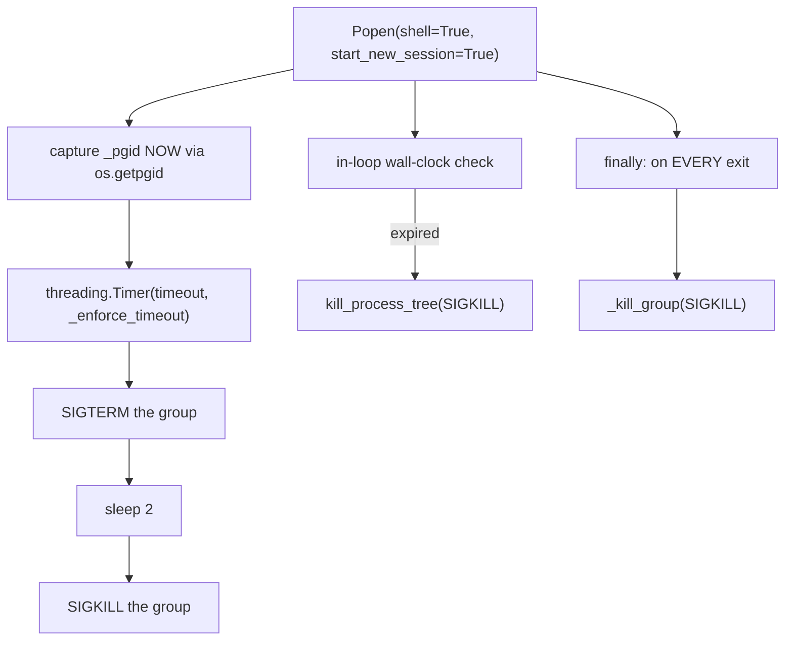

# 61 — `engine/skills/handlers/` — the 34-tag dispatch surface

> [!INFO] Scope
> `engine/skills/handlers/` — **5,420 lines across 20 modules**, all 40 `HANDLER_MAP` entries read, plus re-reads of `parser.py` head, `common.py` tail, and the `_sync_agent_context` path. Doc 29 documented this area at contract level; this is the line-by-line pass. **With this doc, application Python is fully read.**

This is the layer every model turn passes through. Every tag the model writes — `<browser>`, `<spawn_agent>`, `<execute_command>`, `<study_note>` — lands in one of these generators. The signature is uniform and it is a good one:

```python
def handle_x(tag_id, name, attrs, content) -> Generator[dict, None, None]
```

Every handler yields zero or more `skill_output` events and terminates with exactly one `skill_end` carrying `ok`. That single contract is what lets `execute.py` stream a 10-minute build while `ask_user.py` yields two events and pauses the turn. It is the most consistently applied convention in the codebase.

***

## 1. The dispatch table

`__init__.py` maps 34 keys to 26 handler functions. Aliases are deliberate:

| Alias | Real handler | Why |
|:--|:--|:--|
| `read_file` | `get_file` | Old model output, still parsed |
| `web_search`, `online_search` | `handle_online_search` | Same function, schema name drifted |
| `web_fetch` | `handle_online_search` | Dispatched by the presence of `urls` |
| `memory_manager` | `handle_memory` | |

`web_fetch` and `web_search` sharing one handler is the only place the dispatch table is *semantically* branched rather than aliased — `handle_online_search` checks `attrs.get("urls")` first and falls through to query mode. That is why the function is 90 lines of dispatch at the top and search at the bottom.

> [!WARNING] `handle_load_tool` is imported from a module doc 29 never listed
> `from engine.skills.handlers.load_tool import handle_load_tool` — `load_tool.py` (61 lines) is a separate file that defines only this one handler. It upgrades an `[OUTER]` tool stub to its full schema mid-conversation and returns `list_outer_tools()` as the error payload when the name is wrong, which is the right shape: the model gets the valid list instead of a bare failure.

***

## 2. `execute.py` — the most carefully written handler in the tree

587 lines and almost every one of them is a scar. Four distinct mechanisms protect the same operation:



### 2.1 Why the pgid is captured at spawn

The comment states it plainly and it is the single most important line in the file:

> The group outlives its leader. Once the shell exits and is reaped by `proc.wait()`, `/proc/<pid>` disappears and `os.getpgid(pid)` can no longer resolve the group — so we would permanently lose our only handle on any descendants the command left behind.

I initially flagged the in-loop `kill_process_tree(proc.pid, sig=SIGKILL)` at line 226 as inconsistent with the `_kill_group` helper used everywhere else. **That finding was wrong and I killed it.** `popen_kwargs()` returns `start_new_session=True`, so the shell *is* the group leader (`pgid == pid`), and `kill_process_tree` explicitly handles that case — it resolves the pgid before any liveness check and killpg's when `pgid == pid`, with a dedicated comment about the zombie-leader scenario. At the in-loop deadline the leader is still alive (we are reading its stdout), so the call is correct. Two mechanisms, same result, by different routes.

### 2.2 The `finally` block that used to do nothing

The block carries a long, specific apology for its own past:

> Previously this block only cancelled the timer, i.e. it DISARMED the one thing that would ever have killed the child, then walked away. Any command still running at Stop time was orphaned deliberately.

The old guard was `if proc.poll() is None:` — wrong in both directions. On normal completion the shell has already been reaped, so `poll()` is not `None` and the kill was **skipped**, leaking every `nohup x &`. On Stop the leader is a zombie or gone and `/proc/<pid>` no longer resolves. The fix — unconditional `_kill_group(SIGKILL)` using the spawn-time pgid — is correct because `killpg` on an empty group raises `ESRCH` and is swallowed.

### 2.3 Output capping, three ways

| Mechanism | Bound | Purpose |
|:--|--:|:--|
| SSE batching | ~4 KB | Batch lines into one event; `zip`/`find` would otherwise emit thousands |
| Emitted cap | `RESULT_PREVIEW_CHARS` (75,000) | What the model sees |
| Spill file | `tmp_path("sable_full_exec_*.log")` | Full output recoverable by `view_file`/`grep` |

The batching comment names the exact commands that motivated it. The spill mechanism is what makes the cap safe rather than lossy — the truncation message includes the path, and the model is told to `view_file` it.

### 2.4 Hard blocks before spawn

Three refusals run before `Popen`, and each is a correct guard:

- `sable.service` restart/stop — the agent cannot kill the process serving it.
- `git checkout` — destroys uncommitted work, no recovery path.
- Sudo password injection is POSIX-only and replaces only the first standalone `sudo` token via `(?<![\w-])sudo(?![\w-])`, so `sudo -S` is not double-injected and `visudo` is not mangled.

### 2.5 Editor introspection without a subprocess

`parse_editor_command(cmd)` inspects the shell command string for `editor_tools.py`, extracts the `(op, path)` pair, and — when the command succeeds — builds a `file_edit` SSE event with a line diff for the sidebar. This is the code path that lets the UI show a diff for a command the model ran through `execute_command` rather than through `edit_file`. `build_file_edit_event` reads the file back from disk for `create` rather than trusting stdout.

***

## 3. `browser.py` — 60 actions, one generator

444 lines, one `if/elif` chain from `open` to `console_clear`. Three design decisions carry it:

**Lifecycle verbs do not auto-launch.** `status` and `close` return before `session.ensure_started`, so a `status` check never spawns a Chromium. Everything else launches if `not session.alive` and reports `launched_now` in the result so the model knows it just paid a 2-second cost.

**Post-click screenshots drop the selector.** The code comments the reason:

> Drop the selector: the element we just clicked is usually gone after a navigation, and screenshotting it stalls 30s waiting for a detached handle.

**A non-dict return is wrapped rather than crashing.**

```python
if not isinstance(result, dict):
    result = {"result": result}
```

That is defensive coding aimed at one specific failure mode — a session method that forgets its return type turning a *successful* action into a `TypeError` two lines later.

`snapshot` is the exception to the JSON-preview rule: it yields the accessibility text, then returns only `{"count": n}`. The comment says why — the refs and URL are already in the text, so echoing them as JSON doubled the output for no new facts.

> [!NOTE] Known, filed elsewhere
> `_launch_opts` runs before the `try` block, so `width="abc"` raises out of the generator instead of yielding a failed `skill_end` (#52). `_OUTPUT_DIR` and screenshot accumulation are covered by #253 below.

***

## 4. `agents.py` — the pipeline-reuse decision

The module docstring is the architectural statement:

> Subagents use the EXACT same pipeline as main chat. `spawn_agent` emits SSE events that cause the frontend to call `POST /api/chat` with the agent's `chat_id`, `model`, and system prompt. No isolated LLM loop, no skill filtering, no extra parsing logic.

The handler therefore does not run an agent. It registers state (`runtime._agents[agent.id]`, `ensure_chat`, `insert_agent_run`), then pushes `agent_start` and `agent_trigger` to the `agent-events` queue and returns a `skill_end` so the main loop continues. Two events, not one, because `agents.js` listens on its own `EventSource` and the main chat stream ignores these types to prevent double-triggering.

`teacher_guidance` is a two-line handler in contrast — it calls `auto_turn.resolve_teacher_guidance(agent_id, guidance)` and returns. The escalation/resolution state lives in `auto_turn`, not here.

> [!NOTE] Known, filed elsewhere
> Four `logger.warning("[AGENT_DEBUG] …")` calls and the in-loop `PurePosixPath` import are #55.

***

## 5. `study.py` — four handlers over a domain layer

The largest handler module (660 lines) and the only one that speaks to a store rather than the filesystem. Every mutation calls `ctx.mark_changed(...)` so the reader re-renders live:

```python
if ctx:
    ctx.mark_changed("highlights", doc_id=doc_id)
```

That is the mechanism that makes a model-authored highlight appear on the page immediately, and it is applied uniformly across `highlights`, `notes`, `progress` and `bookmark`.

Three helpers do the argument work:

| Helper | Behaviour |
|:--|:--|
| `_resolve_doc_id` | explicit `doc_id` → ContextVar → JSON content blob |
| `_parse_pages` | `"3"`, `"3-12"`, `"1,4,9"` → ordered, deduped, capped list |
| `_attr_json` | attrs entry that may hold JSON; falls back to the raw string |

`highlight_text` is the interesting action: it calls `study_pdf.find_text_rects(doc_id, page, text)` and, on failure, tells the model exactly what to do differently — *"Check the wording, or highlight a phrase that appears verbatim."* An error message that teaches.

> [!WARNING] Two findings live in this module's helpers — see #250 and #251.

***

## 6. The CLI wrappers

`memory_manager.py` and `tracknote.py` are thin shims over `tools/` scripts, both using `sys.executable`, both with a 15-second timeout, neither with `shell=True`. Argument construction is plain list append, so no injection surface.

`tracknote.py` carries one good detail the others lack:

```python
subprocess.run(cmd, capture_output=True, text=True, encoding="utf-8", errors="replace", timeout=15)
```

The comment names the reason — without explicit `encoding`, Windows CP1252 raises `UnicodeDecodeError` on any non-ASCII output.

`image_generator.py` (549 lines) is the largest wrapper and the most complex: five providers, an auto-fallback chain, per-provider model namespaces, and a batch path that splits between native-batch providers (Perchance, Puter, DreamForge, SDXL) and looped single-image providers (Cloudflare, Pollinations).

> [!WARNING] The provider/model guard in `image_generator.py` is defeated on the Pollinations path — #248.

***

## 7. Findings

| # | Location | Finding | Sev |
|:--|:--|:--|:--|
| 248 | `image_generator.py` `poll_model = attrs.get("model", "flux")` (×2, lines 385, 420) | **The provider/model sanity guard is defeated.** Lines 310–333 validate `model` against the chosen provider's namespace and rewrite it to the default when it looks foreign, with a user-visible warning. Lines 385 and 420 then re-read `attrs.get("model")` **raw**, discarding the corrected value. So `provider="pollinations" model="@cf/black-forest-labs/flux-1-schnell"` warns *"using default 'flux'"* and then sends the Cloudflare model ID to Pollinations anyway. The guard exists precisely for this case and the same function walks around it twice. | 🟠 |
| 249 | `web.py handle_openweb` | **Second unguarded URL-fetch entry point.** `handle_openweb` accepts `params.url` or the tag content, prepends `https://` if no scheme, and calls `httpx.get(url, follow_redirects=True)`. There is no scheme allowlist and no private-address block, so `http://127.0.0.1:8080/api/keys` and `http://169.254.169.254/latest/meta-data/` both fetch. #81 filed this exact flaw against `online_search._normalize_url`; this is a **separate function in a separate file** that #81 does not cover — the two-implementations-one-flaw pattern with the flaw present in both. | 🟠 |
| 250 | `study.py study_note` `create` | `"pinned": bool(_attr_json(attrs, "pinned"))`. `_attr_json` returns the **raw string** when `json.loads` fails, and `bool("false")` is `True`. A model passing `pinned="false"` — the natural stringification of a boolean attribute — pins the note. The inverse of the usual truthiness bug: the value that should turn the feature off is the one that turns it on. Same shape exists at `tags`/`refs` but `bool()` is only applied to `pinned`. | 🟠 |
| 251 | `study.py _parse_pages` | The range branch does `pages.extend(range(lo, hi + 1))` **before** the cap is applied, and the cap is `seen[:cap]` on the deduped result. `pages="1-9999999"` from a model builds a ten-million-element list in memory and then discards all but ten. The bound exists and is correct in effect, but it is enforced after the allocation rather than during it. | 🟡 |
| 252 | `grep_search.py` (all three handlers) | **One SSE event per output line.** `for line in lines: yield _output_event(tag_id, line + "\n")`. With `max_results` up to 200 a single grep emits 200 events — exactly the pattern `execute.py` explicitly batches into ~4 KB chunks to avoid, with a comment naming `zip`/`find`/`tar` as the motivation. The lesson was learned in one handler and not propagated to its three siblings in the same package. | 🟡 |
| 253 | `common.py make_backup` + `image_generator`/`browser` assets | **Unbounded on-disk growth, no pruning anywhere.** `make_backup` writes a full copy of the target file into `.sable_backups/` on every `edit_file`, `insert_file`, and overwriting `create_file` — two copies per edit once `editor_tools.edit_file(backup=True)` is counted (that doubling is already noted for `code_editor`). Generated images land in `ASSETS_DIR` and screenshots in the same directory; nothing removes either. This is the same shape as #50 (`get_file` uploads) but a much higher growth rate: a 1024×1024 JPEG per generated image, and a full file copy per edit. | 🟡 |
| 254 | `execute.py BG_JOBS` | Module-level dict keyed by pid. Entries are added on every `bg=true` command and removed **only** by an explicit `kill_command`. `check_command` updates `status` on the info dict but never evicts, so a session that starts fifty background jobs holds fifty entries plus their log files for the life of the process. Eighth instance of the unbounded-module-dict convention (#23, #118, #145, #165, #226, #238). | 🟡 |
| 255 | `file_ops.py handle_edit_file` | `make_backup(path)` runs **before** `_parse_search_replace_blocks(content)`. A malformed or empty SEARCH/REPLACE payload — the most common model failure mode — therefore writes a full copy of the file into `.sable_backups/` and then fails without editing anything. The backup should follow successful parsing. Combined with the `backup=True` argument, a successful edit produces two identical snapshots and a failed edit produces one useless one. | 🟡 |

> [!NOTE] Findings deliberately not re-filed
> `ask_user`'s `options[:8]` slice truncating after the auto-appended "Other" entry is #29. The `[AGENT_DEBUG]` logging in `agents.py` is #55. `critique.py` ignoring `attrs` is #53. `_launch_opts` running outside the `try` is #52. `get_file`'s un-cleaned uploads are #50. Those are real and already recorded; repeating them would inflate the ledger without adding information.

> [!NOTE] Killed candidates — do not re-investigate
> **`execute.py:226` `kill_process_tree` vs `_kill_group`** — I filed this as an inconsistency and withdrew it. `popen_kwargs()` returns `start_new_session=True`, so `pgid == pid`, and `kill_process_tree` resolves the pgid before its liveness check and killpg's on `pgid == pid` with an explicit zombie-leader comment. Correct on both routes. **`common.safe_under`** — resolves both sides, rejects on `base not in candidate.parents`, which also catches the `/a/b` vs `/a/bc` prefix case and symlink escapes. No bug. **`ask_user` default bounds-check** — validated against the final list after "Other" is appended, which is the correct order and was clearly a fix.

***

## 8. What this layer gets right

Worth stating explicitly, because this is where the model meets the filesystem:

1. **One contract, twenty modules.** Every handler is a generator that ends in exactly one `skill_end` with `ok`. No handler returns a bare dict, none raises into the caller.
2. **`safe_under` for every model-supplied path.** `create_note` is the only writer in the package and it goes through the resolver. No `../` escape, no symlink escape.
3. **Spill-not-drop truncation.** `execute.py` writes the full output to a tmp file and tells the model the path. Truncation is recoverable, not lossy.
4. **Errors that teach.** `study_document`'s text-not-found message, `ask_user`'s parse failure naming the raw input, `replace.py`'s list of valid shape keys — all three tell the model what to do next rather than only what went wrong.
