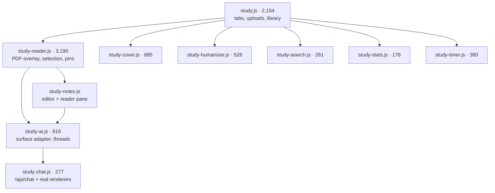

# 62 — Study Frontend: reader, AI surfaces, notes, cover, timer

> [!INFO] Scope
> The study cluster — **9,884 lines across 10 modules**, plus `study-chat.js` (277) and `study-ai.js` (816) which the reader depends on. `sse.js` and `render-components.js` were doc 25; the study *routes* were doc 22. This is the browser side.

This is the largest single feature in the frontend and the only place where a PDF, a live LLM stream, a mutable database and a drag-and-drop annotation layer all share one screen. The design decision that makes it tractable is stated in `study-chat.js` and repeated verbatim in `study-ai.js`:

> Study chats are ordinary chats. *"Mirror the main chat" is the whole design.*

Rather than build a private store, a private bubble renderer and a private SSE loop, study AI delegates to `POST /api/chat` with `layout_mode="study"` and calls the same `addMessage` / `addBotStreaming` / `consumeChatStream` / `addHistoryMessage` the main chat and critique feature use. Tool cards, thinking blocks and page images therefore render in study mode for free, and a bug fixed in `sse.js` is fixed in both.

***

## 1. Module map



`study-reader.js` is the only module that owns global page state; everything else either mounts into it or is driven by `study.js`'s tab router.

***

## 2. `study-reader.js` — the hard part

### 2.1 Memory management is the whole file

A 74-page deck with two full-bleed PNGs per page expands to roughly **1 GB of RGBA** if every page is held. The reader fights this at four levels, and each level has a comment explaining what broke without it:

| Mechanism | Bound | Comment's stated reason |
|:--|:--|:--|
| `pageCache` LRU | 10 pages | "an unbounded cache over 74 pages is a gigabyte the reader never gives back" |
| `releaseCanvas` | `canvas.width = 0` | "Detaching the element only marks it collectable, and the browser is in no hurry" |
| `unrenderPage` | outside the band | "the reader is a roach motel: pages check in and never leave" |
| `scheduleDocCleanup` | debounced 2 s | `pdfDoc.cleanup()` **throws** if any page is mid-render |

The `activeRenders` counter is the guard that makes the debounced cleanup honest, and the code says so directly:

> The old `rendering` boolean was declared, reset to false once, and never set true — a dead flag that guarded nothing.

It is incremented around both `page.render()` **and** `TextLayer.render()`, because `startCleanup()` clears TextLayer's shared static caches and would corrupt a layer still being built.

### 2.2 One intersection band, not two

The lazy-render observer uses a single `rootMargin: '1000px 0px'` for both rasterise and evict, with a comment recording the exact symptom that forced it:

> The old split — render in at 600px, evict out at 1500px — left a hole. A page evicted past 1500px never came back at 1400px... Pages sat blank across a ~900px band and popped in late. That pop-in is the flicker you were seeing while scrolling.

Active-page tracking deliberately does **not** come from the observer, because a 1000 px margin makes several off-screen pages report as intersecting. `pageAtViewportTop()` probes at **28% of the viewport height** instead, matching what the eye reads as the current page.

### 2.3 Selection is a three-problem problem

Highlighting text in a pdf.js layer is hard for three independent reasons, and each has a dedicated fix:

**a. The native selection text is wrong.** pdf.js spans are absolutely positioned and overlap by geometry, not by space characters. `sel.toString()` routinely returns a whole line for a one-word click. So the dictionary uses `wordAtPoint(x, y, pageEl)` — a caret-API probe clamped to the single text node, with a comment about the flattened string reading `"Breadth-FirstSearch"`. The deliberate decision *not* to snap the whole selection is documented in place.

**b. The bar keeps re-appearing.** `hlBarSuppressedUntil` mutes detection for 400 ms from `pointerdown` (which precedes the document's `pointerup`), and `hlBarDismissedText` refuses to re-show for the *same still-alive* selection. Cleared when the selection collapses, so re-selecting the same word works again.

**c. Text-layer orphans corrupt geometry.** `renderTextLayer` **clones and swaps** the container rather than setting `innerHTML = ''`:

> `TextLayer.render()` schedules work across rAF ticks, so a cancelled layer can still append its `.endOfContent` marker after the wipe. Those orphans pile up on every evict/re-render and poison `range.getClientRects()` — which is why selection geometry drifted worse the longer a session ran.

Selection is **never** cleared after an action. Three separate comments explain why — clearing it was what made the reader feel like it "ate" your selection.

### 2.4 The answer card's synthetic thread key

This is the cleverest piece of state management in the frontend. Every Define / Ask / Explain press must get its **own** conversation, separate from the document's Study AI thread. But a thread id must keep the shape `study-<docId>-<rand>` because the backend links a chat to its document with `^study-([0-9a-f]{32})-`.

The solution is two namespaces:

```javascript
function aiCardCtx(key) {
  return {
    getDocId:       () => key,              // map key — synthetic
    getGroundDocId: () => docId,            // the real document
    threadId: () => (tid || (tid = window.studyChat.newDetachedThread(docId))),
  };
}
```

`getDocId()` keys every in-memory map (threads, caches, busy flags) so the card never collides with the popup. `newDetachedThread` mints a real `study-<docId>-…` id *without* making it the document's active thread. The comment states the failure mode explicitly: a synthetic namespace "would silently orphan every card thread from its document".

`releaseSurface(key)` exists because those maps are keyed by a monotonic id — without it every press leaks one dead entry for the life of the tab.

***

## 3. `study-ai.js` — the adapter, and its two asymmetries

The adapter's central problem is **the reload flash**: an async DB load that resolves *after* a turn has started wipes the live user bubble and streaming answer. Three mechanisms guard it:

1. `isBusy(docId)` — checked before the fetch *and* after it.
2. `renderGen[docId]` — a monotonic token; a paint only lands if it is still the newest render.
3. `liveDirty[docId] = {tid, host}` — records that this exact host already holds this exact thread live, so `renderThread` skips the DB repaint entirely.

Each one has a comment naming the bug it fixes (`"message disappears, answer dumps at once"`, `"a saved thread flashed on screen and was then wiped"`, `"every finished turn flash back in as a reloaded dump"`). This is defensive code written against real symptoms, and it is correct.

> [!WARNING] Finding #257 lives here — `runTurn` clears its busy flag without `try/finally`.

***

## 4. `study-notes.js` / `study-cover.js` — two lessons applied

**`study-notes.js`**: the shared AI surface is mounted into the note editor with `{launcher: false}` and `mountSurface`, so the note AI is literally the same DOM as the document AI popup — same actions menu, same attachments, same tool cards. The only difference is the context adapter. `renderReaderPane` guards against blowing away an open editor with a check **both** before and after its `await`, and binds its delegated click handler once per host via `host.dataset.snWired` (the comment names the bug: "duplicate listeners, and duplicate editor opens").

**`study-cover.js`**: the form never rebuilds while typing. Inputs mutate `state` in place, repaint only the preview, and schedule a debounced 700 ms save. `paintPreview()` and `paintStatus()` are the only repaint paths during typing. `fitPreview()` measures the action bar's height and caps the scale on **both** axes, with the reason stated: without the height cap, a full-width column pushes Generate below the fold.

***

## 5. `study-timer.js` — patch, never replace

The 250 ms ticker would destroy buttons between `mousedown` and `mouseup` if it rebuilt the DOM, so the panel is split into **structure** (rebuilt only when `panelSignature` changes) and **live values** (patched in place):

```javascript
if (v._panelSig === sig) { updatePanelValues(v); return; }
```

The comment names both symptoms: "silently eats click events (the button 'sometimes' works)" and "wiped the alarm `<input>` while the user was typing". State persists as **absolute timestamps** in localStorage, so a reload does not lose a running countdown.

> [!WARNING] Finding #256 lives here — `destroy()` leaks the document listener.

***

## 6. Findings

| # | Location | Finding | Sev |
|:--|:--|:--|:--|
| 256 | `study-timer.js` `mount()` / `destroy` | **Every mount leaks a document-level listener forever.** `mount()` calls `document.addEventListener('mousedown', …, true)` capturing `wrap`; `destroy` is `() => views.delete(v)` and removes nothing. The reader mounts a timer per document open and `teardown()` never calls `destroy` at all, so opening N documents leaves N capture listeners on `document`, each holding a detached DOM tree and closing over a `views` entry that is gone. Every subsequent mousedown anywhere runs N stale handlers. | 🟠 |
| 257 | `study-ai.js` `runTurn` | **No `try/finally` around the busy flag.** `emitBusy(docId, true)` → `await window.studyChat.send(...)` → `emitBusy(docId, false)`. If `send` throws — and it can, before its own `try` starts at line 43 — the adapter-level `docBusy[docId]` sticks true, `isBusy()` returns true forever, and `renderThread`'s first guard (`if (!force && isBusy(docId)) return;`) makes the thread permanently unrepaintable. The sibling `sendCurrent` in the *same file* wraps its call in `try { … } finally { emitBusy(docId, false); }` — the lesson was applied one function away and not here. | 🟠 |
| 258 | `study-chat.js` `send` | **The busy flag is set before the `try`.** `busyByThread[threadId] = true` at line 13; `try` opens at line 43. Between them: `pane.querySelectorAll`, `addMessage`, `addBotStreaming`, `Object.assign`, and the `body` build. Any throw in that window leaves `busyByThread[tid]` true with no `finally` to clear it — and `send`'s very first guard is `if (busyByThread[threadId]) return;`, so that thread can never send again for the life of the page. The `finally` that does exist only covers the fetch onward. | 🟠 |
| 259 | `study-cover.js` `save` | **A save in flight silently drops the next one.** `if (saving) return;` at the top, and `save()` never re-schedules on that path. `scheduleSave` debounces 700 ms and sets `dirty = true`, but if the timer fires while a previous `PUT` is still open, the save is discarded and the field is only persisted on the *next* keystroke. Type-and-stop on a slow connection loses the last edit. The correct shape is a trailing re-run — set a `pending` flag in the guard and re-invoke in `finally`. | 🟡 |
| 260 | `study-humanizer.js` `refresh` / `openHumanizerView` | `refresh()` calls `host.innerHTML = renderTab()` and then restores the caret by `id`. If the textarea was scrolled, `scrollTop` is not restored — the pane jumps to the top on every persona/model/strength change. `paintPreservingFocus` in `study.js` exists for exactly this and solves it properly; it was not reused here. | 🟡 |

> [!NOTE] Killed candidate — do not re-investigate
> I flagged `textToRects` as broken because its docstring says it "builds a char-offset index" while the body anchors on first/last **word**. Reading the comment beneath it: the char-offset approach was tried and abandoned — *"`getTextContent` gives no stable per-char positions"* — and the word-anchor is the deliberate replacement, bounded to the selection span. The docstring is stale, the code is correct. Recorded so it is not filed again.

***

## 7. What this cluster gets right

Four patterns worth propagating to the rest of the frontend:

1. **Reuse the pipeline, don't reimplement it.** Study AI, note AI, the answer card and the critique card are all the same chat. `layout_mode` and a context adapter are the only differences.
2. **Two namespaces for a synthetic key.** `getDocId()` for maps, `getGroundDocId()` for requests. This is the correct way to isolate a surface without orphaning its persistence.
3. **Patch live values, rebuild structure.** The timer's `panelSignature` and `study.js`'s `paintPreservingFocus` are two solutions to the same class of bug: a repaint that eats focus, caret or a click in flight.
4. **Comments that name the symptom.** Nearly every non-obvious line in this cluster carries the bug that motivated it — the roach motel, the ~900px blank band, the orphaned `.endOfContent` marker, the `rendering` flag that guarded nothing. That is what makes 9,884 lines reviewable at all.
