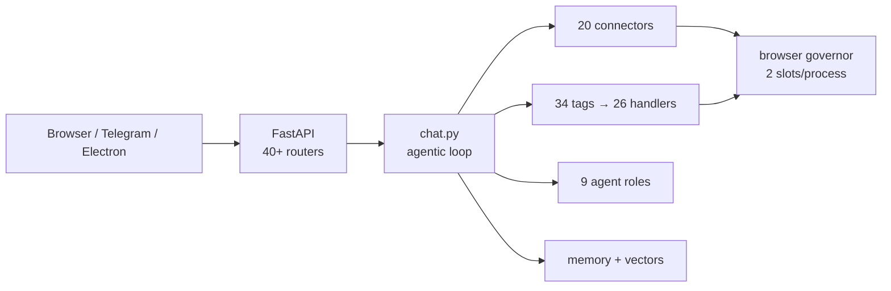

# Sable — Codebase Documentation

> Sable is **~137,000 lines of Python** across `engine/`, `server/`, `connectors/`, `skills/`, `tools/`, plus **~52,000 lines** of frontend JS and **~26,000 lines** of CSS. This directory holds **64 documents, 21,112 lines**, recording what that code actually does.
>
> **Application Python is now fully read.** Every router, every orchestration object, every connector, every skill handler, and every engine module has been read line by line. What remains partial is leaf frontend JS (~40% at line level) and the `tests/` + `scripts/` trees.
>
> **Read with a pen, not a sponge.** [[26-engine-library-rag]] exists because a 🔴 entry in this ledger was wrong — the doc predicted silent misattribution, and the code has a three-line guard that makes it impossible. When a later doc contradicts an earlier one, the later doc wins. Three other findings were filed and later **withdrawn** after re-reading; they are listed in §6 so nobody re-investigates them.

***

## What Sable is

A self-hosted agentic AI platform. FastAPI backend, vanilla-JS PWA frontend with no build step, multi-provider AI backend (Qwen / DeepSeek / Gemini / Groq / Mistral / Kimi / z.ai / MiMo / ChatGPT / Claude / local GGUF), Playwright browser automation, 15 skills + 21 tool dirs, multi-agent orchestration, and persistent memory with vector search.

| | |
|:--|:--|
| Default port | **61770** |
| Desktop shell | 61771 |
| Sealed starter | 61772 |
| Health check | `/api/health` |
| Python | 3.12, `uv`-managed |
| Frontend | ~60 `<script>` tags, no bundler — **load order is the dependency graph** |
| Database | SQLite WAL at `system/sable.db` (243 MB) |



***

## How to read this

### 🏗️ Track A — understand the architecture

```
00 → 11 → 12 → 03 → 17 → 13 → 25
```

Boot (00) → server wiring (11) → provider plugin (12) → core service/session objects (03) → the agentic loop that ties it together (17) → frontend map (13) → the two biggest JS modules (25).

### 🔍 Track B — debug a specific area

| Symptom | Start here |
|:--|:--|
| Chat hangs / no response / duplicate events | [[17-server-chat-route]] |
| Settings won't save / toggle does nothing | [[18-server-settings-route]] |
| Study upload or indexing stuck | [[22-server-study-routes]] → [[19-engine-library-index]] |
| DeepSeek rotation / amnesia / empty responses | [[21-connectors-deepseek]] |
| Rich UI block renders wrong or flickers | [[20-engine-ui-format]] → [[25-web-frontend-sse-and-components]] |
| Streaming text jank | [[25-web-frontend-sse-and-components]] §2 |
| Memory retrieval misses | [[23-server-memory-and-chats]] → [[09-memory-search-and-research]] |
| Scraper / browser / WAF | [[06-engine-browser-scraper]] → [[15-deep-dive-corrections]] |
| Ghost tab never works | [[48-inpage-and-browser-governor]] |
| Telegram | [[16-telegram-bot]] |
| Local model serving | [[56-engine-search-cookbook-root]] §2 |
| Office file corruption | [[60-document-skills]] |

### 📖 Track C — read everything

`00 → 63` in order. Each doc cross-references forward and back.

### 🎯 Track D — the one-document summary

[[features]] — every capability, every subsystem, in 584 lines.

***

## The documents

### Foundations

| # | Document | Lines | Covers |
|--:|:--|--:|:--|
| 00 | [[00-root-and-launchers]] | 177 | `start` (779L bash), `start.ps1`, launchers, `server.py`, `pyproject.toml`, `render.yaml` |
| 01 | [[01-sable-tools-vault]] | 246 | `sable-tools/` — crypto, seal, boot, vimport, Go starter, pinned trust root |
| 02 | [[02-brain-instruction-system]] | 211 | `Brain/` + `instruction/` — persona loading, memory files, tool format |
| 11 | [[11-server]] | 416 | `application.py`, `dependencies.py`, `auth.py`, `database/` |
| 12 | [[12-connectors]] | 292 | Provider contract, `get_connector`, 20 provider dirs |

### Engine — core

| # | Document | Lines | Covers |
|--:|:--|--:|:--|
| 03 | [[03-engine-root]] | 768 | `service.py` (1,962L) + `session.py` (1,480L) line-by-line |
| 04 | [[04-engine-skills]] | 726 | `parser.py` (1,928L) ~95%, skill dispatch, `build_tool_feedback` |
| 05 | [[05-engine-agents]] | 314 | Agent runtime, roles, resilience, `LoopDetector` |
| 06 | [[06-engine-browser-scraper]] | 516 | `scraper/core.py` + `scraper/stream.py` full |
| 07 | [[07-engine-config]] | 372 | `config.py` (1,494L) full — **supersedes doc 03's config section** |
| 08 | [[08-engine-search]] | 276 | Search providers, `browser_provider.py` |
| 09 | [[09-memory-search-and-research]] | 303 | `scoring.py` full, memory + research engines |
| 10 | [[10-engine-subsystems]] | 397 | study, drive, cookbook, mcp, security, diary, notifications, plugins |
| 15 | [[15-deep-dive-corrections]] | 496 | `browser_governor`, `response_normalizer`, `inpage`, `ui_format` — **corrects docs 03/06** |

### Engine — deep reads

| # | Document | Lines | Covers |
|--:|:--|--:|:--|
| 37 | [[37-engine-research-engine]] | 292 | `research/engine.py` (974L) full — fractal tree, rotation ladder, 3-stage report fallback |
| 38 | [[38-research-manager-study-store-memory-searcher]] | 271 | `research/manager.py` + `study/store.py` + `memory_search/searcher.py` full |
| 40 | [[40-engine-study-context-and-cover]] | 212 | `study/context.py` + both cover templates full. **`engine/study/` closed** |
| 41 | [[41-memory-search-support]] | 219 | `tokenize.py` + `cache.py` + `embedder.py` + `scoring.py` full |
| 43 | [[43-engine-agents-resilience-memory]] | 224 | `agents/resilience.py` (798L) + `memory_trigger.py` (772L) full |
| 44 | [[44-engine-agents-runtime-registry]] | 269 | `agents/runtime.py` + `auto_turn.py` + `registry.py` + `teacher.py` full |
| 45 | [[45-engine-agents-core-types]] | 179 | `agents/agent.py` + `loop.py` + `protocol.py` + `notifications.py` + `decomposer.py`. **`engine/agents/` closed** |
| 48 | [[48-inpage-and-browser-governor]] | 140 | `inpage.py` (994L) + `browser_governor.py` (954L) full |
| 55 | [[55-engine-root-utilities]] | 248 | 16 of 20 `engine/*.py` full (2,750L) — keyring invariant, tool tiers, shadow-git |
| 56 | [[56-engine-search-cookbook-root]] | 257 | `search/` (2,528L) + `cookbook/` (2,407L) + 4 root files. **Both dirs closed** |
| 57 | [[57-engine-subsystems-drive-mcp-scraper]] | 333 | `drive/` + `mcp/` + `notifications/` + `diary/` + `plugins/` + `scraper/` remainder |
| 58 | [[58-engine-security-and-skills-core]] | 265 | `security/` (689L) + `skills/` core (1,113L) |

### Engine — library & study

| # | Document | Lines | Covers |
|--:|:--|--:|:--|
| 19 | [[19-engine-library-index]] | 438 | `library_index.py` (1,184L) full — resumable OCR + embedding |
| 26 | [[26-engine-library-rag]] | 300 | `library_rag.py` (352L) full. **Corrects doc 19 §11** |
| 36 | [[36-library-stack]] | 359 | `library_catalog` + `_upload` + `_sessions` + `_ingest` + `routes/library.py` full. **Cleanest cluster** |
| 20 | [[20-engine-ui-format]] | 332 | `ui_format.py` (1,032L) full — Rich UI parser |

### Connectors

| # | Document | Lines | Covers |
|--:|:--|--:|:--|
| 21 | [[21-connectors-deepseek]] | 508 | `deepseek/client.py` (2,163L) full — PoW, rotation, six failure recoveries |
| 27 | [[27-connectors-browser-scraper]] | 412 | `common/browser_scraper.py` (1,517L) full — SSE tap, capture state machine |
| 28 | [[28-engine-scraper-engines]] | 264 | `scraper_engines/deepseek/` + `qwen/` — **two generations, older one not importable** |
| 30 | [[30-markdown-compat-humanizer]] | 274 | `markdown.js` + `openai_compat.py` + `humanize.py` full |
| 42 | [[42-connectors-common-shared-layer]] | 285 | `profile_hub.py` + `scraper_connector.py` + `instruction_builder.py` full |
| 46 | [[46-connectors-common-injection-native-media]] | 236 | `prompt_injection.py` + `native_tools.py` + `media.py` full |
| 47 | [[47-connectors-common-errors-jitter-budget]] | 264 | `browser_errors` + `jitter` + `context_summarizer` + `history_budget` + `error_ctx`. **`common/` closed** |
| 49 | [[49-connectors-ghost-hijack]] | 194 | `chatgpt` + `kimi` + `zai` clients — three transports, three strategies |
| 50 | [[50-connectors-api-key-providers]] | 160 | `gemini` + `local` + 3 pass-throughs |
| 51 | [[51-cookie-connectors-and-scrapers]] | 203 | `mistral_web` + `mimo` + 3 scraper engines |
| 52 | [[52-connectors-ghost-sessions-and-image-providers]] | 171 | 3 ghost sessions + cloudflare/puter/opencode. **`connectors/` closed** |

### Server

| # | Document | Lines | Covers |
|--:|:--|--:|:--|
| 17 | [[17-server-chat-route]] | 455 | `chat.py` (4,404L) full — **the agentic loop** |
| 18 | [[18-server-settings-route]] | 660 | `settings.py` (4,742L) full — ~120 endpoints |
| 22 | [[22-server-study-routes]] | 615 | `study.py` (2,340L) + `study_ai.py` (1,641L) full |
| 23 | [[23-server-memory-and-chats]] | 545 | `memory.py` (1,233L) + `chats.py` (1,196L) full |
| 24 | [[24-remaining-routers]] | 586 | 30 routers, ~13,550L |
| 39 | [[39-server-memory-route]] | 205 | `memory.py` **second pass** — 7 stores, 14 bare writes, 0 locks |
| 59 | [[59-server-non-route]] | 278 | `application.py` + `auth.py` + `database/` + PTY + 2 schedulers |

### Frontend

| # | Document | Lines | Covers |
|--:|:--|--:|:--|
| 13 | [[13-web-frontend]] | 182 | Module map + load order |
| 25 | [[25-web-frontend-sse-and-components]] | 708 | `sse.js` (3,753L) + `render-components.js` (2,562L) full |
| 35 | [[35-web-agent-ui]] | 274 | `render-html.js` + `msg-actions.js` + `agents.js` full |
| 54 | [[54-web-chat-and-settings]] | 229 | `chat.js` + `settings-init/projects/ui.js` full |
| 62 | [[62-study-frontend]] | 155 | study cluster — 9,884L across 10 modules |
| 63 | [[63-frontend-agents-filesystem]] | 141 | `agents.js` + `mode.js` + `core.js` full; filesystem/appearance |

### Tools, skills, integrations

| # | Document | Lines | Covers |
|--:|:--|--:|:--|
| 14 | [[14-tools-skills-bots-desktop]] | 250 | Tool manifests, skill README (**which is wrong**), desktop shell |
| 16 | [[16-telegram-bot]] | 497 | `telegram_bot/bot.py` (2,654L) full |
| 29 | [[29-engine-skills-handlers]] | 353 | `skills/handlers/` (5,401L) full — all 18 modules |
| 61 | [[61-engine-skills-handlers]] | 203 | **Second pass** — all 40 `HANDLER_MAP` entries, line by line |
| 31 | [[31-library-search-browser-session]] | 186 | `library_search.py` + `browser/session.py` (1,362L) full |
| 32 | [[32-tools-computer-use]] | 192 | `computer_use.py` (1,549L) full — 3 desktop backends |
| 33 | [[33-online-search-dil-parser]] | 170 | `online_search.py` + `dil_parser.py` full |
| 34 | [[34-tools-code-editor]] | 328 | `editor_tools.py` (1,017L) + `handlers/file_ops.py` full |
| 53 | [[53-document-skills-ooxml]] | 198 | `docx/document.py` + `pptx/inventory.py` + `utilities.py` full |
| 60 | [[60-document-skills]] | 299 | `document_skills/` remainder — 8,926L, 32 files, **1,845 a byte-identical duplicate** |

### Summary

| # | Document | Lines | Covers |
|--:|:--|--:|:--|
| — | [[features]] | 584 | **Every capability in one document.** Start here if you want the product, not the code |

***

## Bug ledger

**~255 findings** recorded across the set. Each entry states whether it was fixed when found — **almost none were**. Listed by severity; the full text is in the referenced doc.

### 🔴 Critical — silent corruption, guaranteed `NameError`, or a boundary that isn't there

| # | Where | Problem | Doc |
|--:|:--|:--|:--|
| 1 | `settings.py:1367` | `@router.post("/providers/custom/models")` attached to `_fetch_cloudflare_models`; the general handler has **no route at all** | 18 |
| 2 | `settings.py` | `/accounts/backup` + `/restore` each registered **twice**; FastAPI keeps the first, second pair is dead | 18 |
| 30 | `security/middleware` | `scan(ctx.content)` runs on **every** tag — `create_file` writing a doc *about* injection is blocked, no approval path. **Reproduced live** | 58 |
| 39 | `deepseek_engine.py` | Not importable: `Any` in annotation with no future-import, `Path` and `_SESSION_ID_RE` undefined | 28 |
| 41 | `qwen/engine.py` | `connect()` references undefined `logger`; `NameError` propagates on **attempt 1**, so the 5-attempt retry never runs | 28 |
| 42 | `qwen/engine.py` | `ProxyHTTPHandler` is a stub on a plain `TCPServer`, yet `use_obsidian` defaults **True** — CDP path cannot work | 28 |
| 44 | `ask_user` | `Other` appended then sliced by `options[:8]` — a model supplying 8 options always loses the manual-entry path | 29 |
| 57 | `openai_compat._trim_history` | Pops by char budget with no role awareness — orphans a `tool` message → API 400 | 30 |
| 58 | `openai_compat` | **Full conversation history to disk every turn, every provider**, unbounded, unredacted | 30 |
| 81 | `online_search._normalize_url` | No scheme allowlist, no private-address block → `file://`, loopback, `169.254.169.254` | 33 |
| 115 | `research/manager` | Never writes a mid-run checkpoint → resume restores **nothing**, starts fresh at full cost | 38 |
| 143 | `agents/loop.py` | Deprecated shim posts to `127.0.0.1:8080`; Sable runs on **61770**. Only path the scheduler has | 45 |
| 194 | `_loadOlderMessages` | No `try/finally` → `activePane` dangles + `_historyLoading` stuck; chat appears frozen until reload | 54 |
| 195 | `loadMessages` catch | Resets `_historyLoading` but **not** `activePane` — every later message renders invisibly | 54 |
| 201 | `account_login.py` | Omits `ignore_default_args` → mock keychain → cookies unreadable by every other component | 55 |
| 209 | `build_enhanced_query` | Appends `after:d` / `after:w` — `after:` takes a **date**. Corrupts every time-filtered query | 56 |
| 210 | `sable_provider._read_marker` | `os.kill(pid, 0)` **terminates** the target on Windows — kills the desktop shell | 56 |
| 232 | `application.py` | `[AUTH-DEBUG]` print writes the **full** Bearer token to stderr on every 401 | 59 |
| 233 | `auth.revoke_token` | A `SABLE_TOKEN` from env **cannot be revoked** — every revoke path only unlinks the file | 59 |
| 240 | `convert_pdf_to_images` | No-Poppler fallback renders **blank pages** and exits 0 — model authors coordinates against nothing | 60 |
| 7 | `processes.py` | `_system_cpu_percent` returns undefined `prev["pct"]` — fires when two polls land in one jiffy | 24 |
| 8 | `agents.py` | `kill_agent` calls `logger.warning` but the module never imports `logging` — fires exactly when upstream stop fails | 24 |
| 9 | `scraper.py` | Missing `HTTPException` **and** `_resolve_connector` — both routes raise `NameError` on every call | 24 |
| 11 | `sse.js` | `renderAskUserCard` treats the **last option** as an escape hatch — a 3-option question loses its third answer | 25 |
| 12 | `sse.js` | `retryLastCommand` POSTs to `/api/retry-command`, which **no router registers** — always 404s | 25 |

### 🟠 Security

| # | Where | Problem | Doc |
|--:|:--|:--|:--|
| 13 | `filesystem.py` | `_is_allowed` is **lexical only** (`normpath`) — symlink escapes browse roots, and `/api/filesystem/` is auth-exempt | 24 |
| 14 | `Brain/Protected.json` | **Google password in plaintext** on disk | 02 |
| 15 | `deepseek/client.py` | Every prompt and response to `logs/deepseek_raw.txt` — no rotation, no redaction | 21 |
| 82 | `dil_parser` | Self-closing `<script/>` slips past the raw-text drop — bypassable by one `/` | 33 |
| 137 | `memory_trigger` | `consolidation.txt` unbounded, unredacted, contains credential values | 43 |
| 148 | `media.py` | `mkdtemp` output never removed — up to 20 PNGs per doc conversion | 46 |
| 173 | `claude_scraper` | `_sse_line_buf` is a base-class contract with **no declaration** — a subclass naming it differently tears down the browser every turn | 51 |
| 179 | `kimi/ghost.py` | `_stream_lock.acquire()` with **no timeout** — an abandoned stream wedges every future message on that account | 52 |
| 184 | `chatgpt/ghost.py` | Every SSE event to disk, always, unbounded | 52 |
| 249 | `web.handle_openweb` | Second unguarded URL fetch — `#81` filed it against `online_search`, this is a **separate function** with the same flaw | 61 |
| 228 | `security/middleware` | `_BLOCKED_COMMANDS` has three word-boundary-less alternatives — `systemctl status reboot.target` is hard-blocked | 58 |

### 🟡 Correctness / concurrency

| # | Where | Problem | Doc |
|--:|:--|:--|:--|
| 3 | `library_index` | `existing.extend(batch)` outside the embed `try` → chunk/vector divergence. **Guarded downstream** — degrades to lexical, no misattribution | 19 → 26 |
| 4 | `library_index` | `model_obj is None` → cursor advances, stage marked **100% with zero vectors** | 19 |
| 5 | `library_index.run_job` | `finally` maps **every** non-stop exit to `done` — a crash reports success | 19 |
| 17 | `chats.py` | `os.chdir` + module-global `_pre_project_cwd` — cross-tab and cross-request CWD corruption | 23 |
| 18 | `fork_chat` | Docstring says "up to and including", SQL is `id < ?` — exclusive | 23 |
| 24 | `config.py` | `_SYSTEM = _ROOT / "system"` hardcodes the root, ignoring `SABLE_PERSISTENT_ROOT` → **state split across two trees** | 07 |
| 33 | `browser_scraper` | `_sse_active_req_id` recorded but **never used to filter the drain** — a stopped turn's XHR can append to the next answer | 27 |
| 68 | `library_search` | Snippets embed raw document text with `<mark>` around it — XSS if the consumer uses `innerHTML` | 31 |
| 69 | `browser/session.run` | `fut.result(timeout)` expires **without cancelling** — coroutine keeps running while the handler reports failure | 31 |
| 102 | `library_catalog` | `rebuild_from_meta` only upserts, **never deletes** — stale rows widen topic context forever | 36 |
| 104 | `library_ingest` | PDF and original written with bare `write_bytes` while text/meta/thumb use atomic writes | 36 |
| 105 | `routes/library` | `library_read_file` uses `str.startswith` — `notes_backup/` passes as `notes/` | 36 |
| 116 | `memory_search` | `_persist_episodic_access` writes `Memory.json` **unguarded**, on every retrieval that touches an episodic entry | 38 |
| 120 | `routes/memory.py` | **14 bare `write_text` across 7 stores, 0 `exclusive_lock`** — concurrent with #116 | 39 |
| 126 | `embedder.py` | Sync `httpx.post` on the event loop — up to 2×60 s | 41 |
| 132 | `resilience` | `SAME_TOOL_FAIL_HALT = 8` declared, **never used** — a model can fail one tool indefinitely | 43 |
| 133 | `resilience` | No-progress reset compares a 16-char hash against a different 16-char hash — **never fires**, so legitimate calls eventually block | 43 |
| 138 | `runtime._tasks` | **Never populated** — `wait()` returns immediately with a `RUNNING` agent's empty result; `kill()` never cancels | 44 |
| 139 | `registry.export_roles` | Rebuilds **nine full system prompts** on every settings-tab open | 44 |
| 144 | `agent.get_stream_history` | Applies an absolute index to a rolling deque — replay is **silently lossy** past 300 events | 45 |
| 146 | `prompt_injection` | Parses a URL as a provider name — `cfg.get("http")` can never succeed; saved only by the `or cfg.get("local")` fallback | 46 |
| 147 | `native_tools` | `parse_openai_function_call`'s streaming branch is **unreachable** — both blocks read the same key | 46 |
| 217 | `scraper/lifecycle` | `_cleanup_engine` returns **before** resetting state when `kill_browser=False` — `stop()` and `reset()` are no-ops | 57 |
| 218 | `json_sanitize` | `_normalize_backslashes` drops any backslash outside the valid-escape set — `\d+` → `d+`, silently rewriting regexes | 57 |
| 248 | `image_generator` | Provider/model guard is **defeated** — lines 385/420 re-read `attrs.get("model")` raw, discarding the corrected value | 61 |

### 🔵 Dead code, unbounded maps, and conventions that aren't

The docs record ~180 more at 🔵 level. Recurring shapes worth naming:

| Pattern | Instances |
|:--|:--|
| **Two implementations, one flaw** | `openweb`/`online_search` URL (#81/#249), `_trim_history` (#57/#152), ooxml trees (#186), `deepseek_engine.py` (#40) |
| **Base-class convention enforced by nothing** | `_sse_line_buf` (#173/#32), `SAME_TOOL_FAIL_HALT` (#132), `_recovery_attempts` (#134), `_tasks` (#138) |
| **Unbounded module-level dict keyed by chat** | `_doc_locks` (#23), `_project_searchers` (#118), `_queues` (#145), `_permissions` (#226), `_scheduled_tasks` (#238), `BG_JOBS` (#254) |
| **Unbounded conversation log** | `deepseek_raw.txt` (#15), `cloudflare_payload.jsonl` (#58), `chatgpt_sse_*.jsonl` (#184) |
| **Correct only on the author's machine** | port 8080 (#143), POSIX `os.kill` (#210), no Poppler (#240), Windows font paths (#187), `account_login` keyring (#201) |
| **Dead code that looks live** | `_connectStream`/`_consumeStream` (#94), `_dedup_and_resolve_adds` (#121), `_filter_skills_prompt` (#130), `deepseek_engine.py` (#39) |
| **`assert` as the only guard** | `_parse_fragment` (#243), `_parse_fragment` docx (#188) |
| **A correct helper not used** | `kill_process_tree` (#237), `pid_exists` (#210), `sanitize_message_content` (#122), `monkeypatch_pydpf_method` (#242) |

***

## Conventions the codebase expects

Referenced throughout the docs as "convention #N". Violating one is a finding, not a style nit.

| # | Rule |
|--:|:--|
| 1 | **Validate IDs before touching disk.** Every `doc_id`/`note_id` becomes a filename; a crafted value must not escape its directory. |
| 2 | **Atomic writes.** `.tmp` → `replace()` on every write path. A crash must never leave a truncated file. |
| 3 | **`exclusive_lock` for any read-modify-write on a shared store.** Not asyncio locks — cross-process. |
| 4 | **`asyncio.to_thread` for every blocking call.** `subprocess.run`, `httpx.get`, PDF parsing, filesystem walks. |
| 5 | **Background tasks held in a module-level `set`** with `add_done_callback(discard)`, so a fire-and-forget task can't be GC'd mid-flight. |
| 6 | **Mask every secret in a response.** `key[:4] + "•"*n + key[-4:]`. |

> [!IMPORTANT] Convention #6 has no violations. Conventions #2 and #3 have dozens.
> That asymmetry is the single most useful signal in this documentation set: the rules that are *visible in the UI* are followed, and the rules that are *invisible until something breaks* are not.

***

## Coverage — what is and isn't full-read

| Area | Line coverage |
|:--|:--|
| **Application Python** (`engine/`, `server/`, `connectors/`, `skills/`, `tools/`) | **~100%** |
| `server/api/routes/` | 100% — all 34 routers |
| `connectors/` | 100% — all 20 provider dirs + `common/` |
| `engine/agents/`, `engine/study/`, `engine/search/`, `engine/cookbook/` | 100% — **all closed** |
| Frontend JS (`web/js/`, 52,114L) | ~40% at line level |
| `tests/` + `scripts/` (~13,560L) | **not read** — never opened |
| `skills/document_skills/` remainder | ~70% |

> [!NOTE] What "contract level" means when it appears
> A few docs (16, 22, 24, 59) describe a file's public surface and key branches without reading every line of every function. Where that is the case, the doc says so in its first callout. Nothing in this set claims a full read it did not do.

***

## Withdrawn findings

Three entries were filed and then **withdrawn** after re-reading the code. They are listed so nobody re-investigates them.

| Filed as | Actually |
|:--|:--|
| `execute.py` in-loop `kill_process_tree(proc.pid)` inconsistent with `_kill_group` | `popen_kwargs()` sets `start_new_session=True`, so `pgid == pid`, and `kill_process_tree` resolves the pgid before any liveness check and `killpg`s on `pgid == pid`. **Correct on both routes.** |
| `inventory.py` assigns `shape_id` after `ShapeData.__init__` runs overlap detection | Order is `sort_shapes_by_position` → assign → `detect_overlaps`. `ShapeData.__init__` computes overflow only. **No bug.** |
| `common.safe_under` misses the `/a/b` vs `/a/bc` prefix case | Resolves both sides and rejects on `base not in candidate.parents`, which catches prefix *and* symlink escapes. **No bug.** |

And one that was **downgraded** rather than withdrawn:

> [!NOTE] Ledger #3 — from 🔴 silent corruption to 🟡 degraded retrieval
> Doc 19 predicted that a chunk↔vector divergence causes chunk *N* to retrieve vector *N+k*, silently. `library_rag._vector_scores` validates `vectors.shape[0] != len(chunks)` and returns `None`, and `retrieve()` falls back to lexical. The divergence is real and reachable; the *misattribution* is not. A divergent pair degrades to lexical retrieval — it never cites the passage from the wrong page. **#26 exists because of this correction**, and it is the reason this set says "read with a pen".

***

## Known gaps

| Gap | Impact |
|:--|:--|
| `tests/` and `scripts/` never read | Several findings claim "a single test would catch this" — unverified. The suite may already cover some of them |
| Frontend JS ~60% unread at line level | `study-reader.js` (3,190), `library.js` (1,735), `knowledge.js` (1,498), `preview-pane.js` (1,210) are covered only via their consumers |
| `skills/document_skills/` ~30% unread | xlsx recalc, PDF form scripts, pack/unpack |
| No runtime verification | Every finding is from reading. None was reproduced except #30, which reproduced itself while writing doc 58 |

***

<p align="center"><sub>64 documents · 21,112 lines · ~255 findings · every application Python file read</sub></p>
