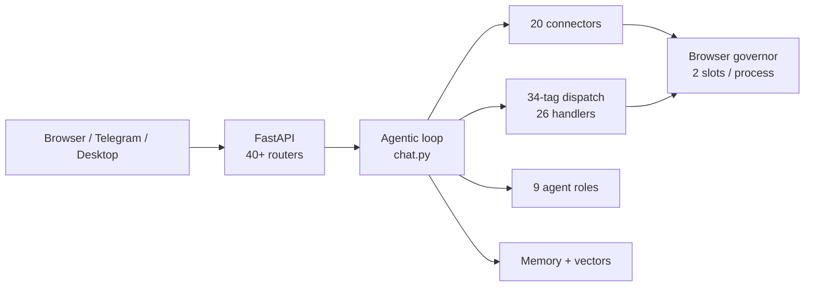

# Sable — Complete Feature Reference

> [!INFO] What this document is
> A consolidated feature inventory for **Sable** — the self-hosted agentic AI platform at `/home/sifat/hdd/projects/test/Sable-exp`. Sourced from **all 64 documentation files** (~21,164 lines), read in full.
>
> **Scale:** ~137,000 lines Python · ~52,000 lines frontend JS · ~26,000 lines CSS · 67 server files · 40+ routers · 20 AI providers · 21 tools · 15 skills · 9 agent roles.

***

## What Sable is

A self-hosted agentic platform. FastAPI backend, vanilla-JS PWA with **no build step**, multi-provider AI backend, Playwright browser automation, multi-agent orchestration, and persistent memory with vector search.

| Property | Value |
|:--|:--|
| Default port | **61770** |
| Desktop shell | 61771 |
| Sealed starter | 61772 |
| Health endpoint | `/api/health` |
| Python | 3.12 (pinned `>=3.12,<3.13`) |
| Package manager | `uv` |
| Frontend | ~60 `<script>` tags, **no build step**, order is the dependency graph |
| Database | SQLite WAL at `system/sable.db` (243 MB) |



***

## 1. Core chat & agentic loop

Everything funnels through **one endpoint**: `POST /api/chat` — a ~3,300-line handler in `server/api/routes/chat.py`.

| Capability | Detail |
|:--|:--|
| Streaming | SSE, ~25 event types |
| Tool loop | Multi-round; feedback → continue |
| Loop guards | 3 independent detectors |
| Session recovery | Upstream expiry → rebuild history → re-stream |
| Stall timeout | Retry 3× on no-chunk |
| Empty-response cap | Global counter across accounts |
| Queued messages | Typed mid-turn, drained at round boundary |
| Pauses | `ask_user`, permissions, cwd warnings |

### Three guardrails

| Guard | Catches | Disableable |
|:--|:--|:--|
| `LoopDetector` | Error-aware repeats, no-progress, stubbing | Yes |
| `MainChatGuard` | Malformed `<action>` markup | Yes |
| `TurnCapTracker` | 50 web searches / 50 spawns per turn | **No — hard cap** |

> [!IMPORTANT] Exactly one `done` per stream
> Upstream `done` is swallowed; the user-facing one fires in `finally`. Duplicates were a real bug — a comment marks the line that caused it.

***

## 2. AI backends — 20 providers

Duck-typed contract: `stream_chat()`, `chat()`, `is_available`. Adding one means implementing three things, not subclassing.

| Provider | Transport | Auth |
|:--|:--|:--|
| **Qwen** | Ghost tab → curl fallback | Browser session + WAF cookies |
| **DeepSeek** | Ghost / HTTP + **Go PoW solver** | Tokens + device identity |
| **Gemini** | API key | Key pool |
| **Gemini Web** | Cookie jar + `WIZ_global_data` | Browser |
| **ChatGPT** | Ghost tab | localStorage bearer |
| **Kimi** | Ghost tab | **JWT `exp` validated** |
| **z.ai** | Browser-assisted | Aliyun captcha |
| **MiMo** | 3 cookies | `xiaomichatbot_serviceToken` |
| **Mistral Web** | tRPC JSON-patch | Ory session cookies |
| **Claude** | Scraper only | `sessionKey` on `.claude.ai` |
| **Groq / Mistral / OpenAI** | API key | Pools with rotation |
| **Cloudflare** | Workers AI (FLUX) | Account ID + token |
| **Local** | llama-server / vLLM | OpenAI-compatible |
| **OpenCode** | Free model discovery | Anonymous tier |
| **Puter** | API key | Monthly allowance |
| Scrapers | `deepseek_scraper`, `qwen_scraper`, `claude_scraper` | DOM automation |

### Model registry

24 static + custom (`.custom_models.json`) + hidden (`.hidden_models.json`). Per model: capabilities, thinking modes, `max_session_chars` (3M–4M).

### Six tool-call dialects

`qwen_json` · `hermes` · `dsml` · `mimo` · `native` (bare JSON) · `none` (API function calling)

Per-provider override map with one-way migration from a legacy global.

***

## 3. Tools — 21 directories, 34 tags

`tool.json` is an **array** of function schemas. `HANDLER_MAP` has 34 keys → 26 handlers.

| Tool | Function |
|:--|:--|
| `execute_command` | Shell + background + check/kill. **SIGTERM→SIGKILL process-group ladder** |
| `code_editor` | view/edit/create/insert + shadow-git checkpoints |
| `computer_use` | **3 backends**: X11, Wayland, Windows |
| `browser` | 60 actions, a11y snapshots |
| `online_search` | SearXNG → providers → scraper fallback |
| `image_generator` | 6-provider fallback chain |
| `grep_search` | grep / glob / list_dir |
| `multi_agent` | spawn / status / kill |
| `critique` | Inline critic, fresh context |
| `ask_user` | Structured MCQ + free text |
| `mcp` / `mcp_list` / `load_tool` | MCP client + outer-tool upgrade |
| `study_*` (4) | Document / note / PDF / diagnostics |

### Execution limits

| Constant | Value |
|:--|--:|
| Default timeout | 15 s |
| Max timeout | 180 s |
| Max output | 2 MB |
| Preview | 64 KB |
| Result shown | 75,000 chars |

**Three hard blocks:** `systemctl restart/stop sable.service`, `git checkout`, and sudo is **rewritten** to `sudo -S` with password on stdin.

> [!TIP] Spill, don't drop
> `execute_command` writes full output to `/tmp/sable_full_exec_*.log` and tells the model the path. Truncation is recoverable.

***

## 4. Skills — 15 modules

Each has `skill.json` + `instruction.md`. **Lazy-loaded** — registry summary in prompt, full instructions cost a tool call.

| Skill | Priority | Category |
|:--|--:|:--|
| `testing_debugging` | 90 | core |
| `phone_control` | 80 | core |
| `system_repair` | 75 | core |
| `document_skills` | 65 | data |
| `text_humanizer` | 65 | data |
| `deep_research` | 60 | data |
| `http_client` | 55 | data |
| `study_suite` | 55 | study |
| `email` | 50 | data |
| `graph_master` | 50 | visuals |
| `svg_creator` | 50 | visuals |
| `telegram` | 50 | data |
| `frontend_design` | 45 | visuals |
| `youtube_downloader` | 40 | data |

> [!WARNING] `skills/README.md` is wrong
> Claims 25 skills, lists `tools/` entries as skills. There are **15** real `skill.json` files.

Every manifest declares **`not_this_if`** — negative routing. That's what stops `frontend_design` firing on "write a quick Python snippet".

***

## 5. Multi-agent orchestration

Hub-and-spoke. Main chat spawns background agents; each runs **through the same `POST /api/chat` pipeline** — no second LLM loop.

| Role | Timeout | Max ∥ | Required output |
|:--|--:|--:|:--|
| `analyst` | 300s | 4 | Findings, Sources, Confidence |
| `coder` | 600s | 2 | Files Modified, Tests |
| `writer` | 120s | 2 | Structure, Word Count |
| `sysutil` | 300s | 2 | Diagnosis, Actions Taken |
| `docs` | 300s | 2 | Document Path, Structure |
| `visuals` | 300s | 2 | Output Path, Description |
| `tester` | 300s | 2 | Root Cause, Fix, Verification |
| `scheduled` | 600s | 2 | Task, Result |
| `maria` | 600s | 1 | *(all skills)* |

### Resilience

- **Circuit breakers** per backend — closed → open → half-open (one probe)
- **Loop detection** — 4 detectors, escalating severity
- **Polling exemption** — `*_get_result` / `*_poll` bypass no-progress detection
- **Teacher escalation** — stronger model diagnoses, max **2 interventions**

> [!NOTE] Config overrides code
> `agent_config.json` sets `max_iterations: 100`; code default is 25.

***

## 6. Memory system

Human-readable JSON — openable in an editor.

| Store | Size | Role |
|:--|--:|:--|
| `Memory.json` | 173 KB | semantic (68) / procedural (37) / episodic (8) |
| `Procedural.json` | 61 KB | Separate procedural store |
| `Protected.json` | 196 B | Credentials — undeletable |

### Hybrid retrieval — 5 signals

| Signal | Weight |
|:--|--:|
| Vector similarity | **0.70** |
| IDF trigger match | 0.15 |
| Protected boost | 0.15 |
| Keyword overlap | 0.05 |
| Key-token match | 0.05 |
| Source-query match | 0.05 |

> [!IMPORTANT] Measured, not guessed
> *"100-prompt hand-labelled set: retrieval 33%→44%, rejection 50%→60%."* Keyword weights were cut to near-zero because they **harmed** short queries.

**Gates:** `MIN_QUERY_TOKENS = 3` · `VECTOR_ONLY_MIN = 0.50` · auto-disabled below **8 GB RAM** *(silent)*

**Decay:** episodic only, `0.95/day` — ~13.5 day half-life.

***

## 7. Deep research

Recursive fractal tree, LLM-in-the-loop, ~50–80 model calls per run.

```
_expand_root → angles
  → _maybe_split(topic) → children
    → _gen_queries → _search → _select_pages
      → _fetch_one → _extract → _synthesize
  → FINAL_PROMPT → report
```

| Feature | Detail |
|:--|:--|
| Live tree | Every node emitted as SSE |
| Model/account ladder | Per `model:account` circuit breaker, **rotation not retry** |
| Recovery | Failed search → reformulate; failed fetch → skip |
| Report fallback | **3 stages, never returns empty** |
| Resumable | ✗ — see below |

> [!WARNING] Resume is inert
> `ResearchManager` persists **only at spawn and terminal state**. A server crash leaves `{status: running, findings: [], nodes: []}`, so "resume" starts a fresh run at full cost. The entire four-argument plumbing is correct and unreachable.

***

## 8. Study suite

The largest feature cluster. 20 library paths under `sable_output/library/`.

| Feature | Detail |
|:--|:--|
| PDF reader | Page render, text search **with coordinates** for highlights |
| OCR | 3 engines: BanglaOCR (cloud, proxy rotation) → SableOCR (local) → AI vision |
| Indexing | Resumable, 3 stages: ocr → search → ai |
| Embeddings | 1400-char chunks, 200 overlap, 32/batch |
| Full-text | SQLite FTS5 + LIKE fallback |
| Notes | Obsidian-style, body as real `.md` |
| SRS | **SM-2** spaced repetition, ease `[1.3, 2.8]` |
| Dictionary | English + Bangla (~106k offline headwords) |
| Cover pages | **2 templates, positions measured off a reference PDF** |
| Humanizer | LLM rewrite → rule pass, rewrite-distance retry |

> [!IMPORTANT] `_AI_OCR_CONCURRENCY = 1` is a deadlock fix
> AI OCR drives the vision model through the scraper path, capped at `MAX_BROWSERS = 2`. 4-wide deadlocks: two pages hold slots forever while two wait.

**Strike system:** a page failing 3× becomes `permanent` — without it a blank page re-queues forever.

***

## 9. Browser automation

**Four** browser engines in the tree, three lineages:

| Layer | Purpose |
|:--|:--|
| `engine/scraper/` | Original framework |
| `connectors/common/browser_scraper.py` | **The one connectors use** |
| `engine/scraper_engines/` | Second generation — **not importable** |

### The governor

```
MAX_BROWSERS = 2   (per Sable process)
```

Slots live in a **shared directory** (`$XDG_RUNTIME_DIR/sable-browser-slots/`), not memory — so a stable install and a dev tree each enforce their own quota.

| Priority | At cap |
|:--|:--|
| `EPHEMERAL` | Waits, never evicts |
| `CHAT` + ephemeral exists | Evicts LRU ephemeral |
| `CHAT` + all chat | `None` → `no_slot` UI card |

> [!NOTE] No memory or idle killing
> cgroups are **ownership markers only** — no `memory.max`, no `oom.group`. The kernel can't OOM-kill a browser tree.

### Anti-detection

| Technique | Why |
|:--|:--|
| `curl_cffi` `impersonate="chrome"` | httpx's TLS is WAF-fingerprinted |
| **Real OS keyring, not mock** | Mock keychain → undecryptable cookies → every call 401s |
| Xvfb auto-spawn | Headed Chromium aborts with no `DISPLAY` |
| WAF cookie poll | `acw_tc` + `isg` generated async; 6 s wait |
| Background-timer flags | Ghost tab is never focused → 60–120 s PoW delay |
| Port diversion | 9222 collides with Obsidian → 9225 |

**Two-tier headers:** `get_fresh_headers()` ≈ **9 s** vs `get_live_headers()` ≈ **200 ms**.

***

## 10. Document & media generation

| Capability | Implementation |
|:--|:--|
| **DOCX** | Tracked changes, comments across **5 XML parts**, RSID injection |
| **PPTX** | Inventory, overflow detection via PIL, thumbnail grids, rearrange |
| **XLSX** | LibreOffice **StarBasic macro** recalc + error scan |
| **PDF** | 8-script form pipeline: extract → validate → fill |
| **Images** | 6-provider chain |
| **SVG / charts / designs** | `svg_creator`, `graph_master`, `frontend_design` |

> [!TIP] `RedliningValidator` is the best checker in the tree
> Removes every change authored by `"Claude"` from both original and modified, then asserts remaining text is **byte-identical**. If they differ, the edit wasn't tracked. Full stop.

***

## 11. Search

Two stacks, deliberately separate.

| Stack | Transport |
|:--|:--|
| **API** | SearXNG (default, keyless) · Brave · DDG · Google PSE · Tavily · Serper |
| **HTTP ladder** | Brave → Bing, `curl_cffi` `chrome124` |

### RRF fusion

`1/(K+rank)` summed, plus **agreement** `+0.3` per extra engine and **priority** `0.7^i` geometric decay.

**Dedup keeps query strings** — deliberate. `youtube.com/watch?v=abc` ≠ `?v=xyz`.

**DDG throttle:** 4 s, Chrome UA only (others get a 202 challenge).

> [!WARNING] Every time-filtered query is corrupted
> `build_enhanced_query` appends `after:d` / `after:w` — `after:` takes a **date**. All four providers then also send the *correct* `freshness`/`tbs`/`dateRestrict` param. One function, four providers, always wrong.

***

## 12. Integrations

| Integration | Capability |
|:--|:--|
| **Google Drive** | **Keyless-first** (public folder scrape) + optional OAuth PKCE |
| **Telegram** | Two independent integrations |
| **Email** | IMAP read / SMTP send |
| **MCP** | stdio client, auto-connect, GitHub server pre-installed |
| **Phone** | ADB via `phone_control` |
| **Desktop** | Electron shell attaches to running server |

### Two Telegram integrations

| | `skills/telegram/` | `telegram_bot/` |
|:--|:--|:--|
| Protocol | **Telethon (MTProto)** | Bot API |
| Acts as | A user account | A bot |
| Can read | Any chat | Only addressed messages |

The bot is a **full second chat surface** — 2,654 lines, HTTP only, message chaining at 3,500 chars, inline panels, voice transcription.

***

## 13. Web IDE

| Feature | Detail |
|:--|:--|
| File explorer | 6 browse roots, extension icons |
| Editor | **Monaco** (vendored) |
| Terminal | **xterm.js** over WebSocket PTY |
| Diff review | Inline accept/reject against backups |
| Checkpoints | **Shadow git** per turn, self-healing |

**PTY backends:** POSIX `loop.add_reader`; Windows ConPTY + executor.

> [!TIP] Server answers terminal capability probes
> Except XTGETTCAP — fish leaks those replies into the command line as typed text.

***

## 14. Voice

| Direction | Engine | Detail |
|:--|:--|:--|
| **TTS** | Kokoro (ONNX, local) | 325 MB, WAV |
| **TTS** | Edge TTS | MP3, cloud |
| **STT** | faster-whisper `small.en` | CTranslate2, 483 MB, int8 |

**Two filters:**
1. **Whisper hallucination** — 18 YouTube-outro phrases, repetition ratio, min alpha chars
2. **TTS echo** — `SequenceMatcher ≥ 0.75` against last 5 TTS outputs

***

## 15. Rich UI rendering

| DSL | HTML |
|:--|:--|
| `<render_component>` | `<render_html>` |
| Cards, stats, tables, quizzes, charts, steps, forms | Sandboxed iframe, arbitrary JS |

### Reactivity

`DIL.useState` + `{expr}` — updates in-browser, no round-trip.

> [!IMPORTANT] The reactivity contract
> Server evaluates once and ships `__expr__<prop>` alongside so the **client re-evaluates every render**. Stripping them — an obvious cleanup — silently breaks every live-updating component.

**Media resolves server-side:** `` → real search; `<file>` → data URI (8 MB cap). Image *queries* ship `pending: true` and resolve client-side in parallel — the parse path must never block.

***

## 16. Secondary subsystems

| Subsystem | Feature |
|:--|:--|
| **Diary** | Gemini session reflection, key rotation persisted |
| **Notifications** | Cross-platform toast, category policy |
| **Cookbook** | Local model serving — HF download, `llama-server`, hardware presets |
| **Plugins** | Free model discovery, 4 filters before offering |
| **Schedules** | Recurring agent ops, daily/weekly/occasional |
| **Knowledge graph** | Cytoscape |

***

## 17. Security

| Layer | Mechanism |
|:--|:--|
| Prompt injection | **11 patterns**, 3-level severity |
| Untrusted content | `wrap_untrusted()` — structural boundary |
| Permissions | 34 gates, per-chat session cache |
| XSS | DOMPurify on every render path |
| `render_html` | Sandboxed, `allow-scripts` **without** `allow-same-origin` |
| Electron | `contextIsolation`, `sandbox: true` |

> [!CRITICAL] The guard has no notion of direction
> `scan(ctx.content)` runs on **every** tag. `create_file` writing a document *about* prompt injection is blocked with no approval path. **This fired live while writing this file** — the first draft quoted two patterns verbatim and was rejected.

### Auth

- Bearer token, **multi-session** (one browser never evicts another)
- Six paths accept `?token=` where headers are impossible
- 401 log prints prefix + length + session count

***

## 18. Packaging & deployment

```
./start → systemd unit → sable-launch.sh → starter → server.py
```

`start` (779 lines bash) auto-installs Python, uv, Docker, Playwright, SearXNG, GitHub MCP, and writes a **self-healing** systemd unit.

### The sealed vault

`vault.sable` — 33 MB encrypted tree.

| | v3 | v4 |
|:--|:--|:--|
| Secrets | Bridge DEK | DEK **+ passphrase** |
| KDF | — | Argon2id 256 MiB × 3 |

**Per-file keys:** path is in the HKDF derivation, so swapping file contents fails the Poly1305 tag.

> [!CRITICAL] The pinned trust root
> The Go starter has the signing pubkey **compiled in**. Verifying against the header's own `signer` is worthless — an attacker signs their own vault.

**Current state:** no Linux starter binary → falls through to `server.py` (plaintext tree).

***

## 19. Frontend

| Property | Value |
|:--|:--|
| JS | ~52,000 lines, no framework, no bundler |
| CSS | ~26,000 lines, hand-written |
| Largest modules | `sse.js` (3,753) · `study-reader.js` (3,190) · `agents.js` (2,824) |

> [!WARNING] Load order is load-bearing
> Script order **is** the dependency graph. `app.js` is dead documentation — never loaded.

**Scroll during streaming** is the hardest UI problem, solved with four cooperating mechanisms: synchronous wheel listener, rAF-coalesced scroll, same-tick pin, and an iframe bridge for sandboxed panes.

***

## 20. Update system

Seven phases, each with a rollback point.

```
resolve → download → stage-extract → snapshot → overlay → uv sync → restart
                        ↓            ↓          ↓          ↓
                      abort       abort    rollback   rollback
```

**Protected:** `system/`, `output/`, `.venv/`, `.git/`, `.sable_backups/` — an update never touches memory, personas, or profiles.

***

## Known issues

The docs record ~255 findings. Highest-impact:

### 🔴 Critical

| Where | Problem |
|:--|:--|
| `qwen/engine.py` | Undefined `logger` → `NameError` on attempt 1; the 5-attempt retry never runs |
| `qwen/engine.py` | `ProxyHTTPHandler` is a stub — Obsidian CDP path **cannot work** but is on by default |
| `online_search._normalize_url` | No scheme allowlist → `file://`, loopback, cloud metadata |
| `search/query.build_enhanced_query` | Appends `after:d` — corrupts **every** time-filtered query |
| `search/sable_provider._read_marker` | `os.kill(pid, 0)` **terminates** the target on Windows |
| `openai_compat._trim_history` | Orphans `tool` messages → 400 → key rotation burns the pool |
| `openai_compat` | Full conversation history to disk **every turn, every provider** |
| `account_login.py` | Omits keyring flag → cookies unreadable by every other component |
| `convert_pdf_to_images` | No-Poppler fallback renders **blank pages** and exits 0 |
| `settings-projects._loadOlderMessages` | No `try/finally` → `activePane` dangles, chat appears frozen |
| `settings-projects.loadMessages` | Resets `_historyLoading` but not `activePane` |
| `settings.py:1367` | Decorator on the **wrong function** — general endpoint has no route |
| `processes.py` | `prev` undefined → 500 whenever two polls land in one jiffy |
| `agents.py` | `logger` never imported → `NameError` exactly when upstream stop fails |
| `scraper.py` | Missing two imports → both routes 500 on every call |
| `ask_user` | `Other` appended then sliced away — 8 options always loses manual entry |
| `dil_parser` | Self-closing `<script/>` bypasses the drop |

### 🟠 Security

| Where | Problem |
|:--|:--|
| `Brain/Protected.json` | **Google password in plaintext** |
| `instruction/personal.md` | Sudo password in plaintext |
| `/api/filesystem/` | **Auth-exempt** + lexical path check → LAN arbitrary read |
| `application.py` | `[AUTH-DEBUG]` print logs the **full** Bearer token on every 401 |
| `auth.revoke_token` | `SABLE_TOKEN` from env **cannot be revoked** |
| `deepseek/client.py` | Every prompt and response logged, unbounded |
| `chatgpt/ghost.py` | Every SSE event to disk, always |

### 🟡 Correctness

- `os.chdir` + module-global `_pre_proj_cwd` — cross-tab CWD corruption
- `fork_chat` docstring says "inclusive", SQL is exclusive
- `library_index`: `model_obj is None` → job reports **100% with zero vectors**
- `run_job`'s `finally` maps every non-stop exit to `done` — a crash reports success
- `ResearchManager` never checkpoints → resume restores nothing
- 14 unguarded `write_text` on `Memory.json` vs a concurrent writer per retrieval
- `SABLE_PERSISTENT_ROOT` splits state across two trees

> [!NOTE] Honest framing
> Most of these are **latent** — they sit in error paths that only run after something else failed. That's why they survived: invisible in normal operation, fatal in the moment they matter.

***

## Quick reference

| | |
|:--|:--|
| **Ports** | 61770 server · 61771 desktop · 61772 starter · 8080 SearXNG · 8765 vault bridge |
| **Max browsers** | 2 per process |
| **Agent iterations** | 100 (config) / 25 (code) |
| **Tool output cap** | 75,000 chars |
| **Memory top-k** | 5 chat / 20 search |
| **Session chars** | 3M–4M per model |
| **Header mint** | ~9 s fresh / ~200 ms live |
| **Vision OCR** | Serial (concurrency 1) |
| **Chunk size** | 1400 chars, 200 overlap |

***

*Generated from the complete documentation set — 64 docs, 21,164 lines.*
